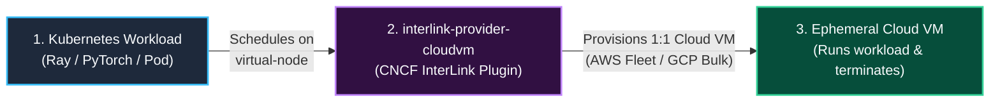
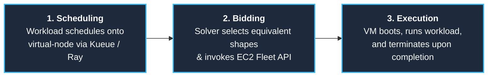
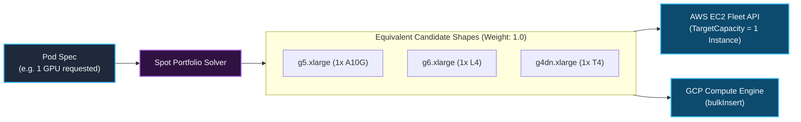
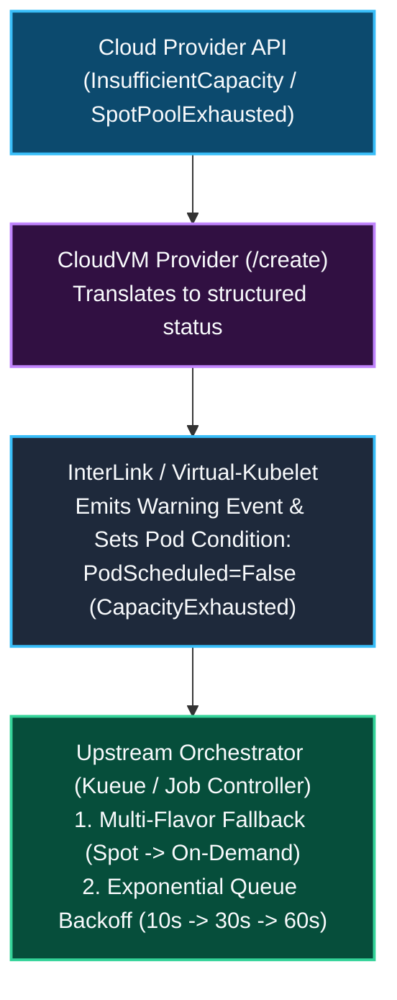
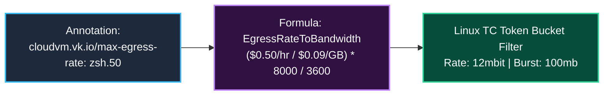
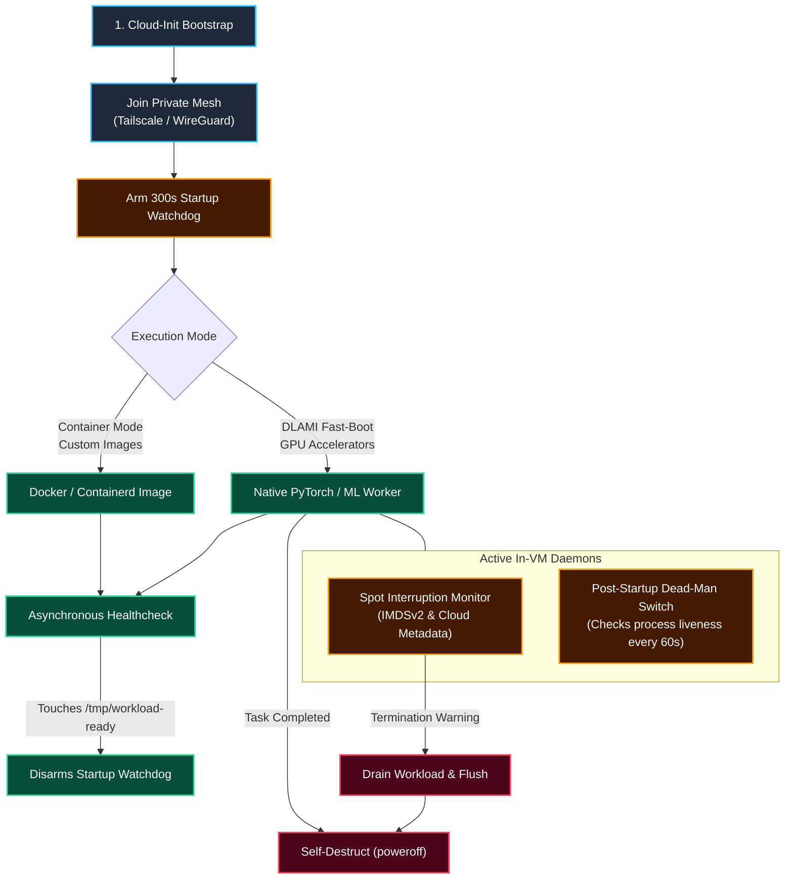
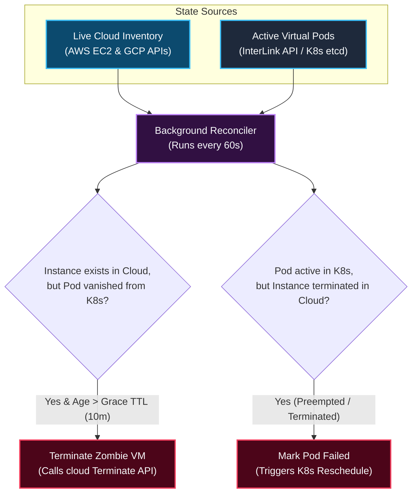
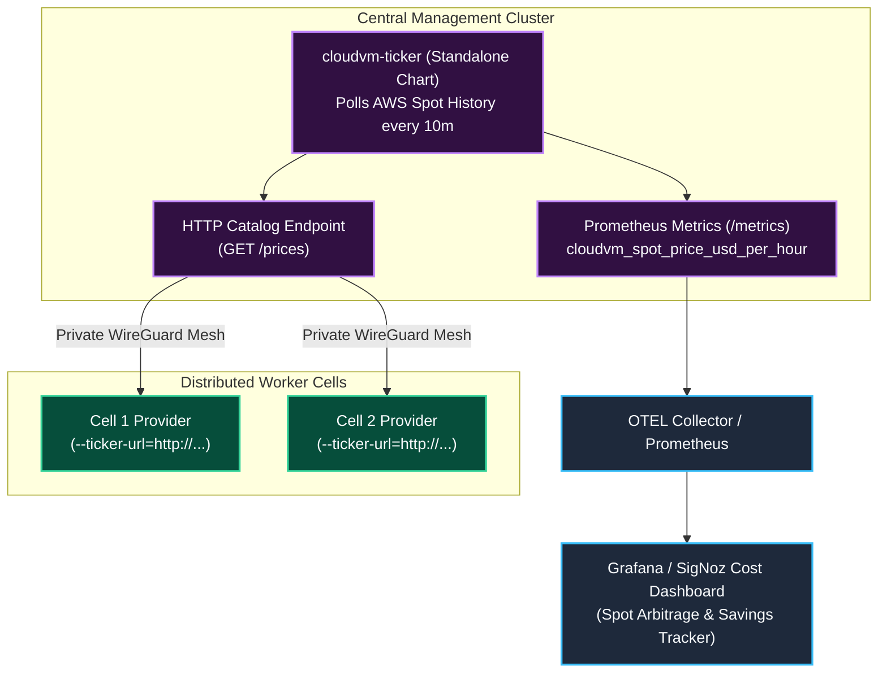
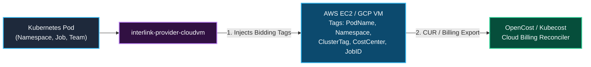

<h1 align="center">interlink-provider-cloudvm</h1>

<p align="center">
  <!-- Implementation -->
  <a href="https://go.dev/">
    
  </a>
  <!-- Toolchain - mise -->
  <a href="https://mise.jdx.dev/">
    
  </a>
  <br>
  <!-- Verification -->
  <a href="https://github.com/simonepri/interlink-provider-cloudvm/actions/workflows/ci.yml">
    
  </a>
  <br>
  <!-- Distribution -->
  <a href="https://github.com/googleapis/release-please">
    
  </a>
  <a href="https://helm.sh/">
    
  </a>
  <a href="https://www.docker.com/">
    
  </a>
  <a href="LICENSE">
    
  </a>
</p>

<p align="center">
  Multi-cloud Spot and On-Demand VM bursting for Kubernetes via CNCF InterLink.
</p>

---

## 1. High-Level Concept

`interlink-provider-cloudvm` is an open-source provider plugin for **[CNCF InterLink](https://github.com/interlink-hq/interLink)**.

Its primary purpose is to solve the **Spot GPU bottleneck** in Kubernetes: allowing clusters to tap into global, multi-region spot and on-demand GPU fleets (e.g. NVIDIA A10G, L4, L40S, H100) with zero local node-pool overhead. It also supports general-purpose CPU batch workloads (such as data preprocessing, ETL, and Ray data pipelines).



### Extending Kubernetes: In-Cluster vs. Global Burst

`interlink-provider-cloudvm` does not replace Kubernetes or in-cluster node autoscalers like Karpenter—it **extends** them. A common production pattern is a hybrid topology:
- **In-Cluster Nodes (Karpenter)**: Manages local persistent infrastructure (Ray head, Kueue queues, databases, web ingress, intra-VPC low latency services).
- **Virtual Burst Nodes (`interlink-provider-cloudvm`)**: Absorbs elastic, large-scale GPU/TPU batch computing across spot markets globally whenever local capacity is constrained.

| Capability | In-Cluster Autoscaler (Karpenter) | `interlink-provider-cloudvm` (Burst Engine) |
| :--- | :---: | :---: |
| **Primary Role** | In-cluster microservices & local steady-state | Ephemeral multi-region & multi-cloud burst |
| **Geographic Scope** | ❌ Single VPC & region | ✅ Global fleet across regions & clouds |
| **Spot Arbitrage** | ❌ Local AZ pools only | ✅ Multi-region price/capacity solver |
| **Node Join Overhead** | ⚠️ 2–4 min (Kubelet, CNI, DaemonSets) | ✅ Instant (boots directly into container) |
| **Cluster Impact** | ⚠️ `Node` in etcd + DaemonSets + VPC IPs | ✅ Zero (single static virtual node) |
| **Isolation Boundary** | ⚠️ Shared host kernel across pods | ✅ Dedicated hardware hypervisor per job |
| **Stateful Storage (CSI/PVC)** | ✅ Native EBS / CSI support | ❌ Object storage / network mounts (S3/GCS) |
| **Idle Cost Baseline** | Scale-down delays & consolidation cooldown | **`$0`** (VM terminates immediately on exit) |

---

## 2. How It Works (Step-by-Step)

A workload progresses through three stages:



### Core Architecture

`interlink-provider-cloudvm` is built on four core components:

1. **Fleet Capacity Engine (Spot & On-Demand)**: Translates pod resource requirements into single-instance fleet requests (`CreateFleet` / `bulkInsert`) across diversified equivalent candidate shapes, supporting native hourly price caps (`cloudvm.vk.io/max-price`).
2. **Backpressure & Orchestrator Feedback Loop**: Emits real-time scheduling conditions (`CapacityExhausted`, `PriceCapExceeded`) back to Kubernetes, driving upstream multi-flavor fallback (Spot → On-Demand) and queue backoff in Kueue.
3. **Hourly Spend Governors & Traffic Shaping**: Burn-rate enforcement in `USD/hr` for both Compute (`cloudvm.vk.io/max-price`) and Network Egress (`cloudvm.vk.io/max-egress-rate`). Translates authorized egress dollars directly into kernel-level Token Bucket Filters (Linux `tc`), permitting burst transfers while pacing sustained egress to avoid runaway bandwidth bills.
4. **Bidirectional Reconciler & FinOps Accounting**: A background loop that garbage collects zombie instances, synchronizes status, and maps cloud costs to Kubernetes pods for **OpenCost** FinOps visibility.

---

## 3. Subsystem Deep Dives

### A. Spot Portfolio Solver & Single-Instance Fleet Allocation

In `interlink-provider-cloudvm`, **1 Pod = 1 Dedicated Cloud VM**.

When bidding for spot capacity across diversified GPU instance families (`g4dn`, `g5`, `g6`, `g6e`, `p4d`, `p5`), the solver defines a portfolio of **equivalent single-VM candidate shapes** that satisfy the pod's accelerator requirements.

Fleet `TotalTargetCapacity` is strictly set to **1 instance**. The allocation strategy (`price-capacity-optimized`) instructs the cloud hypervisor to provision the single lowest-priced, highest-availability instance from the approved candidate list.



| Workload Requirement | Target Capacity | Candidate Shapes Offered to Fleet | Resulting Provisioning |
| :--- | :---: | :--- | :--- |
| **1-GPU Pod** | 1 instance | `g5.xlarge`, `g6.xlarge`, `g4dn.xlarge` | Provisions **1 VM** with 1 GPU (cheapest available) |
| **4-GPU Pod** | 1 instance | `g5.12xlarge`, `g5.24xlarge`, `g6.12xlarge` | Provisions **1 VM** with 4 GPUs |
| **8-GPU Pod** | 1 instance | `p5.48xlarge`, `p4de.24xlarge`, `g5.48xlarge` | Provisions **1 VM** with 8 GPUs |

> [!NOTE]
> Multi-node distributed workloads (such as distributed PyTorch or multi-node Ray clusters) are orchestrated by scheduling **multiple worker pods** in Kubernetes (e.g. 1 head pod and N worker pods). Each worker pod schedules to the virtual node and receives its own 1:1 dedicated cloud VM.

#### Multi-Cloud Placement Strategies
- **`price-capacity-optimized` (AWS EC2 Fleet)**: Filters for spot pools with deep inventory (lowest preemption probability), then allocates the lowest-priced pool among them.
- **`locationPolicy: ANY_SINGLE_ZONE` (GCP Compute Engine)**: Automatically places worker batches in whichever single availability zone has sufficient spot inventory.

#### Request Idempotency & Hardware Pinning
- **Idempotent Launches**: Every EC2 Fleet request passes a unique `ClientToken: cvm-<uid>-<namespace>-<pod>` placing the Pod UID first. A missing Pod UID is rejected as an error. Retries triggered by network timeouts or controller restarts cannot spin up duplicate instances.
- **Hardware Family Pinning**: When specific accelerator architectures are required (e.g. NVIDIA H100 vs A10G), users specify `cloudvm.vk.io/instance-type: "p4d.24xlarge"` or restrict candidate instance families.

---

### B. Backpressure Feedback Loop & On-Demand Capacity

When cloud spot capacity is temporarily unavailable, the driver emits structured feedback to prevent API hammering:



1. **Structured Capacity Signals**:
   - `CapacityExhausted`: All candidate spot pools in the requested region are dry.
   - `PriceCapExceeded`: Current spot pricing exceeds `cloudvm.vk.io/max-price`.
2. **Kueue Multi-Flavor Fallback**:
   Kueue can configure a `ClusterQueue` with multiple `ResourceFlavors`:
   - Primary: `spot-gpu` (tolerates virtual-node, requests spot).
   - Fallback: `on-demand-gpu` (`cloudvm.vk.io/capacity-type: "on-demand"`).

---

### C. Network Egress Spend Rate Governor (Linux tc Token Bucket Filter)

Public cloud egress costs (\$0.09/GB on AWS, \$0.085/GB on GCP) can exceed compute costs during large-scale inference or data extraction.

Users declare a maximum hourly spend ceiling via `cloudvm.vk.io/max-egress-rate` in dollars per hour (e.g. `"$0.50"`).

The driver converts this spend limit into kernel-level rate limiting using Linux Traffic Control (`tc`):



#### Two-Band Priority Queue (Mesh Exemption)
Linux Traffic Control (`tc`) configures a two-band priority scheduler (`prio bands 2`) on `eth0`:
- **Band 1 (Unthrottled Priority)**: Kernel filters classify encapsulated WireGuard (`UDP 51820`) and Tailscale (`UDP 41641`) mesh packets into Band 1, allowing cluster control plane communication, Ray GCS heartbeat, and metadata synchronization to operate unthrottled.
- **Band 2 (Spend Governed)**: All outbound public internet traffic flows through Band 2, governed by the Token Bucket Filter.

> [!NOTE]
> Same-region VPC traffic or VPC endpoints that bypass the default internet gateway can be routed via direct VPC subnet routes.

---

### D. In-VM Ephemeral Lifecycle & Execution Modes

`interlink-provider-cloudvm` supports two runtime modes:

1. **Native DLAMI Fast-Boot (Optimized for GPU ML Workloads)**:
   - Utilizes the official **AWS Deep Learning AMI (DLAMI)** with NVIDIA drivers, CUDA, and PyTorch pre-installed.
   - Bypasses pulling heavy container images over the network.
   - Reaches cluster-ready status in **~30–60 seconds**.
2. **Container Mode (Optimized for CPU & Custom Workloads)**:
   - Uses Docker/Containerd execution for CPU pipelines, data transformations, or custom application containers.



#### Watchdogs & Shutdown Behavior
- **Multi-Cloud Preemption Monitors**:
  - **AWS (120s window)**: Continuously polls IMDSv2 (`/latest/meta-data/spot/instance-action`). Triggers graceful drain before hypervisor termination.
  - **GCP (30s window)**: Polls metadata (`/computeMetadata/v1/instance/preempted`). Initiates checkpointing within the 30-second ACPI window.
- **Two-Phase Watchdog & Dead-Man's Switch**:
  - **Startup Watchdog (300s)**: Automatically terminates the instance if the workload fails to reach readiness (`/tmp/workload-ready`) within 5 minutes.
  - **Post-Startup Dead-Man's Switch**: After becoming ready, the background monitor checks workload container/process liveness every 60s. If the target workload exits without a clean shutdown, the VM automatically powers off.
- **Shutdown Guarantee (`InstanceInitiatedShutdownBehavior=terminate`)**:
  - AWS instances are configured with `instance-initiated-shutdown-behavior: terminate`. When the workload completes and invokes `poweroff`, the instance transitions directly to `terminated`, releasing root EBS volumes and IP addresses.

---

### E. Bidirectional Reconciler & Zombie Instance Garbage Collection

An asynchronous background loop runs every 60 seconds to synchronize Kubernetes Pod state with live cloud inventory:



---

### F. Pricing Catalog & Central Ticker Architecture (cloudvm-ticker)

To evaluate spot arbitrage without exhausting cloud API rate limits, pricing is decoupled into two tiers:



#### Deployment Modes:
1. **Embedded Ticker (Standalone Default)**:
   - When running in an isolated cluster without a central ticker, the provider uses an internal ticker with randomized jitter (`10m ± 2m`).
2. **Central Ticker Service (`cloudvm-ticker` Chart)**:
   - In multi-cell environments, deploy the standalone `cloudvm-ticker` chart once in your management cluster.
   - Worker cells configure `provider.tickerURL: "http://cloudvm-ticker.monitoring.svc:8080"`.
   - The ticker exports Prometheus metrics (`cloudvm_spot_price_usd_per_hour`) for Grafana and SigNoz cost dashboards.

---

### G. OpenCost & FinOps Cloud Cost Allocation

Because CloudVM instances run outside the Kubernetes node boundary, standard cAdvisor daemonsets cannot scrape their container cgroups.

`interlink-provider-cloudvm` integrates with OpenCost and cloud billing pipelines via structured tagging:



#### 1. Bidirectional Resource Tagging
When launching an EC2 Fleet or GCP bulk insert, `interlink-provider-cloudvm` tags every instance and attached EBS volume:
- `ManagedBy: interlink-provider-cloudvm`
- `ClusterTag: <cluster-name>`
- `PodName: <pod-name>`
- `Namespace: <pod-namespace>`
- `PodUID: <pod-uid>`
- `CostCenter: <cost-center>`
- `JobID: <job-id>`

OpenCost matches these tags in the AWS Cost and Usage Report (CUR) or GCP Cloud Billing export to attribute cloud compute and storage spend to Kubernetes namespaces and jobs.

---

## 4. Node Daemon Architecture (Virtual Worker Environment)

In standard Kubernetes, cluster tooling runs as **DaemonSets**. Because `interlink-provider-cloudvm` provisions pure 1:1 cloud instances without a local Kubelet, DaemonSets do not schedule on ephemeral VMs.

Instead, node-level capabilities are provided via host-level services and cloud-init hooks:

| Traditional DaemonSet | CloudVM Host Mechanism | Integration Mode | Architectural Purpose |
| :--- | :--- | :--- | :--- |
| **Storage FUSE Driver** (`csi_rclone`) | In-VM `cloud-init` FUSE mount (`rclone mount` / `s3fs` / `gcsfuse`) | Host FUSE mount | Mounts object storage buckets directly to `/mnt/data` before workload starts. |
| **Torch Compile Cache** | Pre-warmed Triton/Inductor kernel cache in Golden AMI | Disk Cache / S3 Gateway | Eliminates 5–15 minute CUDA compilation delays on cold spot boot. |
| **Node Problem Detector** (`npd`) | In-VM watchdog polling NVML for GPU Xid and ECC memory errors | Host background watcher | Emits structured `HARDWARE_FAULT` logs to serial console for pod re-queuing. |
| **NVIDIA DCGM Exporter** (`gpu_operator`) | Bundled in DLAMI or host OTEL collector scraping NVML | Host telemetry agent | Pushes GPU SM utilization, Tensor core activity, and VRAM over private mesh. |

---

## 5. Security & Ephemeral VM Isolation Model

1. **Hardware-Level Hypervisor Isolation**:
   - Each workload runs in its own dedicated virtual machine (AWS Nitro / GCP KVM). Unlike shared multi-tenant Kubernetes nodes, container escapes cannot compromise adjacent tenant workloads.
2. **IMDSv2 Token Protection**:
   - AWS IMDSv2 session tokens are required for all metadata queries, with `HttpPutResponseHopLimit: 1` preventing containerized processes from accessing instance metadata credentials.
3. **No Open SSH Ports**:
   - The Tailscale mesh connection runs without `--ssh`. Inbound SSH ports are disabled in security groups by default.
4. **Tag-Scoped Ephemeral Mesh Credentials**:
   - Network mesh join keys are scoped to ephemeral tags with short lifespans.

---

## 6. Operational Boundaries (When NOT to Use This)

| Workload Characteristic | Why CloudVM is NOT Suitable | Recommended Alternative |
| :--- | :--- | :--- |
| **High-Bandwidth Multi-Node NCCL Training** (e.g. 400–3200 Gbps RoCE/EFA internode all-reduce) | Encapsulated mesh overlays (WireGuard / Tailscale) are designed for control plane and Ray GCS coordination. They cannot carry multi-hundred-gigabit internode tensor-parallel training. | Bare-metal GPU clusters with AWS Elastic Fabric Adapter (EFA) and Cluster Placement Groups. |
| **Microservices & Sub-Core Tasks** (e.g. 0.25 CPU, 512MB RAM) | 1 Pod = 1 Dedicated Cloud VM. Running tiny microservices on dedicated VMs wastes compute and incurs a 60-second cloud billing minimum. | Traditional Kubernetes worker nodes with **Karpenter** bin-packing. |
| **Complex Multi-Container Pods with Shared Volumes** | Only the primary container is executed on the bare VM. Kubernetes ConfigMaps and Secrets are not mounted as local in-pod volumes. | Standard Kubernetes node pools or pre-baking configuration into container images. |
| **Short-Lived Tasks (< 60 seconds)** | AWS and GCP bill cloud instances with a **60-second minimum charge**. | In-cluster warm pod pools or serverless functions (Knative / AWS Lambda). |

---

## 7. Failure Modes & Resilience Matrix

| Failure Event | Detection Mechanism | Automated Reaction | System State & Recovery |
| :--- | :--- | :--- | :--- |
| **Spot Market Preemption** | In-VM metadata monitor (IMDSv2 on AWS, metadata on GCP) | Workload captures notice (120s AWS, 30s GCP), flushes checkpoints, and powers off. | Reconciler detects instance exit; Pod marked `Failed` (Reason: `SpotInterruption`); Kueue re-queues. |
| **Cloud Capacity Pool Exhaustion** | Cloud API returns `InsufficientInstanceCapacity` / 429 | `/create` sets Pod condition `PodScheduled=False (CapacityExhausted)`. | Upstream orchestrator (Kueue) triggers fallback to On-Demand flavor or exponential queue backoff. |
| **Workload Initialization Failure** | In-VM 300s startup watchdog | Watchdog triggers `poweroff` after 300s without `/tmp/workload-ready`. | VM terminates; Reconciler evicts pod; prevents zombie idle billing. |
| **Workload Process Crash** | In-VM 60s dead-man's switch | Background monitor detects process vanished; executes `poweroff`. | Instance terminates immediately; Pod status updated to `Failed`. |
| **Control Plane Network Partition** | Background reconciler tracking instance timestamps | If pod object vanishes from K8s API for longer than grace TTL (default 10m), reconciler terminates cloud VM. | Prevents orphaned VMs from running indefinitely during network splits. |

---

## 8. Usage Examples

### Example 1: Spot GPU ML Worker (Fast-Boot)

```yaml
apiVersion: v1
kind: Pod
metadata:
  name: esm2-gpu-inference
  annotations:
    cloudvm.vk.io/provider: "aws"
    cloudvm.vk.io/capacity-type: "spot"
    cloudvm.vk.io/ami-mode: "dlami"
    cloudvm.vk.io/instance-type: "g5.xlarge"
    cloudvm.vk.io/max-price: "2.50"
    cloudvm.vk.io/max-egress-rate: "$0.50"
spec:
  nodeSelector:
    kubernetes.io/role: cloudvm
  tolerations:
    - key: virtual-node.interlink/no-schedule
      operator: Exists
      effect: NoSchedule
  containers:
    - name: worker
      resources:
        limits:
          nvidia.com/gpu: "1"
```

### Example 2: Spot CPU Data Pipeline Worker (Container Mode)

```yaml
apiVersion: v1
kind: Pod
metadata:
  name: ray-data-transform
  annotations:
    cloudvm.vk.io/provider: "aws"
    cloudvm.vk.io/capacity-type: "spot"
    cloudvm.vk.io/instance-type: "c6i.2xlarge"
spec:
  nodeSelector:
    kubernetes.io/role: cloudvm
  tolerations:
    - key: virtual-node.interlink/no-schedule
      operator: Exists
      effect: NoSchedule
  containers:
    - name: worker
      image: rayproject/ray:2.44.0
      env:
        - name: RAY_HEAD_ADDRESS
          value: "ray-head.default.svc.cluster.local:6379"
      resources:
        limits:
          cpu: "8"
          memory: "16Gi"
```

---

## 9. Installation via Helm

### InterLink CloudVM Provider Plugin

```bash
helm upgrade --install interlink-provider-cloudvm   oci://ghcr.io/simonepri/charts/interlink-provider-cloudvm   --namespace interlink   --create-namespace   --set provider.type=aws   --set provider.awsRegion=us-east-1
```

### Standalone Spot Price Ticker (Optional)

```bash
helm upgrade --install cloudvm-ticker   oci://ghcr.io/simonepri/charts/cloudvm-ticker   --namespace monitoring   --create-namespace   --set serviceMonitor.enabled=true
```

---

## 10. Development & Verification

### Local Toolchain Setup via mise

```bash
# Install toolchain and dependencies
mise install

# Run the complete verification gate (lint + security + tests)
mise run verify
```

### Verification Tasks

```bash
# Run race-enabled unit tests
mise run test

# Run Go static analysis and linters
mise run lint-go

# Audit GitHub Actions workflows for security vulnerabilities
mise run lint-actions-security

# Scan for committed secrets
mise run lint-secrets
```
