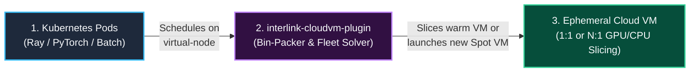
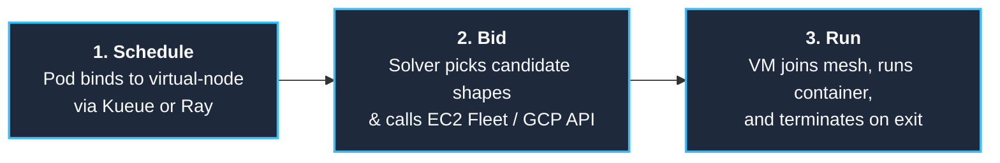
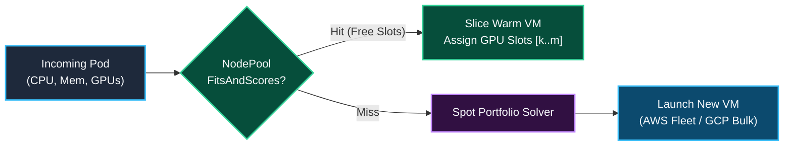
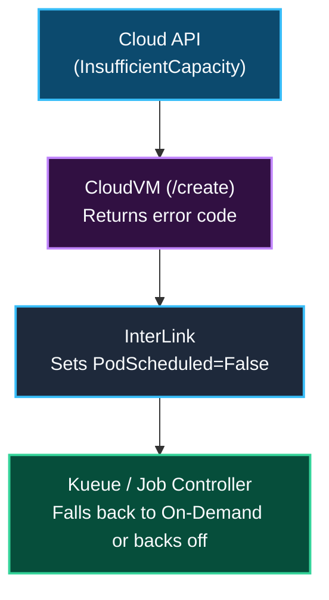
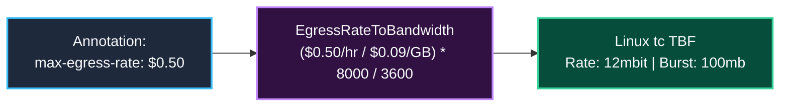
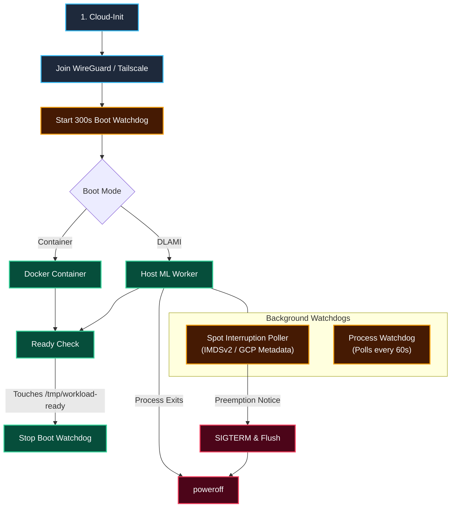
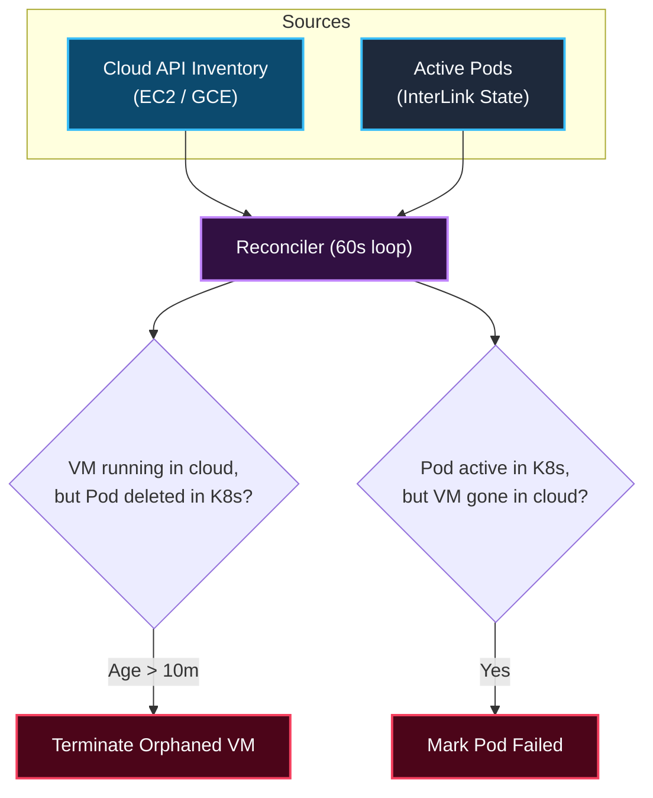
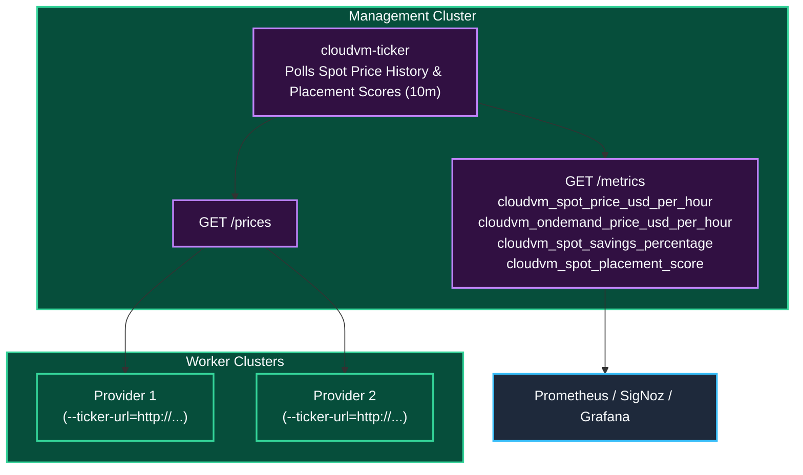

<h1 align="center">interlink-cloudvm-plugin</h1>

<p align="center">
  <!-- Implementation -->
  <a href="https://go.dev/">
    
  </a>
  <!-- Toolchain - mise -->
  <a href="https://mise.jdx.dev/">
    
  </a>
  <br>
  <!-- Verification -->
  <a href="https://github.com/simonepri/interlink-cloudvm-plugin/actions/workflows/ci.yml">
    
  </a>
  <br>
  <!-- Distribution -->
  <a href="https://github.com/googleapis/release-please">
    
  </a>
  <a href="https://helm.sh/">
    
  </a>
  <a href="https://www.docker.com/">
    
  </a>
  <a href="LICENSE">
    
  </a>
</p>

<p align="center">
  Multi-cloud Spot and On-Demand VM bursting for Kubernetes via CNCF InterLink.
</p>

---

## Overview

`interlink-cloudvm-plugin` is a **[CNCF InterLink](https://github.com/interlink-hq/interLink)** provider plugin that lets a Kubernetes cluster burst pods directly onto ephemeral cloud VMs across regions and cloud providers.

When a single region runs out of spot GPUs (A10G, L4, L40S, H100), in-cluster autoscalers get stuck in `Pending` because they can only launch nodes inside the local cluster VPC. `interlink-cloudvm-plugin` bypasses that limit by turning scheduled pods into standalone EC2 Fleet or GCP Compute Engine requests in any target region, connecting the VM back to the cluster over a private WireGuard mesh.



### In-Cluster Autoscaling vs. Virtual Bursting

Most setups run both side-by-side:
- **In-Cluster Nodes (Karpenter / Cluster Autoscaler)**: Run persistent services, Ray head nodes, Kueue controllers, databases, and low-latency workloads inside the cluster VPC.
- **Burst Virtual Nodes (`interlink-cloudvm-plugin`)**: Run stateless GPU/CPU batch jobs across external regions and spot pools when local capacity is full or too expensive.

| Capability | In-Cluster Autoscaler (Karpenter) | `interlink-cloudvm-plugin` |
| :--- | :--- | :--- |
| **Primary Role** | Local steady-state & stateful services | Multi-region & multi-cloud batch burst |
| **Geographic Scope** | Single VPC & region | Any region or cloud via WireGuard |
| **Spot Pool Access** | Local AZs only | Cross-region price & capacity arbitrage |
| **Node Bootstrap** | Kubelet join + CNI + DaemonSets | Boots straight into workload |
| **Cluster Overhead** | `Node` object in etcd + VPC IPs | Single static virtual node, 0 VPC IPs |
| **Packing & Isolation** | Shared host kernel across pods | 1:1 dedicated VM or same-namespace N:1 bin-packing |
| **Persistent Volumes (CSI)** | Native EBS / CSI mounts | S3 / GCS / FUSE mounts only |
| **Idle Cost** | Consolidation & scale-down cooldown | `$0` when last pod on VM exits |

---

## Architecture



The provider consists of five main components:

1. **Multi-Pod Bin-Packer (`NodePool`)**: Tracks free CPU, memory, and discrete GPU/TPU device slots across active VMs using `k8s.io/apimachinery/pkg/api/resource`. If a 4-GPU pod lands on an 8-GPU spot VM (`g5.48xlarge` or `p4d.24xlarge`), a second 4-GPU pod packs straight into the remaining 4 GPUs (`[4,5,6,7]`) without booting another VM.
2. **Fleet Solver**: On a bin-pack miss, maps pod resource requests (`nvidia.com/gpu`, `google.com/tpu`, CPU, memory) to equivalent cloud instance types (`CreateFleet` on AWS, `bulkInsert` on GCP) with optional hourly price caps (`cloudvm.vk.io/max-price`).
3. **Backpressure Loop**: Returns capacity status (`CapacityExhausted`, `PriceCapExceeded`) to Kubernetes so job queues like Kueue can fall back to on-demand or another region.
4. **Egress Spend Governor**: Converts an hourly dollar budget (`cloudvm.vk.io/max-egress-rate: "$0.50"`) into a Linux `tc` Token Bucket Filter on `eth0`, throttling public internet egress while leaving private mesh traffic untouched.
5. **Reconciler & Cost Tagging**: Polls cloud APIs every 60s to clean up orphaned VMs, update pod states on spot preemption, and tag instances/EBS volumes for OpenCost billing reports.

---

## Core Subsystems

### 1. Spot Fleet Bidding & Multi-Pod Bin-Packing (N Pods to 1 VM)

When a pod schedules onto the virtual node, the provider first checks `NodePool` for an active VM in the same namespace and region (a VM never takes pods of a second namespace, and a pod without a namespace never shares a VM) that has enough free CPU, memory, and discrete GPU/TPU slots (`NodeResourcesMostAllocated` scoring) and meets the pod's instance constraints: its capacity type, provider, GPU type, instance-type annotations, and Karpenter label requirements:

- **Bin-Pack Hit**: If an active VM has free capacity (for example, an 8-GPU `g5.48xlarge` currently running a single 4-GPU pod on GPUs `[0..3]`), the provider assigns the remaining GPU slots (`[4..7]`) and dispatches the second pod onto that warm VM without calling EC2/GCE.
- **Bin-Pack Miss**: If no active VM can fit the request, the solver builds a list of candidate instance types and requests a new VM (`price-capacity-optimized` on AWS EC2 Fleet, `bulkInsert` on GCP).
- **Co-Tenant Lifecycle**: Deleting one pod on a shared VM releases its GPU/CPU slots while keeping the VM running for remaining pods. The cloud VM is only terminated once its last active pod finishes.
- **Idle VM Reuse**: A VM whose last pod was deleted stays allocatable for `IDLE_GRACE_PERIOD`, so a new pod of the same namespace that fits reuses it and its image cache instead of booting a VM. Before the pod starts, the provider checks that the VM's runner answers; a VM that fails the check is spun down and the pod launches a new VM. The runner removes each deleted pod's container, which drops its writable layer and logs, and revokes the pod's credential endpoint secret, so a later pod finds only the pulled images. A VM whose pod finished but is not deleted yet takes no new pod.
- **Spin-Down**: A VM marked for spin-down takes no new pods, and the idle collector terminates it on its first pass after its last active pod leaves, without waiting for `IDLE_GRACE_PERIOD`. The provider marks a VM after a spot interruption notice, when it is older than `REUSE_MAX_VM_AGE` (default `24h`, `0` disables), when its reverse tunnel has been down for longer than `REUSE_TUNNEL_DOWN_GRACE` (default `30s`), when its runner fails the check before a reuse or a container removal, when it was adopted after a restart, when it runs a native DLAMI pod, and, with `REUSE_MAX_PRICE_PREMIUM` set (such as `0.2`) and the embedded ticker enabled, when its spot price in its zone exceeds the cheapest zone of its region by more than that fraction.



| Scenario | Pod Request | Provisioned VM Shape | NodePool Allocation |
| :--- | :--- | :--- | :--- |
| **Exact 1:1 Fit** | 1 GPU (`16Gi` RAM) | `g5.xlarge` (`1` GPU, `16Gi`) | Pod 1 gets GPU `[0]` (VM 100% full) |
| **Oversized Spot VM (Pod 1)** | 4 GPUs (`64Gi` RAM) | `g5.48xlarge` (`8` GPUs, `768Gi`) | Launches 1 VM; Pod 1 gets GPUs `[0,1,2,3]` |
| **Oversized Spot VM (Pod 2)** | 4 GPUs (`64Gi` RAM) | *Reuses warm `g5.48xlarge`* | **0 VMs launched**; Pod 2 gets GPUs `[4,5,6,7]` |
| **CPU Batch Slicing** | 4 Pods x `8` vCPU | `c6i.8xlarge` (`32` vCPU, `64Gi`) | All 4 pods pack onto 1 shared VM |

- **Idempotency**: Every AWS `CreateFleet` call sets a deterministic `ClientToken` (`cvm-<uid>-<namespace>-<pod>`) with the Pod UID first so network retries never launch duplicate VMs.
- **Hardware Pinning**: To require a specific instance shape, set `cloudvm.vk.io/instance-type: "p4d.24xlarge"` on the pod; `cloudvm.vk.io/candidate-instance-types` adds comma-separated alternatives. Either annotation makes the list authoritative.
- **Derived Instance Types**: A pod that sets neither annotation launches on every catalog type that fits its total CPU, memory and `nvidia.com/gpu` request and satisfies its [Karpenter well-known label](https://karpenter.sh/docs/concepts/scheduling/#well-known-labels) requirements, cheapest first. The provider reads them with Karpenter's own scheduling package from the node selector and the first required node affinity term, with the operators Karpenter supports (`In`, `NotIn`, `Exists`, `DoesNotExist`, `Gt`, `Lt`, `Gte`, `Lte`, `minValues`). It understands `node.kubernetes.io/instance-type` (only values shaped like an EC2 type, so a virtual node label such as `clvm` is ignored), `kubernetes.io/arch`, `karpenter.sh/capacity-type`, and `karpenter.k8s.aws/instance-{category,family,generation,size,cpu,cpu-manufacturer,memory,gpu-name,gpu-manufacturer,gpu-count,gpu-memory}`, with the values `DescribeInstanceTypes` reports (memory in MiB). Without an `instance-gpu-count` requirement a GPU pod takes only types with exactly its GPU count, and a CPU-only pod only types without GPUs. A type is a candidate only if one of the pinned region's launch templates can boot it (see [Launch Templates](#launch-templates)), so a pod that requires `kubernetes.io/arch: arm64` gets Arm types only where an Arm template exists. The catalog is `AWS_INSTANCE_TYPES` when set, otherwise the ticker's tracked GPU types for GPU pods and the `m7i`, `c7i`, `r7i`, `m6i`, `c6i` and `r6i` families for CPU pods, plus any EC2 type an `instance-type` requirement names. Types are ordered by the ticker's spot price in the pinned region (or the on-demand list price), and the list is cut so types times subnets stay within 300 fleet overrides. `karpenter.sh/capacity-type: on-demand` selects on-demand capacity when `cloudvm.vk.io/capacity-type` is unset.

---

### 2. Capacity Backpressure & Kueue Integration

When spot pools are empty or above the price cap, the provider fails fast so upstream controllers can react instead of hanging:



- `CapacityExhausted`: Requested spot pools have no capacity in the target region.
- `PriceCapExceeded`: Current spot price is higher than `cloudvm.vk.io/max-price`.

---

### 3. Egress Rate Limiting (Linux `tc`)

Cloud internet egress ($0.09/GB on AWS, $0.085/GB on GCP) can easily surprise teams running data-heavy jobs. Setting `cloudvm.vk.io/max-egress-rate: "$0.50"` caps public egress spend at $0.50/hr by configuring a Linux `tc` Token Bucket Filter at boot:



`tc` sets up a two-band priority queue (`prio bands 2`) on `eth0`:
- **Band 1 (Unthrottled)**: WireGuard (`UDP 51820`) and Tailscale (`UDP 41641`) mesh traffic bypasses the rate limit so cluster heartbeats and Ray GCS traffic are never throttled.
- **Band 2 (Throttled)**: All other outbound traffic goes through the Token Bucket Filter.

---

### 4. VM Boot Lifecycle & Watchdogs

The provider supports two boot modes:
1. **DLAMI Mode (`cloudvm.vk.io/ami-mode: "dlami"`)**: Boots an AWS Deep Learning AMI with NVIDIA drivers, CUDA, and PyTorch pre-installed on disk.
2. **Container Mode (Default)**: Pulls and runs the pod's container image via Docker/Containerd.



- **Spot Interruption Poller**: Polls AWS IMDSv2 (`/latest/meta-data/spot/instance-action`, 120s warning) or GCP metadata (`/computeMetadata/v1/instance/preempted`, 30s warning) and sends `SIGTERM` to the container before shutting down.
- **300s Boot Watchdog**: Powers off the VM if the container fails to start within 5 minutes, preventing stuck VMs from accruing charges.
- **Process Exit Hook**: AWS VMs launch with `InstanceInitiatedShutdownBehavior=terminate`. As soon as the container exits and `cloud-init` runs `poweroff`, AWS terminates the instance and deletes its root EBS volume.

---

### 5. Reconciler & Zombie Cleanup

A background loop runs every 60 seconds in the provider to keep Kubernetes and cloud state in sync:



---

### 6. Spot Price Ticker, Placement Scores, and Cost Metrics (`cloudvm-ticker`)

To avoid hitting AWS/GCP API rate limits when running multiple provider instances, spot price polling, placement score analysis, and cost benchmarking can be separated into a standalone `cloudvm-ticker` deployment:



- **Tracked Instance Types**: Unless `TICKER_INSTANCE_TYPES` lists them, the ticker tracks every EC2 GPU instance type that `DescribeInstanceTypes` returns in the tracked regions, re-read daily, and labels each GPU with the name and memory AWS reports. A GPU slice, part of one GPU that instances such as `g6f` share, counts as one GPU named like a MIG profile, such as `L4 1/8 3GB`. A slice is one GPU at launch too, so a pod that needs more GPU memory states it with `karpenter.k8s.aws/instance-gpu-memory`.
- **Embedded Mode (Default)**: The provider polls spot prices and placement scores directly every `10m ± 2m`.
- **Central Ticker Mode**: Deploy the `cloudvm-ticker` Helm chart once and point providers at `--ticker-url=http://cloudvm-ticker.monitoring.svc:8080`.
- **Exposed Prometheus Metrics**:
  - `cloudvm_spot_price_usd_per_hour{region, instance_type}`: Current AWS EC2 Spot price per hour.
  - `cloudvm_ondemand_price_usd_per_hour{region, instance_type}`: Baseline AWS EC2 On-Demand list price per hour.
  - `cloudvm_spot_savings_percentage{region, instance_type}`: Percentage savings of Spot compared to On-Demand ((OnDemand - Spot) / OnDemand * 100).
  - `cloudvm_spot_placement_score{region, instance_type}`: Real-time AWS Spot Placement Score (1 to 10 scale) indicating likelihood of successful spot instance fulfillment with low preemption risk.
  - `cloudvm_transfer_price_usd_per_gb{provider, source_region, destination_region, transfer_kind}`: AWS list price in USD per GB of data leaving `source_region`, read from the Price List API (`AWSDataTransfer`) between every region in `AWS_REGION`, `AWS_REGIONS`, the `NODE_REGIONS` values, and the ticker's market regions (`TICKER_REGIONS`, or the discovered regions when it is `auto`), and reloaded daily, or hourly after a failed read, which keeps the last prices. `transfer_kind` is `cross_region` with `destination_region` set to another of those regions, `cross_zone` with `destination_region` equal to `source_region` (charged in each direction), or `internet` with `destination_region="internet"`. Internet transfer is tiered by monthly volume, and the gauge reports the first paid tier, the first tier after any free allowance; the account-wide free allowance and the cheaper tiers at higher volumes are not reflected. Region ranking does not use these prices yet.

**Fill plans.** For every GPU count in `LADDER_SIZES` and memory floor in `LADDER_MEMORY_TIERS`, the ticker plans the cheapest way to get that many GPUs. It takes spot GPUs first, but in each region only up to the largest probed count at which every smaller probe also scores at least 3, then covers the rest with on-demand GPUs. Each step takes the offer with the lowest cost per GPU still needed, so a whole instance larger than the remainder is priced at what it costs. Both stay within what is left of the region's EC2 quotas, which every instance type of a family (G or P) shares: the quota limit minus the account-wide usage CloudWatch reports in its `AWS/Usage` metric. An offer whose quota could not be read is not planned, and when usage cannot be read the whole limit counts as free. To score spot capacity, the ticker asks [`GetSpotPlacementScores`](https://docs.aws.amazon.com/AWSEC2/latest/APIReference/API_GetSpotPlacementScores.html), for each memory floor and GPUs-per-instance size, about the tracked shapes of that size at 8, 64, 256, and 1024 GPUs, at the real target size. There is no cap by default; `TICKER_PROBE_MAX_INSTANCES` optionally caps the instance count of a probe. AWS sets its limit from the account's recent spot usage; when it rejects a target, the ticker logs that once, remembers it for that shape group for six hours, and probes that size at half the rejected one instead, halving up to three more times until AWS accepts. After six hours it asks for the larger sizes again, so a raised limit is noticed. A score is stored at the GPU count actually probed, for example 256 GPUs for 8-GPU shapes after a 1024-GPU rejection, so it always describes the size it was measured at and plans take no spot GPUs beyond the largest probed size that scores well; a region with no score gets no spot GPUs of that size. GCP offers have neither scores nor quotas yet, so plans use AWS only. Expected GPUs count each spot GPU at its score divided by 10 and each on-demand GPU in full; AWS does not calibrate the scores as probabilities, so treat the result as a ranking signal.

  - `cloudvm_spot_capacity_score{provider, region, min_gpu_memory_gb, gpus_per_instance, gpus}`: Spot placement score for getting that many GPUs in shapes of that size at that memory floor.
  - `cloudvm_fill_price_usd_per_gpu_hour{min_gpu_memory_gb, gpus}`, `cloudvm_fill_planned_gpus{...}`, `cloudvm_fill_expected_gpus{...}`: Blended price, planned GPUs (whole instances can exceed the target), and expected GPUs of each plan.
  - `cloudvm_fill_gpus{min_gpu_memory_gb, gpus, provider, region, gpu_model, capacity_type}`: GPUs a plan takes from one region, GPU model, and capacity type.
  - `cloudvm_fill_limited{min_gpu_memory_gb, gpus, reason}`: 1 when a plan falls short, with `reason` `quota`, `no_quota_data`, or `capacity`.

---

### 7. Cost Allocation (OpenCost)

Because burst VMs do not run Kubelet or cAdvisor, cost attribution relies on cloud billing tags. Every instance and EBS volume is tagged on creation:
- `ManagedBy: interlink-cloudvm-plugin`
- `ClusterTag: <cluster-name>`
- `PodName: <pod-name>`
- `Namespace: <pod-namespace>`
- `PodUID: <pod-uid>`
- `CostCenter: <cost-center>`
- `JobID: <job-id>`

OpenCost ingests these tags from the AWS Cost and Usage Report (CUR) or GCP billing export to map VM spend back to Kubernetes namespaces and jobs.

---

### 8. Replacing Node DaemonSets on Bare VMs

Standard Kubernetes DaemonSets do not run on InterLink virtual nodes. Instead, host-level tools are configured via `cloud-init` or pre-baked into the VM image:

| Kubernetes DaemonSet | CloudVM Equivalent | How It Runs | Purpose |
| :--- | :--- | :--- | :--- |
| **CSI FUSE Driver** (`csi-rclone`) | `rclone mount` / `s3fs` / `gcsfuse` | `cloud-init` service | Mounts S3/GCS buckets to `/mnt/data` before the container starts. |
| **Torch Compile Cache** | Pre-populated kernel cache in AMI | Local disk / S3 | Avoids 5-15 minute Triton/Inductor compilation on cold boot. |
| **Node Problem Detector** (`ENABLE_NPD=true`) | Embedded standalone NPD agent | Host systemd service | Checks GPU Xid/ECC errors, kernel deadlocks, and driver faults; terminates unhealthy VMs cleanly. |
| **DCGM Exporter / OTEL** (`OTEL_ENDPOINT`) | Host OTEL Collector / Vector | Systemd service | Ships GPU telemetry, container logs, and system metrics directly to central SigNoz/Honeycomb. |
| **Log collector** (`CLOUDVM_OTLP_LOGS_ENDPOINT`) | Tunnel agent log stream | Reverse tunnel session | The tunnel agent streams the bootstrap log, runner log, and `docker logs` (or `CLOUDVM_CONTAINER_CLI logs`) of each pod container over its tunnel; the plugin forwards them as OTLP/HTTP logs tagged `cloudvm.instance_id`, `cloudvm.region`, `k8s.pod.name`, and `k8s.namespace.name`, and keeps the last 128 KiB of each pod's container output for `kubectl logs`. |
| **Pull-Through Cache** (`REGISTRY_MIRRORS`) | Docker / containerd registry mirrors | Host daemon config | Pulls container images via local cluster caches (Harbor, Spegel) avoiding Docker Hub limits. |
| **Custom Bootstrap** (`CUSTOM_BOOTSTRAP_SCRIPT`) | Shell script execution hook | `cloud-init` execution | Allows mounting NFS/EFS/FSx shares, enrolling security agents, or injecting custom CA certs. |

---

## Provider Support Matrix

| Provider | Backend Mechanism | Maturity | Capabilities |
| :--- | :--- | :--- | :--- |
| **AWS** | EC2 Instant Fleet (`CreateFleet`) | Production-ready | Multi-shape portfolio bidding, dynamic hardware catalog discovery, `price-capacity-optimized` spot allocation, IMDSv2 interruption poller, rate limiting via `tc` |
| **GCP** | Compute Engine (`bulkInsert`) | Experimental / Preview | Single-zone spot provisioning, preemption metadata polling, basic egress rate limiting |

---

## Security & Isolation

1. **VM-Level Isolation**: Each job runs in a dedicated cloud VM (AWS Nitro / GCP KVM) with its own kernel and ephemeral root disk.
2. **IMDSv2 Hop Limit**: AWS instances enforce IMDSv2 with `HttpPutResponseHopLimit: 1`, blocking containers from stealing host IAM role credentials via `169.254.169.254`.
3. **No Inbound SSH**: VMs join the WireGuard/Tailscale mesh without `--ssh` enabled and with no inbound ports open on the cloud security group.
4. **Ephemeral Mesh Keys**: Mesh auth keys are scoped to short-lived tags.
5. **Non-Root Container Execution & IMDS Lockdown**: Workload containers run as non-root (defaulting to UID `65532:65532` unless configured via pod or container `securityContext.runAsUser`), dropping `SETUID` and `SETGID` with `no-new-privileges`. Pods or containers specifying `runAsUser: 0` or `runAsGroup: 0` are rejected to prevent accessing cloud instance metadata under host networking. Host iptables rules drop all non-root outbound traffic to `169.254.169.254`, preventing containers from reading cloud instance metadata (IMDS) or user-data while allowing host system daemons (dockerd, SSM, AWS CLI, spot-monitor) full access.
6. **Same-Namespace Host Network Sharing**: Bin-packed containers from several pods on a shared VM run with `--net=host` to provide native throughput for Ray workers and distributed training. Co-tenants on the same VM share localhost networking within the same Kubernetes namespace (bin-packing across different namespaces is disallowed).
7. **AWS KMS Runner Token Encryption**: When `KMS_KEY_ID` is configured, runner authentication tokens are encrypted using AWS KMS before rendering instance user-data. The VM decrypts the token at boot using its instance profile (`kms:Decrypt`), ensuring zero plaintext tokens are present in user-data or cloud instance metadata.
8. **Private Registry Auth & Ephemeral Credentials**: Kubernetes `imagePullSecrets` arrive in the virtual kubelet's create request (or, when the request lacks one, are read through the Kubernetes API if the plugin has access) and are transferred exclusively over the authenticated runner channel. The in-VM runner creates an ephemeral, permission-restricted (`0700`) temporary directory for `docker --config` during image pull and deletes it immediately in a `finally:` block, preventing co-tenant credential leakage.
9. **Reverse Tunnel Runner Channel**: Workers accept no inbound traffic. At boot each worker joins the tailnet with the plugin's ephemeral, pre-tagged `TAILSCALE_AUTHKEY` (advertising `tag:clvm-worker`, read from a `0600` file and deleted after join, KMS-enveloped when `KMS_KEY_ID` is set), then a small agent dials `TUNNEL_ENDPOINT` over TLS verified against the public CA. The plugin's gateway (plain TCP on `TUNNEL_GATEWAY_LISTEN`, TLS terminated in front of it) accepts a session only from a tracked instance presenting the runner token issued at its launch, and every container call travels over that Yamux session to the runner, which listens on loopback only. A worker that has not connected within `TUNNEL_CONNECT_TIMEOUT` is failed and terminated. `RUNNER_DIRECT_FALLBACK=true` restores direct private-IP calls for same-VPC workers.
10. **Boot Console Diagnostics**: The bootstrap log is mirrored to the serial console. When a worker fails to boot or open its tunnel, the daemon fetches the last 4 KiB of EC2 console output and appends it to the pod's terminal container message. The daemon role needs `ec2:GetConsoleOutput`; without it the fetch is skipped.

---

## When NOT to Use This

| Workload Type | Why It Fits Poorly | Use This Instead |
| :--- | :--- | :--- |
| **Tightly Coupled Multi-Node Training** (e.g. 400-3200 Gbps EFA/RoCE NCCL all-reduce) | WireGuard overlays are built for control-plane traffic and Ray GCS coordination, not multi-hundred-gigabit RDMA tensor parallelism. | Same-AZ GPU placement groups with AWS EFA or GCP GPUDirect-TCPXO. |
| **Small Microservices** (e.g. 0.25 vCPU, 512MB RAM) | Launching a dedicated VM per pod wastes capacity and hits the 60-second cloud billing minimum. | Standard Kubernetes nodes managed by **Karpenter**. |
| **Multi-Container Pods with Shared Volumes** | Only the primary workload container runs on the VM; its `Secret` volume mounts are projected read-only, but `ConfigMap`, `emptyDir`, and other volumes are not. | In-cluster node pools, or pass config via environment variables and S3. |
| **Pods Requiring Arbitrary In-VM Secret Projections** | Only the primary workload container runs on the VM. Its `Secret` volumes are written to tmpfs and mounted read-only when the container starts, with `items`, modes, `optional`, and `subPath`, but a Secret that changes afterwards reaches the VM only when the pod restarts; `ConfigMap` and projected volumes are not projected. Private container registry authentication via `imagePullSecrets` is natively supported. | In-cluster node pools, or pass configuration via environment variables and S3/GCS object stores. |
| **Sub-Minute Tasks (< 60s)** | Cloud providers charge a 60-second minimum per VM launch, and VM boot takes ~30-60s. | Warm in-cluster pod pools or serverless functions. |

---

## Failure Modes

| Event | How It's Detected | What Happens | Recovery |
| :--- | :--- | :--- | :--- |
| **Spot Preemption** | In-VM poller checks IMDSv2 / GCP metadata | Sends `SIGTERM` to workload (120s on AWS, 30s on GCP), flushes logs, and powers off. | Reconciler marks pod `Failed (SpotInterruption)`; job controller re-queues. |
| **Spot Pool Empty** | Cloud API returns `InsufficientInstanceCapacity` | `/create` fails immediately and sets `PodScheduled=False (CapacityExhausted)`. | Kueue falls back to on-demand flavor or retries with backoff. |
| **Container Fails to Start** | 300s boot watchdog on the VM | Watchdog powers off the VM if `/tmp/workload-ready` is not created within 5m. | VM terminates; pod is marked `Failed`. |
| **Container Crashes** | 60s process liveness check | Script sees container exited and runs `poweroff`. | VM terminates; pod is marked `Failed`. |
| **Control Plane Disconnected** | Provider reconciler loop | If the pod no longer exists in Kubernetes after 10m, the provider terminates the VM via cloud API. | Prevents orphaned VMs from running if the cluster loses connectivity. |

---

## Usage Examples

### Example 1: Spot GPU Job (DLAMI Fast-Boot)

```yaml
apiVersion: v1
kind: Pod
metadata:
  name: gpu-inference-worker
  annotations:
    cloudvm.vk.io/provider: "aws"
    cloudvm.vk.io/capacity-type: "spot"
    cloudvm.vk.io/ami-mode: "dlami"
    cloudvm.vk.io/instance-type: "g5.xlarge"
    cloudvm.vk.io/max-price: "2.50"
    cloudvm.vk.io/max-egress-rate: "$0.50"
spec:
  nodeSelector:
    kubernetes.io/role: cloudvm
  tolerations:
    - key: virtual-node.interlink/no-schedule
      operator: Exists
      effect: NoSchedule
  containers:
    - name: worker
      resources:
        limits:
          nvidia.com/gpu: "1"
```

### Example 2: Spot CPU Worker (Container Mode)

```yaml
apiVersion: v1
kind: Pod
metadata:
  name: ray-data-worker
  annotations:
    cloudvm.vk.io/provider: "aws"
    cloudvm.vk.io/capacity-type: "spot"
    cloudvm.vk.io/instance-type: "c6i.2xlarge"
spec:
  nodeSelector:
    kubernetes.io/role: cloudvm
  tolerations:
    - key: virtual-node.interlink/no-schedule
      operator: Exists
      effect: NoSchedule
  containers:
    - name: worker
      image: rayproject/ray:2.44.0
      env:
        - name: RAY_HEAD_ADDRESS
          value: "ray-head.default.svc.cluster.local:6379"
      resources:
        limits:
          cpu: "8"
          memory: "16Gi"
```

---

## Installation

### Provider Chart

```bash
helm upgrade --install interlink-cloudvm-plugin \
  oci://ghcr.io/simonepri/charts/interlink-cloudvm-plugin \
  --namespace interlink \
  --create-namespace \
  --set provider.type=aws \
  --set provider.awsRegion=us-east-1
```

### Spot Price Ticker Chart (Optional)

```bash
helm upgrade --install cloudvm-ticker \
  oci://ghcr.io/simonepri/charts/cloudvm-ticker \
  --namespace monitoring \
  --create-namespace \
  --set serviceMonitor.enabled=true
```

---

## Development

Requires [mise](https://mise.jdx.dev/) for tool management.

```bash
# Install Go, linters, and Helm
mise install

# Run all linters, security checks, and tests
mise run verify

# Run unit tests with race detector
mise run test

# Build binary to ./bin/interlink-cloudvm-plugin
mise run build
```


---

## Known Production Architecture Notes

### High Availability and Storage Options

1. Active-Active High Availability (PostgreSQL Store):
When `DATABASE_URL` is configured, `interlink-cloudvm-plugin` persists runner tokens, completed pod termination records, tombstones, and multi-region instance mappings directly in PostgreSQL.
- Supports multi-replica deployments (`replicas: 2+`) with Kubernetes `RollingUpdate` strategy.
- Eliminates single points of failure and allows zero-downtime control-plane upgrades.
- Shared state prevents duplicate instance creation and guarantees idempotent cleanup across replicas.

2. Single Replica Standalone (Local Disk Store):
When `DATABASE_URL` is omitted, the provider maintains state caches backed by an atomic fsync store on persistent volume storage (`ReadWriteOnce` PVC via `DATA_DIR`). To ensure lock integrity and state consistency across pod restarts, deploy with `replicas: 1` (`Recreate` strategy).

3. In-VM Runner Token Delivery:
Runner authorization tokens are generated securely per instance and passed through cloud instance launch user-data templates. Runner credentials are never exposed via cloud provider metadata tags or external APIs.

4. Co-tenant Discovery Timeout:
When the provider restarts while an in-VM runner is unreachable, the node is flagged with unverified co-tenants and protected from idle collection and zombie cleanup. Background reconciliation retries container discovery on each reconcile pass for up to 30 minutes before releasing the node for garbage collection.

The idle collector terminates a VM once its last pod has been gone for `IDLE_GRACE_PERIOD`, checking every 10 seconds, and retries a failed termination on its next pass. It terminates a VM marked for spin-down on its first pass once the VM has no active pods. It removes the VM from the node pool before calling the cloud, under the same lock allocations take, so no pod can land on a VM being terminated; a VM whose termination failed returns marked for spin-down. The reconciler terminates a pooled zombie VM only once it is idle past its grace period or marked for spin-down, and marks it first. The collector and the reconciler terminate VMs together: on AWS in one `TerminateInstances` call per region and 1000 instances, elsewhere in up to 32 parallel calls, each with a 30 second timeout. `/metrics` exports `cloudvm_idle_nodes`, `cloudvm_idle_terminations_total`, `cloudvm_idle_termination_errors_total`, `cloudvm_reused_allocations_total`, and `cloudvm_spin_downs_total` by `reason`.


### NodeClaim API (one VM per Karpenter NodeClaim)

Next to the per-pod interLink API, the plugin launches one VM per Karpenter NodeClaim, so a Karpenter cloud provider can turn every VM into its own Node with its real instance type, zone and capacity. The Go module [`src/nodeclaim`](src/nodeclaim) holds the JSON types, the API interface and an HTTP client.

| Request | Effect |
| :--- | :--- |
| `POST /v1/nodeclaims` | Launches one VM of the named offering (`name`, `instanceType`, `region`, optional `zone`, `capacityType`, `labels`, `taints`, and `annotations` with `cloudvm.vk.io/*` launch options such as `cloudvm.vk.io/aws-launch-template` or `cloudvm.vk.io/subnets`). It answers `201` once the cloud returns the instance ID, with `providerID` `cloudvm://<cloud>/<region>/<instance-id>` and the instance type's `capacity`. A repeated request with the same name returns the existing claim with `200`. |
| `GET /v1/nodeclaims[?providerID=]` | Lists the claims, each `Launching` until its VM's tunnel connects (or, without a tunnel, its runner answers) and `Running` after, with `interrupted` set after a spot interruption notice. |
| `GET /v1/nodeclaims/{name}` | Returns one claim, or `404`. |
| `DELETE /v1/nodeclaims/{name}` | Terminates the claim's VM and answers `202`; `404` once the claim is gone. |
| `GET /v1/catalog[?regions=a,b]` | Lists the ticker's tracked instance types and the default CPU types with one offering per region, zone and capacity type: spot per zone at the ticker's price, on-demand per region at the list price. Needs `ENABLE_TICKER=true`. |

Errors carry `{"reason", "message"}`: `Unauthorized` (`401`) and `Forbidden` (`403`) for callers (see below), `InsufficientCapacity` (`503`) when the cloud has no capacity, quota or offering for the request, after which the offering is reported unavailable for 3 minutes; `InvalidRequest` (`400`, or `409` for a claim deleted during its launch); `NotFound` (`404`).

- **Pods.** A pod whose `spec.nodeName` is a claim's name runs on that claim's VM through the usual `/create`, `/status`, `/delete` and `/getLogs` calls, next to the other pods bound to the same Node. The scheduler has already fitted it into the Node's allocatable, so the plugin only assigns its GPU devices, which survive a plugin restart. A claim VM takes pods of one namespace: the `cloudvm.vk.io/namespace` label binds it at launch, otherwise its first pod does, and pods of another namespace are refused with `409`. Pods bound to a deleted claim, or to a Node labeled `cloudvm.vk.io/node-agent=true` that the plugin does not know, are refused too, so they never launch VMs of their own.
- **Lifecycle.** Only deleting its claim terminates a claim VM: the idle collector, the zombie reconciler and pod deletion leave it alone, and the plugin calls its runner every minute so the in-VM idle watchdog keeps it. A claim VM that is not ready within `TUNNEL_CONNECT_TIMEOUT` (10 minutes without a tunnel) is terminated, and a claim whose VM disappears from the cloud inventory is dropped, so its NodeClaim fails and Karpenter replaces it.
- **Callers.** Every NodeClaim API request carries `Authorization: Bearer <token>`, a service account token for the audience `NODECLAIM_API_AUDIENCE` (default `cloudvm-plugin`, `nodeClaimAPI.audience` in Helm). The plugin verifies it with a TokenReview, caches the result for 30 seconds, and admits only the users in `NODECLAIM_API_ALLOWED_USERS` (`nodeClaimAPI.allowedUsers`), such as `system:serviceaccount:karpenter:cloudvm-karpenter`; it answers `401 Unauthorized` for a missing or invalid token, `403 Forbidden` for another user, and refuses every call while the list is empty. The service account needs `create` on `tokenreviews`, which the chart grants. `nodeclaim.TokenFileTransport` sends a projected token that it re-reads on every request.
- **Zones.** On AWS a claim with a `zone` launches only into the subnets of that zone. GCP launches ignore the zone, and the catalog lists AWS types only.
- **State.** Claims persist in `CLAIM_STORE_PATH` (the chart puts it on the data volume), so run one replica, which the tunnel requires anyway.

### Regional Virtual Nodes

Run Virtual Kubelet nodes in any number per region, for example one per GPU class and capacity type. A pod launches in the region of the node it is bound to, chosen in this order:

1. The pod's `cloudvm.vk.io/region` annotation.
2. The bound node's `topology.kubernetes.io/region` label, which the plugin reads through a node watch. The service account needs `get`, `list`, and `watch` on `nodes`; the Helm chart's ClusterRole grants them.
3. The bound node's entry in `NODE_REGIONS` (`provider.nodeRegions` in Helm), a JSON object such as `{"virtual-node-region-a":"eu-west-1"}`, for nodes without the label.
4. The pod's `topology.kubernetes.io/region` node selector.

When none of them names a region, the plugin refuses the pod with HTTP 400 and a `CloudVMRegionUnknown` warning event on the pod, and launches nothing. `AWS_REGION` is not a fallback; it remains the plugin's own home region for pricing and the other uses described in this readme.

### Node Agent for NodeClaim VMs

`cloudvm-node-agent` (in the same image, enabled with `nodeAgent.enabled` in the chart) gives every VM the plugin launched for a Karpenter NodeClaim its own Kubernetes Node, so a pod scheduled there runs on that VM through `/create`, `/status`, `/delete` and `/getLogs`, like a pod on a regional virtual node. One process serves many Nodes; `nodeAgent.shards` StatefulSet replicas split them by rendezvous hashing of the node name (`SHARD_COUNT`, with the shard index taken from the pod's ordinal or `SHARD_INDEX`).

- **Nodes.** Every `CLAIM_POLL_INTERVAL` (default `10s`) each shard reads `GET /v1/nodeclaims` once. For each of its claims that is `Launching` or `Running` it registers a Node named after the claim with the claim's `providerID`, labels and taints, the `karpenter.sh/unregistered:NoExecute` taint at creation only, `type=virtual-kubelet`, `cloudvm.vk.io/node-agent=true`, the instance type, region, zone and capacity type labels, and capacity and allocatable from the claim, including `nvidia.com/gpu`. The Node is `Ready` once the claim is `Running`, its `kube-node-lease` Lease lasts 40 s and is renewed every 10 s (`LEASE_DURATION_SECONDS`, `LEASE_RENEW_INTERVAL`), and its status is written every minute (`NODE_STATUS_INTERVAL`) and on every change. Labels and taints that Karpenter changes after creation are left alone. A `Terminating` claim stops being served, a Node someone deleted is not recreated, and the agent deletes a Node whose claim is missing from two successful lists in a row; a failed list changes nothing.
- **Pods.** One pod informer per process watches pods with `spec.nodeName` set and keeps full objects only for its shard's nodes; one virtual-kubelet pod controller runs the pods of the Nodes it serves. Secrets and ConfigMaps that a pod's environment or `imagePullSecrets` name are read by name when the pod starts, never cached cluster-wide; a Service informer backs service-link environment variables, as on the kubelet. Pod status comes from one `/status` call per shard every `POD_STATUS_INTERVAL` (default `5s`).
- **Plugin API token.** The agent sends the projected service account token in `PLUGIN_API_TOKEN_FILE` (default `/var/run/secrets/cloudvm-plugin/token`) to the NodeClaim API, re-reading it on every call; the chart projects it for `nodeClaimAPI.audience` and adds the agent's service account to the plugin's allowed users.
- **Kubelet API.** Every Node advertises its shard's pod IP and `KUBELET_PORT` (default `10250`). The shard serves `/containerLogs` and `/pods` over HTTPS for all its Nodes and answers `exec`, `attach` and `portForward` with `501 Not Implemented`. Callers must present a client certificate signed by a CA in `KUBELET_CLIENT_CA_FILE` (default the service account `ca.crt`). The serving certificate is `KUBELET_TLS_CERT_FILE` and `KUBELET_TLS_KEY_FILE` (`nodeAgent.servingCertSecret`), or a self-signed one for the pod IP.

### Availability Zone Filtering and Region Fallback

Before each `CreateFleet`, the provider resolves each subnet's Availability Zone with `DescribeSubnets` and drops every (instance type, subnet) override whose AZ does not offer that instance type according to `DescribeInstanceTypeOfferings` (location type `availability-zone`). Offerings stay cached for one hour per region and subnet AZs for the process lifetime. When no override remains, the launch fails in that region with `no requested instance type is offered in the availability zones of the configured subnets`. A failed lookup sends the unfiltered overrides instead of blocking the launch.

A pod launches only in its pinned region (see [Regional Virtual Nodes](#regional-virtual-nodes)) unless it sets `cloudvm.vk.io/candidate-regions`, a comma-separated region list. With that annotation, a capacity failure in the pinned region (`InsufficientInstanceCapacity`, `UnfulfillableCapacity`, `InvalidFleetConfiguration`, quota errors, an empty instant fleet, or no offered override) moves the launch to the next candidate region. Candidates are ordered by the embedded ticker's best spot placement score for the requested instance types when `ENABLE_TICKER=true`, and by annotation order otherwise. One launch tries at most 3 regions, counting the pinned one. A fallback region uses only its `CLUSTER_FACTS` launch template and subnets, and its workers reach the gateway over that region's own `tunnelTransport` with that transport's endpoint settings. The provider skips candidates that have no template there, or whose transport lacks a required setting such as `TAILSCALE_AUTHKEY`, before counting the 3-region limit. Fallback is disabled when `KMS_KEY_ID` is a bare key ID or alias rather than an ARN, because workers in other regions could not decrypt the runner token.

Set `cloudvm.vk.io/region-selection: scored` next to `cloudvm.vk.io/candidate-regions` to let the provider pick the best 3 regions instead of always trying the pinned region first. It ranks the pinned region and every usable candidate together by the embedded ticker's data: a region whose remaining quota (the measured EC2 quota less the vCPUs of this provider's live instances in that quota) cannot fit the smallest requested type goes last; then a higher spot placement score for the requested types goes first (spot launches only); then a lower hourly price (spot price, or the on-demand list price). Ties keep the pinned region first, then annotation order. A VM may then run outside its virtual node's region. Its launch template, subnets and tunnel transport always come from the region it launches in, and the pinned region alone honors the pod's `cloudvm.vk.io/aws-launch-template` and `cloudvm.vk.io/subnets`. Without the annotation, or with any other value, the pinned region is tried first as described above.

Every launch posts a `CloudVMRegionSelected` event on the pod naming the region used and, after a fallback, the error that each earlier region returned. The chart's RBAC grants `create` on `events` for this.

### Spot Interruption Draining for KubeRay

Each tunneled worker runs a spot watcher (`spot_watcher.py`) next to the tunnel agent. It polls AWS IMDSv2 `/latest/meta-data/spot/instance-action` every 5s, or waits on GCP `computeMetadata/v1/instance/preempted` with `wait_for_change`, and prints each new notice as one JSON line, such as `{"event": "spot-interruption", "action": "terminate", "time": "2026-10-27T10:02:00Z"}`, to `/var/log/cloudvm-spot-watcher.log`. The tunnel agent ships that file under the `spot` log source.

When the plugin reads a notice from a worker's log stream, it cordons the VM so no new pod lands on it and posts a `CloudVMSpotInterruption` warning event on every pod running there. For each pod labeled `ray.io/cluster` and `ray.io/group`, except Ray heads, it creates a ConfigMap named `spot-interrupted-<pod UID>` in the pod's namespace for the KubeRay operator's spot interruption controller:

```yaml
metadata:
  labels:
    test.k8s.io/event: spot-interrupted
    target-cluster: <ray.io/cluster>
data:
  workerGroup: <ray.io/group>
  interruptedPod: <pod name>
  interruptedReplicas: "1"
```

The ConfigMap name is fixed per pod, so a notice that arrives again creates nothing new. The pod owns the ConfigMap, so Kubernetes deletes it with the pod. The chart's RBAC grants `get` on `pods` and `create` on `configmaps` for this.

### Launch Templates

Each region boots workers from launch templates that `CLUSTER_FACTS` names. `regions.<region>.launchTemplates` lists them in the order launches try them, each with an `id` or `name` and optional `requirements` in the [Karpenter well-known label](https://karpenter.sh/docs/concepts/scheduling/#well-known-labels) format. Every candidate instance type boots from the first template whose requirements it satisfies, so one fleet request can mix templates, and a type no template accepts is not launched in that region. The plugin adds each template's image architecture to its requirements by reading its `$Latest` version and image (`ec2:DescribeLaunchTemplateVersions`, `ec2:DescribeImages`); when EC2 cannot tell, as for an image resolved from an SSM parameter, the template counts as `amd64` unless its requirements name `kubernetes.io/arch`. Besides the Karpenter labels, requirements can use `cloudvm.vk.io/gpu-slice`, which is `true` for a GPU slice and `false` for every other type. For example, GPU slices need NVIDIA's GRID driver:

```json
{"launchTemplates": [
  {"id": "lt-grid", "requirements": [{"key": "cloudvm.vk.io/gpu-slice", "operator": "In", "values": ["true"]}]},
  {"id": "lt-gpu", "requirements": [{"key": "karpenter.k8s.aws/instance-gpu-count", "operator": "Exists"}]},
  {"id": "lt-cpu", "requirements": [{"key": "karpenter.k8s.aws/instance-gpu-count", "operator": "DoesNotExist"}]}
]}
```

Without `launchTemplates`, `gpuLaunchTemplateId` boots types with whole GPUs and `launchTemplateId` or `launchTemplateName` boots the rest, and no template boots a GPU slice; without either, the `interlink-cloudvm-worker` template boots every type except GPU slices. A template a pod names through its annotation boots every candidate.

### AWS IAM Permissions

The provider's AWS role needs these actions:

| Action | Used for |
| :--- | :--- |
| `ec2:CreateFleet`, `ec2:RunInstances`, `ec2:CreateTags` | Launching tagged instant fleets |
| `iam:PassRole` | Passing the worker instance profile named in the launch template |
| `ec2:DescribeInstances`, `ec2:TerminateInstances` | Instance status, inventory, and cleanup |
| `ec2:ModifyInstanceAttribute` | Adding the namespace security group to a new worker when its region sets `namespaceFirewalls` |
| `ec2:DescribeInstanceTypes` | Hardware catalog discovery |
| `ec2:DescribeLaunchTemplateVersions`, `ec2:DescribeImages` | Launch template image architecture |
| `ec2:DescribeInstanceTypeOfferings`, `ec2:DescribeSubnets` | Dropping overrides an AZ does not offer |
| `ec2:DescribeRegions`, `ec2:DescribeSpotPriceHistory`, `ec2:GetSpotPlacementScores` | Spot price ticker and placement scores |
| `pricing:GetProducts`, `servicequotas:GetServiceQuota`, `cloudwatch:GetMetricData` | On-demand baselines, data transfer prices, quota limits, and quota usage |
| `kms:Encrypt` | Runner token encryption when `KMS_KEY_ID` is set |
| `eks-auth:AssumeRoleForPodIdentity` on the cluster named by `EKS_CLUSTER_NAME` | Pod role credentials for EKS Pod Identity |

### EC2 Launch Pacing

EC2 throttles `CreateFleet` per account and region with a token bucket of 50 requests refilled at 5 per second ([request throttling](https://docs.aws.amazon.com/ec2/latest/devguide/ec2-api-throttling.html)). The plugin paces its own `CreateFleet` calls with a client-side token bucket per region, so a burst of pod creates queues inside the create request, within `VM_LAUNCH_TIMEOUT`, instead of failing with `RequestLimitExceeded`.

| Variable | Default | Purpose |
| :--- | :--- | :--- |
| `AWS_LAUNCH_RATE` | `4` | Launch calls per second per region |
| `AWS_LAUNCH_BURST` | `20` | Launch calls a region may make at once before pacing starts |
| `AWS_RETRY_QUOTA` | `2500` | Retry quota of each regional EC2 client; the SDK default of 500 tokens fails every call with `retry quota exceeded` after 100 throttled retries |

`AWS_RETRY_MODE=adaptive` keeps the raised quota and adds the SDK's client-side rate limiter for all calls of a regional client.

### Reverse Tunnel Configuration

With `PROVIDER_TYPE=aws` or `gcp`, the plugin refuses to start unless workers can reach it through the tunnel:

| Variable | Default | Purpose |
| :--- | :--- | :--- |
| `TUNNEL_ENDPOINT` | (required while any region uses `tailnet` or `router`) | `host:port` tailnet and router workers dial, such as `tunnel.example.internal:443`; router workers also map its host in `/etc/hosts` |
| `TUNNEL_GATEWAY_LISTEN` | `:7443` | Plain TCP listener for worker sessions behind the TLS-terminating gateway |
| `TAILSCALE_AUTHKEY` | (required while any region uses `tailnet`) | Reusable, ephemeral, pre-tagged tailnet auth key workers join with |
| `TUNNEL_GATEWAY_IP` | (required while any region uses `router`) | Gateway ClusterIP router workers pin the tunnel host to in `/etc/hosts` |
| `TUNNEL_PUBLIC_ENDPOINT` | (required while any region uses `public`) | `host:port` of the public listener public workers dial |
| `TUNNEL_ALLOWED_ACCOUNTS` | (required while any region uses `public`) | Comma-separated AWS account IDs whose identity documents the gateway accepts |
| `TUNNEL_IDENTITY_VERIFICATION` | `enabled` | `disabled` admits public workers on their launch token alone |
| `TAILSCALE_TAGS` | `tag:clvm-worker` | Tags workers advertise |
| `TUNNEL_CONNECT_TIMEOUT` | `10m` | Deadline for a new worker's first tunnel session |
| `RUNNER_DIRECT_FALLBACK` | `false` | Also call the runner on the worker's private IP |
| `TUNNEL_TCP_SERVICE_CIDRS` | (empty: workers reach no Service) | Comma-separated Service ClusterIP networks, such as `172.20.0.0/16`, that workers reach through the tunnel; needs `list` and `watch` on `services` cluster-wide |
| `TUNNEL_SHARED_SERVICES` | (empty) | Comma-separated `namespace/name` Services that workers of every namespace may reach, such as `s3-system/s3-gateway` |

`CLUSTER_FACTS` picks each region's path to the gateway with `regions.<region>.tunnelTransport`:

- `tailnet` (default): the worker joins the tailnet and dials the tunnel endpoint.
- `router`: the worker skips the tailnet, maps the tunnel host to `TUNNEL_GATEWAY_IP` (which the worker VPC routes through its router pair), and dials the tunnel endpoint with normal TLS and SNI.
- `public`: the worker dials `TUNNEL_PUBLIC_ENDPOINT` and adds its RSA-2048 signed AWS instance identity document to the handshake; the gateway rejects a public-region worker whose document is missing, names another instance, or fails `AWSIdentityVerifier` (signature, `TUNNEL_ALLOWED_ACCOUNTS`, launch record).

The plugin refuses to start when a transport in use lacks its variable or `CLUSTER_FACTS` names an unknown transport.

`regions.<region>.directCidrs` lists the private networks that region's workers share, such as the region's worker VPC. A worker's local CONNECT proxy on `127.0.0.1:13128` connects targets inside those networks directly and carries every other target through the tunnel, so traffic between workers of one region stays inside its network. The plugin refuses to start when an entry is not a CIDR.

`regions.<region>.imageMirrors` maps an upstream registry host to the mirror reference prefix that region's workers pull from, for example `{"docker.io": "123456789012.dkr.ecr.eu-west-1.amazonaws.com/docker-hub"}`. The in-VM runner rewrites an image whose registry host matches before pulling: `rayproject/ray:2.9` becomes `<prefix>/rayproject/ray:2.9`, Docker Hub images without a namespace gain `library/`, and a digest stays attached. ECR mirrors authenticate through the ECR credential helper with the VM's instance role. The plugin refuses to start when a host is not a bare registry host or a prefix is empty or carries a scheme. Mirrors apply only when the tunnel is enabled, because the region facts reach workers through the tunnel route.

`regions.<region>.namespaceFirewalls` maps a pod namespace to the firewall its workers join in that region, so workers reach only workers of their own namespace: a security group ID on AWS, for example `{"team-a": "sg-0123456789abcdef0"}`, and a network tag on GCP. The firewall should admit traffic only between its own members. On AWS the worker boots with its launch template's security groups, and the plugin then adds the namespace group with `ec2:ModifyInstanceAttribute`, because EC2 Fleet overrides cannot name security groups; when the group does not attach, the plugin terminates the worker and fails the launch. On GCP the instance carries the namespace tag. When a region lists namespace firewalls but none for the pod's namespace, the plugin refuses the launch, skips that region as a fallback candidate, and posts a `CloudVMNamespaceFirewallMissing` warning event on the pod. A region without `namespaceFirewalls` launches workers as before. The plugin refuses to start when a key is not a namespace name or a value is neither a security group ID nor a network tag.

The tunnel agent on each worker reads these variables, which the bootstrap script sets:

| Variable | Default | Purpose |
| :--- | :--- | :--- |
| `CLOUDVM_DIRECT_CIDRS` | (empty) | Comma-separated CIDRs the CONNECT proxy dials directly from the worker |
| `CLOUDVM_TUNNEL_CIDRS` | (empty) | Comma-separated CIDRs the CONNECT proxy carries through the tunnel, such as the cluster's pod and service networks; when set, the proxy resolves host names itself and dials every target outside these networks directly, so internet traffic leaves from the worker; when empty, it tunnels every target outside `CLOUDVM_DIRECT_CIDRS` |
| `CLOUDVM_TRANSPARENT_PORT` | `0` (off) | Loopback port where the agent accepts TCP connections that the bootstrap's `nat` `OUTPUT` rule redirects from the Service networks, and tunnels each to its original destination; the bootstrap sets `13129` when `TUNNEL_TCP_SERVICE_CIDRS` is set, so clients that use no proxy reach Services too |
| `CLOUDVM_CONTAINER_CLI` | `docker` | CLI whose `logs --follow --timestamps` and `ps --all` the agent runs to stream container output, such as `nerdctl` |
| `CLOUDVM_DNS_LISTEN` | (empty: no forwarder) | UDP `host:port` of the agent's DNS forwarder, such as `127.0.0.153:53`; it sends queries for names in the cluster domain through the tunnel and every other query to the nameservers in `CLOUDVM_DNS_RESOLV_CONF` |
| `CLOUDVM_CLUSTER_DOMAIN` | `cluster.local` | Domain whose names the forwarder resolves through the tunnel |
| `CLOUDVM_DNS_RESOLV_CONF` | `/etc/resolv.conf` | Resolver configuration the forwarder reads its upstream nameservers from |
| `CLOUDVM_DNS_TAKEOVER` | `0` | `1` rewrites `CLOUDVM_DNS_RESOLV_CONF` once the forwarder listens: the forwarder comes first, up to two original nameservers follow as fallbacks while the agent is down, and `svc.<domain>` and `<domain>` lead the search list, so `my-svc.my-ns` resolves as in a pod; the forwarder must listen on port 53 |
| `CLOUDVM_DNS_UPSTREAM` | (nameservers of `CLOUDVM_DNS_RESOLV_CONF`) | One `host:port` resolver that replaces those nameservers |

The gateway answers a worker's cluster DNS query by sending it to the nameservers in the plugin pod's `/etc/resolv.conf`, over UDP and then TCP when the reply is truncated, and refuses names outside `cluster.local`. The forwarder answers SERVFAIL when no tunnel session is up or the gateway does not reply within 5 seconds.

The gateway forwards tcp streams in three directions: cluster pods send HTTP CONNECT requests to `TUNNEL_PROXY_LISTEN` for a worker's address, workers reach cluster pods inside `TUNNEL_TCP_DIRECT_CIDRS` on ports from 1024 up, and workers reach each other's addresses. It allows a stream only when both ends belong to the same Kubernetes namespace. A cluster end belongs to the namespace of the running, non-host-network pod that holds its IP, which the plugin learns from a cluster-wide pod watch; a worker belongs to the namespace of the pods allocated to it, and the plugin never places pods of two namespaces on one VM. The gateway refuses a stream when the namespaces differ, when the pod watch has not completed its first list, when no pod or pods of several namespaces hold a cluster IP, such as a client on the node network, and when a worker runs no pods. A refused CONNECT gets `403 Forbidden`, or `502 Bad Gateway` when no worker owns the address; a refused worker stream is closed. The gateway logs at most one refusal per reason every 10 seconds, with the count it held back.

Workers also reach Service ClusterIPs inside `TUNNEL_TCP_SERVICE_CIDRS`, on any TCP port the Service exposes, when the Service is in the worker's namespace or listed in `TUNNEL_SHARED_SERVICES`; the gateway learns ClusterIPs from a cluster-wide Service watch and refuses with the reasons above (`direct_forbidden` for a port the Service does not expose). The plugin adds these networks to the workers' `CLOUDVM_TUNNEL_CIDRS`, and the bootstrap redirects every IPv4 TCP connection to them, except to `TUNNEL_GATEWAY_IP`, into the agent, so a pod with `AWS_ENDPOINT_URL_S3=http://s3-gateway.s3-system.svc` works unchanged: the DNS forwarder's search list resolves `s3-gateway.s3-system.svc` as `s3-gateway.s3-system.svc.cluster.local`.

Tunneled Service traffic is bounded by the worker's single-threaded agent and the single plugin replica that every worker shares. On a laptop over loopback, where no network latency limits the 2 MiB stream window, one stream carried about 100-135 MiB/s from the cluster to the worker (the direction of S3 downloads), four streams together about 210 MiB/s, and one stream about 800 MiB/s from the worker to the cluster. Bulk S3 reads and writes go faster, and spare the shared gateway, when workers call S3 directly with a pod identity role; the in-cluster path suits small objects and buckets that only the cell can reach.

Tunnel workers download the runner and the tunnel agent at boot instead of carrying them in their user data, which keeps it far below the 16 KiB EC2 limit. The bootstrap requests `https://<tunnel endpoint>/bootstrap/<sha256>` with `curl`, after the step that makes the tunnel host reachable, and stops with a `BOOTSTRAP_FAILED` console status when the download fails or the file's sha256 differs from the one the user data pins. The gateway answers a connection that opens with an HTTP `GET` instead of a handshake with the embedded script of that hash (`runner.py`, `tunnel_agent.py`, or `spot_watcher.py`) and `404` for any other path; the scripts are public, so the request carries no credential. Workers without a tunnel endpoint still receive the runner inline.

`/metrics` exports `cloudvm_tunnel_sessions{region}`, `cloudvm_tunnel_handshake_rejections_total{reason}`, `cloudvm_tunnel_bootstrap_requests_total{result}`, where `result` is `served`, `not_found`, or `bad_request`, and `cloudvm_tunnel_tcp_refused_total{reason}`, where `reason` is `namespace_mismatch`, `unsynced`, `unknown_source`, `unknown_target`, or `direct_forbidden`. Sessions live in one plugin process, so run a single replica while the tunnel is enabled.

### AWS KMS Runner Token Encryption

For high-compliance environments, set `KMS_KEY_ID` (or `provider.kmsKeyId` in Helm). When configured:
- The provider daemon encrypts the generated runner authorization token using `kms:Encrypt` before launching EC2 instances.
- Only the base64 ciphertext is placed into EC2 user-data. Zero plaintext authentication secrets appear in launch templates, user-data, or cloud-init logs.
- During instance boot, cloud-init runs `aws kms decrypt` to populate `/etc/cloudvm/runner-token` (`chmod 0600`), and the in-VM micro-runner enforces Bearer authentication on port `:9090`.
- The EC2 instance role attached to worker VMs requires `kms:Decrypt` permissions on the specified KMS key ARN.

### Private Container Registries and imagePullSecrets

- The provider reads the Secrets named in a pod's `imagePullSecrets` from the create request's `secrets`, which a virtual kubelet with [patch 0003](https://github.com/simonepri/elastic-kueue-kuberay-patches/blob/main/patches/interlink/0003-image-pull-secrets.patch) fills the way a kubelet supplies them. It asks the Kubernetes API only for a Secret the request lacks, and only when it has a service-account token; like the kubelet, it logs a warning and launches without a Secret it cannot find, read, or parse.
- The merged credentials are delivered securely over the private WireGuard mesh via `/containers/start`.
- The in-VM micro-runner creates an ephemeral, pod-isolated credentials directory (`mode 0600`) during `docker --config <dir> pull <image>`, and deletes the directory immediately after the pull completes.
- Credentials never touch EC2/GCE user-data and are never shared across co-tenant containers on the same VM.
- In addition to standard Kubernetes secrets, AWS ECR private image repositories remain supported natively via the instance profile EC2 credential helper (`docker-credential-ecr-login`).

### AWS Credentials for Pod Service Accounts

A container on a worker gets the credentials of its pod's own service account role, so AWS SDKs work without code changes, as they do on a cluster node. The plugin decides from the env the EKS webhook adds to the pod: `AWS_CONTAINER_CREDENTIALS_FULL_URI` pointing at the Pod Identity Agent (`169.254.170.23` or `fd00:ec2::23`) means EKS Pod Identity, and `AWS_ROLE_ARN` with `AWS_WEB_IDENTITY_TOKEN_FILE` means IRSA, which wins when both appear, as in the SDK credential chain. A pod with neither gets no credentials and no extra env.

- **Exchange in the plugin.** For a pod with a role, the plugin mints a 10-minute projected token for the pod's service account through the TokenRequest API, bound to the pod so it dies with it, with audience `pods.eks.amazonaws.com` or `sts.amazonaws.com`. It exchanges the token with its own AWS credentials: `eks-auth:AssumeRoleForPodIdentity` against `EKS_CLUSTER_NAME` in `EKS_CLUSTER_REGION` (default `AWS_REGION`), or the unsigned `sts:AssumeRoleWithWebIdentity`. Workers never call AWS for pod credentials, so they may run in another account than the cluster.
- **Delivery and refresh.** The first credentials ride in `/containers/start`. Every minute the plugin replaces any pod's credentials that are past half their lifetime or have less than 20 minutes left, and pushes them over the runner channel to `POST /containers/credentials?podUID=`, retrying until the runner accepts them. Refreshing stops when the pod finishes or is deleted; after a plugin restart the next status poll resumes it. The plugin never logs credentials.
- **Serving on the worker.** The plugin drops the webhook's credential variables, and the runner sets `AWS_CONTAINER_CREDENTIALS_FULL_URI=http://127.0.0.1:170/v1/credentials` and `AWS_CONTAINER_AUTHORIZATION_TOKEN=<random per-pod secret>` in the container. Its loopback endpoint answers a request carrying that secret with the pod's latest credentials in the container credentials format, `401` for an unknown secret, and `503` until current credentials arrive. Containers share the host network, so the secret is what keeps one pod from reading another's credentials; port 170 is privileged, so no non-root container can bind it while the runner is down. Stopping the pod revokes its secret. The instance role stays unreachable from containers through the IMDS block.
- **Requirements.** The plugin's service account needs `create` on `serviceaccounts/token` (the chart grants it), and its AWS role needs `eks-auth:AssumeRoleForPodIdentity` on the cluster ARN for Pod Identity. Set `provider.eksClusterName` in the chart.
