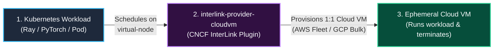
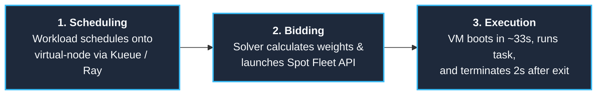
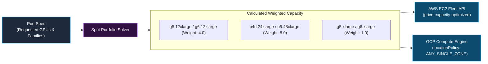
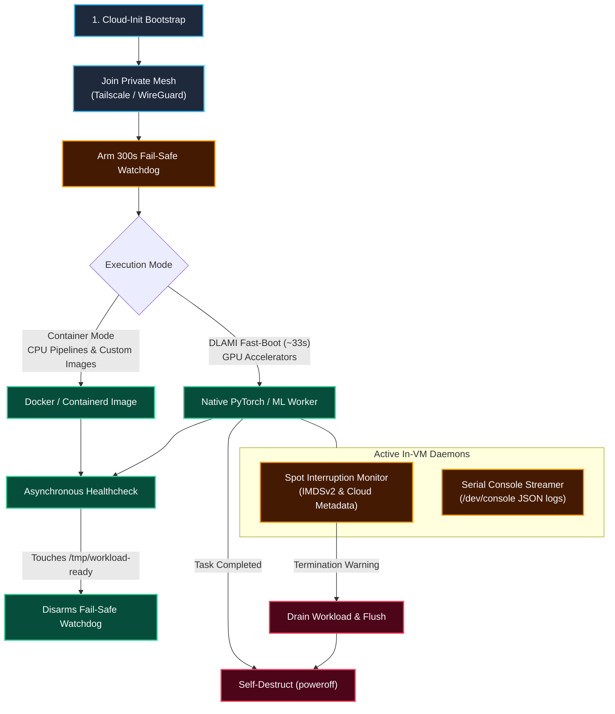
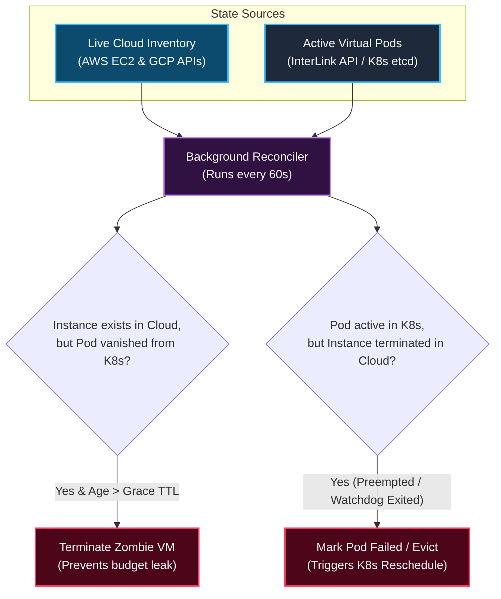
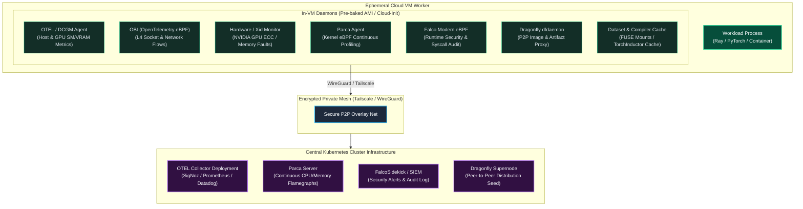
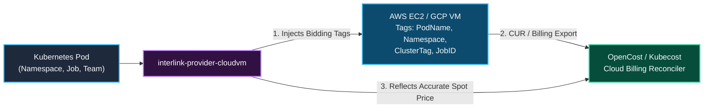

<h1 align="center">interlink-provider-cloudvm</h1>

<p align="center">
  <!-- Implementation -->
  <!-- Language - Go -->
  <a href="https://go.dev/">
    
  </a>
  <!-- Toolchain - mise -->
  <a href="https://mise.jdx.dev/">
    
  </a>
  <br>
  <!-- Verification -->
  <!-- CI - GitHub Actions -->
  <a href="https://github.com/simonepri/interlink-provider-cloudvm/actions/workflows/ci.yml">
    
  </a>
  <br>
  <!-- Distribution -->
  <!-- Release - Release Please -->
  <a href="https://github.com/googleapis/release-please">
    
  </a>
  <!-- Packaging - Helm -->
  <a href="https://helm.sh/">
    
  </a>
  <!-- Container - Docker -->
  <a href="https://www.docker.com/">
    
  </a>
  <!-- License - Apache 2.0 -->
  <a href="LICENSE">
    
  </a>
</p>

<p align="center">
  ⚡ Ultra-fast, multi-cloud Spot and On-Demand VM bursting for Kubernetes via CNCF InterLink.
</p>

---

## 1. High-Level Concept

`interlink-provider-cloudvm` is an open-source provider plugin for **[CNCF InterLink](https://github.com/interlink-hq/interLink)**. 

Its primary purpose is to solve the **Spot GPU bottleneck** in Kubernetes: allowing clusters to instantly tap into global, multi-region spot GPU fleets (e.g. NVIDIA A10G, L4, L40S, H100) with zero local node-pool overhead. It also seamlessly handles general-purpose CPU workloads (such as data preprocessing, ETL, and Ray data pipelines).



### The Problem It Solves

| | Traditional Kubernetes (Cluster Autoscaler / Karpenter) | `interlink-provider-cloudvm` |
| :--- | :--- | :--- |
| **Execution Model** | Provisions full nodes $\→$ registers `kubelet` $\→$ pulls images $\→$ schedules pods | **1 Pod = 1 Dedicated Cloud VM** |
| **GPU Cold-Start** | 3–5 minutes (node bootstrap + pulling 15GB CUDA container images) | **~33 seconds** (native pre-baked DLAMI execution) |
| **Geographic Scope** | Single VPC / Single Region | **Cross-Region & Multi-Cloud Fleet Arbitrage** |
| **Idle Cost** | Keeps empty nodes warm; consolidation and scale-down delay | **\$0** (VM terminates 2 seconds after the task process exits) |
| **Workload Scope** | Any Kubernetes workload | **Optimized for Spot GPUs**, fully supports CPU pipelines |

---

## 2. How It Works (Step-by-Step)

A workload progresses through three clean stages:



### Core Engines

To deliver this, `interlink-provider-cloudvm` is built on four core internal engines:

1. **Fleet Capacity Engine (Spot & On-Demand)**: Translates pod resource requirements into multi-family weighted fleet requests (`CreateFleet` / `bulkInsert`) across both Spot and On-Demand pools, with native hourly price capping (`cloudvm.vk.io/max-price`).
2. **Backpressure & Orchestrator Feedback Loop**: Emits real-time scheduling conditions (`CapacityExhausted`, `PriceCapExceeded`) back to Kubernetes, driving upstream multi-flavor fallback (Spot → On-Demand) and queue backoff in Kueue and cluster autoscalers.
3. **Hourly Spend Governors & Traffic Shaping**: Symmetrical burn-rate enforcement in `USD/hr` for both Compute (`cloudvm.vk.io/max-price`) and Network Egress (`cloudvm.vk.io/max-egress-rate`). Translates authorized egress dollars directly into kernel-level Token Bucket Filters (Linux `tc`), permitting native line-rate bursts while pacing sustained egress to avoid runaway bandwidth bills.
4. **Bidirectional Reconciler & FinOps Accounting**: A background reconciler that garbage collects zombie instances, synchronizes status, and maps cloud costs to Kubernetes pods for full **OpenCost** FinOps visibility.

---

## 3. Subsystem Deep Dives

### A. Spot Portfolio Solver & Weighted Capacity

When bidding for spot capacity across diversified GPU instance families (`g4dn`, `g5`, `g6`, `g6e`, `p4d`, `p5`), cloud fleet APIs count **instances**, not **GPUs**. Without weighting, requesting 8 units from a fleet containing `g5.12xlarge` (4 GPUs each) would launch 8 VMs with 32 GPUs total, quadrupling costs.

The solver computes **Weighted Capacity** based on physical accelerator counts:

$$\\sum (\\text{count}_i \\times \\text{weight}_i) = \\text{TargetCapacity}$$



| Instance Family | Physical GPUs | Calculated Weight | Fulfillment for 8 Requested GPUs |
| :--- | :---: | :---: | :--- |
| `g5.xlarge` / `g6.xlarge` | 1 | **1.0** | Provisions 8 VMs (8 × 1 = 8 GPUs) |
| `g5.12xlarge` / `g6.12xlarge` | 4 | **4.0** | Provisions 2 VMs (2 × 4 = 8 GPUs) |
| `p4d.24xlarge` / `p5.48xlarge` | 8 | **8.0** | Provisions 1 VM (1 × 8 = 8 GPUs) |

#### Multi-Cloud Placement Strategies
- **`price-capacity-optimized` (AWS EC2 Fleet)**: Filters for spot pools with the deepest available inventory (lowest preemption risk), then allocates the lowest-priced pool among them. Delivers 70–90% cost savings with spot stability.
- **`locationPolicy: ANY_SINGLE_ZONE` (GCP Compute Engine)**: Automatically places distributed worker batches in whichever single availability zone has enough spot capacity to host the entire group, eliminating cross-zone egress latency and inter-zone networking fees.

#### Request Idempotency & Hardware Pinning
- **Idempotent Launches**: Every EC2 Fleet request passes a unique `ClientToken: <cluster>-<pod>` derived from the Pod UID and Cluster Tag. Retries triggered by network timeouts or controller restarts are idempotent and cannot spin up duplicate duplicate instances.
- **Hardware Family Pinning**: When specific accelerator architectures are required (e.g. NVIDIA H100 vs A10G), users specify `cloudvm.vk.io/instance-type: "p4d.24xlarge"` or restrict candidate instance families. The solver only diversifies across user-approved families, preventing cheaper but incompatible GPUs from being selected.

---

### B. Backpressure Feedback Loop & On-Demand Capacity

When cloud capacity is constrained or spot pools dry up, the driver prevents API hammering and enables seamless fallback:


#### On-Demand & Spot Capacity Toggles
Workloads choose their capacity type via annotations:
- `cloudvm.vk.io/capacity-type: "on-demand"` (or `"spot"`, default)
- `cloudvm.vk.io/spot: "false"`

In AWS EC2 Fleet, the driver configures `TargetCapacityType: "on-demand"` with `AllocationStrategy: "lowest-price"`. In GCP, it provisions with `provisioningModel: "STANDARD"`.

#### Hourly Price Caps & Policies
To guard against spot pricing spikes, jobs specify a hard price ceiling and reaction policy:
- `cloudvm.vk.io/max-price: "2.50"` (Max USD/hr willing to pay)
- `cloudvm.vk.io/price-policy: "fail-fast"` (Default: immediate rejection if market price > cap)
- `cloudvm.vk.io/price-policy: "wait"` (Backpressure: keeps pod pending in Kueue until spot prices dip below cap)

---

### C. Network Egress Spend Governor (USD/hr) & Token Bucketing

Unrestricted cloud data egress (\$0.08–\$0.12/GB on AWS/GCP) can quickly outpace compute costs. A single instance saturating a 10 Gbps pipe can incur over **\$400/hour** in egress fees alone. Rather than imposing arbitrary speed limits that throttle performance during short checkpoint saves, `interlink-provider-cloudvm` enforces **Egress Spend Rate Governance (USD/hr)**.

```yaml
metadata:
  annotations:
    # Maximum authorized network egress spend rate in USD/hr
    cloudvm.vk.io/max-egress-rate: "$0.50"

    # Optional overrides for raw network bandwidth & burst
    cloudvm.vk.io/egress-bandwidth: "100Mbps"  # or kubernetes.io/egress-bandwidth
    cloudvm.vk.io/egress-burst: "100mb"        # Default burst allowance for checkpoints
```

#### How the Egress Spend Governor Works:
1. **Dynamic Dollar-to-Token Rate Translation**:
   The provider automatically translates your hourly budget ceiling into a kernel-level token rate based on the target cloud's egress pricing catalog (\$0.09/GB on AWS, \$0.085/GB on GCP):

   $$\text{Sustained Rate} = \frac{\text{MaxEgressRate}}{\text{CostPerGB}} \times \frac{8\text{ bits}}{\text{Byte}}$$

   For example, `\$0.90/hr` on AWS configures a sustained rate of **`22mbit`**.
2. **Instant Line-Rate Bursts**:
   The Token Bucket Filter is configured with a generous burst capacity (`100mb`). When a workload uploads periodic checkpoints or model weights, packets transfer at full **10 Gbps line speed** without penalty until tokens are depleted.
3. **Pacing Sustained Streams**:
   If an uncompressed dataset stream or rogue process attempts continuous high-speed egress, the kernel smoothly paces the traffic down to the authorized hourly spend rate. Compute is never killed, work is preserved, and your cloud bill is protected.
4. **Two-Band Priority Queue (Mesh Exemption)**:
   Linux Traffic Control (`tc`) configures a two-band priority scheduler (`prio bands 2`) on `eth0`:
   - **Band 1 (Unthrottled Priority)**: Kernel filters classify encapsulated WireGuard (`UDP 51820`) and Tailscale (`UDP 41641`) mesh packets directly into Band 1, allowing inter-node distributed training, Ray GCS communication, and P2P layer caching to operate at full wire speed.
   - **Band 2 (Spend Governed)**: All other outbound public internet packets flow through Band 2, governed by the Token Bucket Filter.
   > [!NOTE]
   > Encapsulated mesh packets that leave the VM to cross cloud regions or the public internet still incur standard cloud inter-region data transfer fees ($0.01–$0.02/GB). To eliminate mesh transfer fees entirely, place communicating workers in the same availability zone or VPC peering domain.

#### Comparison with SkyPilot Egress Handling:
SkyPilot addresses egress primarily via **smart placement** (co-locating compute in the region where data storage lives) and **application-level flags** (passing `--bwlimit` to `rsync` or `rclone`). SkyPilot does not provide host-level token bucket filters or dollar-based egress rate governance. `interlink-provider-cloudvm` combines native Kubernetes annotation compatibility with kernel-level traffic control.

---

### D. In-VM Ephemeral Lifecycle & Execution Modes

`interlink-provider-cloudvm` supports two runtime modes:

1. **Native DLAMI Fast-Boot (Optimized for GPU ML Workloads)**:
   - Utilizes the official **AWS Deep Learning AMI (DLAMI)**, which comes with NVIDIA drivers, CUDA, and PyTorch pre-installed on disk.
   - Bypasses pulling heavy 10–15GB container images over the network.
   - Reaches cluster-ready status in **~33 seconds**.
2. **Container Mode (Optimized for CPU & Custom Workloads)**:
   - Uses standard Docker/Containerd execution for CPU pipelines, data transformations, or custom application containers.
   - Ideal for Ray Data pipelines, ETL jobs, and batch CPU processing.



#### Watchdogs, Shutdown Guarantee & Dead-Man's Switch
- **Multi-Cloud Preemption Monitors**:
  - **AWS (120s window)**: Continuously polls IMDSv2 (`/latest/meta-data/spot/instance-action`) with token refresh. Triggers graceful drain 2 minutes before hypervisor termination.
  - **GCP (30s window)**: Polls metadata (`/computeMetadata/v1/instance/preempted`). Initiates fast checkpointing within the 30-second ACPI grace window.
- **Two-Phase Watchdog & Dead-Man's Switch**:
  - **Startup Watchdog (300s)**: Automatically terminates the instance if the workload container/script fails to verify healthy (`/tmp/workload-ready`) within 5 minutes.
  - **Post-Startup Dead-Man's Switch**: After becoming ready, the background monitor polls workload process liveness every 60s. If the target process exits or crashes without a clean shutdown, the VM immediately terminates itself, preventing zombie idle billing.
- **Guaranteed $0 Idle Cost (`InstanceInitiatedShutdownBehavior=terminate`)**:
  - On AWS, instances are explicitly configured with `instance-initiated-shutdown-behavior: terminate`. When the workload completes and runs `poweroff`, the instance transitions directly to `terminated`, completely releasing root EBS volumes and elastic IPs to prevent dangling storage costs.
- **Serial Console Telemetry**: Emits structured JSON state transitions (`BOOTING`, `RUNNING`, `SPOT_INTERRUPTION`, `HARDWARE_FAULT`) to `/dev/console` for auditability without requiring open SSH ports or credentials.

---

### C. Bidirectional Reconciler (Garbage Collection)

An asynchronous background loop runs every 60 seconds to synchronize Kubernetes Pod state with live cloud inventory:



---

## 4. Running Node Daemons on Ephemeral VMs

In traditional Kubernetes, infrastructure tools run as cluster-wide **DaemonSets**. Because `interlink-provider-cloudvm` provisions pure 1:1 cloud instances without a local Kubelet, DaemonSets do not schedule on ephemeral VMs.

Instead, the provider uses a **Split Observability & Security Architecture**:



### How Standard Infrastructure Daemons Run:

| Tool / Daemon | Traditional K8s DaemonSet | In Ephemeral CloudVM | Telemetry & Data Path |
| :--- | :--- | :--- | :--- |
| **OpenTelemetry (OTEL)** | OTEL DaemonSet scraping pods | Injected via pod env vars or host agent (`OTEL_EXPORTER_OTLP_ENDPOINT`) | OTLP gRPC over private mesh $\→$ central in-cluster OTEL Collector. |
| **OBI (OpenTelemetry eBPF)** | OBI DaemonSet (`preset: network`) | Runs as lightweight systemd service hooking kernel sockets | Exports `obi.network.flow.bytes` over mesh $\→$ central OTEL Collector / SigNoz. |
| **Parca** | Parca DaemonSet with host eBPF | Runs as systemd service with eBPF enabled on VM kernel | Continuously pushes pprof profiles over mesh $\→$ central Parca server. |
| **Falco** | Falco DaemonSet with kernel driver | Runs `falco --modern-bpf` with VM-level hypervisor isolation | Syscall violations forward via gRPC/HTTP $\→$ central `falcosidekick`. |
| **Dragonfly** | Dragonfly Dfdaemon DaemonSet | Runs local `dfdaemon` proxy redirecting `/etc/docker/daemon.json` | P2P block distribution across global VMs $\→$ avoids registry rate-limits. |
| **OpenCost / Kubecost** | cAdvisor / NodeExporter DaemonSet | Cloud resource tagging + CUR billing reconciliation + Virtual-Kubelet status pricing | Tags instances with `PodName`/`Namespace` $\→$ OpenCost attributes out-of-cluster cloud bills to K8s workloads. |
| **NVIDIA DCGM Exporter** (`gpu_operator`) | DCGM Exporter DaemonSet | Bundled in DLAMI or host OTEL collector scraping NVML | Pushes GPU SM utilization, Tensor core activity, and VRAM over mesh $\→$ central Prometheus / SigNoz. |
| **Node Problem Detector (NPD)** | Node Problem Detector DaemonSet | In-VM watchdog polling `dmesg` and NVML for GPU Xid / ECC errors | Emits structured `HARDWARE_FAULT` logs to serial console $\→$ provider evicts/reschedules pod. |
| **Storage FUSE Driver** (`csi_rclone`) | CSI Node Driver DaemonSet | In-VM `cloud-init` FUSE mount (`rclone mount` / `s3fs` / `gcsfuse`) | Mounts object storage buckets directly to `/mnt/data` before workload container boots. |
| **Torch Compile Cache** | Shared NFS or PVC compiler cache | S3/Dragonfly cache or pre-warmed Triton/Inductor kernel cache in Golden AMI | Eliminates 5–15 min CUDA compilation delays on every cold spot boot. |


### Storage, Compiler Caching & Hardware Health Deep Dive

Beyond telemetry and security, machine learning pipelines rely on three critical node-level primitives:

#### 1. Dataset & Model Weight Mounting (`csi_rclone` / FUSE)
Because Kubernetes CSI drivers cannot mount storage volumes onto virtual nodes across the off-cluster boundary, datasets and checkpoints are mounted at the hypervisor/host level during VM bootstrap:
- **Direct Object Storage Mounts**: `cloud-init` uses `rclone mount`, `s3fs`, or `gcsfuse` to expose remote buckets at `/mnt/data` or `/mnt/models` with multi-threaded read-ahead and local SSD kernel caching (`vfs-cache-mode: full`).
- **P2P Layer Distribution via Dragonfly**: Model weights and large binaries are pulled through the local `dfdaemon` proxy, taking advantage of P2P cache hits across the running fleet without slamming S3/GCS rate limits.

#### 2. PyTorch Compiler Cache (`torch_compile_cache`)
Modern PyTorch workflows using `torch.compile(mode="max-autotune")` compile dynamic CUDA kernels via Triton and PyTorch Inductor. Without cache sharing, newly booted spot instances incur a **5–15 minute CUDA kernel compilation penalty** before processing their first batch.
- **Golden AMI Pre-warming**: Standard foundation model kernels are compiled ahead-of-time (AOT) and saved to `/var/cache/torch/inductor` inside the Golden AMI.
- **Remote Artifact Sync**: Workloads configure `TORCHINDUCTOR_CACHE_DIR=/mnt/cache/inductor` pointing to a shared S3 gateway or local NVMe cache synchronized at boot.

#### 3. Hardware & GPU Problem Detection (`node_problem_detector`)
Cloud spot GPU instances occasionally experience hardware degradation (e.g. uncorrected ECC memory errors, NVLink failures, or GPU fall-off-bus with NVIDIA Xid errors 31, 45, or 79):
- The in-VM `spot-monitor.sh` background watcher continuously polls NVML:
  ```bash
  nvidia-smi --query-gpu=pstate,temperature.gpu,ecc.errors.uncorrected.volatile.total --format=csv,noheader
  ```
- If an uncorrected memory error or kernel Xid is detected, the watcher immediately sends:
  ```json
  CLOUDVM_STATUS: {"status": "HARDWARE_FAULT", "reason": "GPU_ECC_ERROR"}
  ```
  to `/dev/console`. The provider captures this via the cloud serial stream, marks the pod as `Failed` (Reason: `HardwareFault`), and re-queues the workload on a fresh instance without hanging indefinitely.

### Golden AMI vs. Dynamic Cloud-Init Injection

To maintain the **~33-second cold-start**, daemons can be packaged in two ways:
1. **Pre-baked Golden AMI (Recommended for Production)**: Tools (Parca, Falco, Dragonfly) are pre-installed into custom AMIs via Packer. The VM boots with all binaries and kernel eBPF probes already on disk—zero network downloads at runtime.
2. **Cloud-Init Systemd Hooks**: Lightweight binaries or systemd units are launched dynamically at boot through cloud-init user-data scripts.

### OpenCost & FinOps Cost Allocation (Outside Kubernetes)

A major challenge with virtual nodes and off-cluster cloud VMs is that traditional Kubernetes cost monitoring tools (such as **OpenCost** and **Kubecost**) rely on Kubernetes metrics APIs (`cadvisor` / `kubelet`) running directly on physical worker nodes. Because CloudVM instances run outside the Kubernetes node boundary, standard daemonsets cannot scrape their container cgroups.

`interlink-provider-cloudvm` provides seamless OpenCost and FinOps integration through three coordinated mechanisms:



#### 1. Bidirectional Resource Tagging (Cloud Billing Export)
When launching an EC2 Fleet or GCP bulk insert, `interlink-provider-cloudvm` stamps native cloud resource tags onto every instance and attached EBS volume:
- `ManagedBy: interlink-provider-cloudvm`
- `ClusterTag: <cluster-name>`
- `PodName: <pod-metadata-name>`
- `Namespace: <pod-metadata-namespace>`
- `CostCenter: <inherited-annotation>`

OpenCost's **Cloud Cost Reconciliation** pipeline ingests the AWS Cost and Usage Report (CUR) and GCP Cloud Billing BigQuery export. By matching the instance's `PodName` and `Namespace` tags, OpenCost automatically attributes 100% of out-of-cluster spot/on-demand VM compute and disk spend directly to the corresponding Kubernetes Namespace, Service, or Kueue Workload.

#### 2. Virtual-Kubelet Pod Resource Pricing
For real-time in-cluster cost estimation (before billing exports finalize 24 hours later), the provider surfaces the exact negotiated spot bid and instance type back to the Virtual-Kubelet node status. OpenCost reads the pod's declared CPU, GPU, and Memory limits against the real-time spot pricing model, accurately allocating costs across teams and jobs.

#### 3. Network Egress Cost Tracking
Because public egress flows across the shaped `eth0` interface, the VM's OTEL host agent or OBI eBPF probes stream total transmitted bytes (`obi.network.flow.bytes` and `node_network_transmit_bytes_total`) tagged with the pod name over the private mesh. OpenCost aggregates these metrics with cloud provider egress pricing tables to show precise network spend per pod.

### Why Ephemeral VMs Offer Stronger Security (Falco & eBPF)
On a multi-tenant Kubernetes worker node, a compromised container sharing the node kernel poses a risk to neighboring pods. With 1:1 ephemeral VMs:
- Each task runs inside its own **isolated hardware virtual machine** (AWS Nitro / GCP KVM).
- Falco and Parca monitor the dedicated kernel with zero interference from other tenants.
- When the task completes, the VM and its file systems are permanently deleted.


---

## 4. Operational Boundaries: When NOT to Use This

While `interlink-provider-cloudvm` is optimized for GPU-accelerated computing and large-scale batch processing, it is not suitable for every workload:

| Workload Characteristic | Why CloudVM is NOT Suitable | Recommended Alternative |
| :--- | :--- | :--- |
| **Microservices & Sub-Core Tasks** (e.g. 0.25 CPU, 512MB RAM) | 1 Pod = 1 Dedicated Cloud VM. Running tiny microservices on dedicated VMs wastes compute and incurs a 60-second cloud billing minimum. | Traditional Kubernetes worker nodes with **Karpenter** multi-tenant bin-packing. |
| **Short-Lived Tasks (< 60 seconds)** | AWS and GCP bill cloud instances with a **60-second minimum charge**. A 15-second task incurs 60 seconds of compute billing. | In-cluster warm pod pools or serverless functions (Knative / AWS Lambda). |
| **ReadWriteMany (RWX) Shared Block Storage** | Cloud VMs run in isolated VPCs and cannot attach traditional Kubernetes CSI block volumes across the virtual boundary. | Cloud-native object storage (S3 / GCS) via direct SDKs or `rclone` FUSE mounts. |

---

## 5. Failure Modes & Resilience Matrix

| Failure Event | Detection Mechanism | Automated Reaction | System State & Recovery |
| :--- | :--- | :--- | :--- |
| **Spot Market Preemption** | In-VM metadata monitor (IMDSv2 on AWS, metadata on GCP) | Workload captures notice (120s AWS, 30s GCP), flushes checkpoints, and powers off. | Reconciler detects instance exit; Pod marked `Failed` (Reason: `SpotInterruption`); Kueue re-queues. |
| **Cloud Capacity Pool Exhaustion** | Cloud API returns `InsufficientInstanceCapacity` / 429 | `/create` sets Pod condition `PodScheduled=False (CapacityExhausted)`. | Upstream orchestrator (Kueue) triggers fallback to On-Demand flavor or exponential queue backoff. |
| **Workload Initialization Failure** | In-VM 300s startup watchdog | Watchdog triggers `poweroff` after 300s without `/tmp/workload-ready`. | VM terminates; Reconciler evicts pod; prevents zombie idle billing. |
| **Workload Process Crash** | In-VM 60s dead-man's switch | Background monitor detects process vanished; executes `poweroff`. | Instance terminates immediately; Pod status updated to `Failed`. |
| **GPU Hardware / ECC Fault** | NVML background watcher polling Xid / uncorrected ECC | Emits `HARDWARE_FAULT` to `/dev/console`; triggers termination. | Reconciler flags hardware failure; scheduler avoids re-scheduling on faulty hardware. |
| **Control Plane Network Partition** | Background reconciler tracking instance timestamps | If pod object vanishes from K8s API for longer than grace TTL (default 10m), reconciler terminates cloud VM. | Prevents orphaned VMs from running indefinitely during network splits. |

## 6. Usage Examples

### Example 1: Spot GPU ML Worker (Fast-Boot)

```yaml
apiVersion: v1
kind: Pod
metadata:
  name: esm2-gpu-inference
  annotations:
    cloudvm.vk.io/provider: "aws"
    cloudvm.vk.io/capacity-type: "spot"
    cloudvm.vk.io/ami-mode: "dlami"
    cloudvm.vk.io/instance-type: "g5.xlarge"
spec:
  nodeSelector:
    kubernetes.io/role: cloudvm
  tolerations:
    - key: virtual-node.interlink/no-schedule
      operator: Exists
      effect: NoSchedule
  containers:
    - name: worker
      resources:
        limits:
          nvidia.com/gpu: "1"
```

### Example 2: Spot CPU Data Pipeline Worker (Container Mode)

```yaml
apiVersion: v1
kind: Pod
metadata:
  name: ray-data-transform
  annotations:
    cloudvm.vk.io/provider: "aws"
    cloudvm.vk.io/capacity-type: "spot"
    cloudvm.vk.io/instance-type: "c6i.2xlarge"
spec:
  nodeSelector:
    kubernetes.io/role: cloudvm
  tolerations:
    - key: virtual-node.interlink/no-schedule
      operator: Exists
      effect: NoSchedule
  containers:
    - name: worker
      image: rayproject/ray:2.44.0
      env:
        - name: RAY_HEAD_ADDRESS
          value: "ray-head.default.svc.cluster.local:6379"
      resources:
        limits:
          cpu: "8"
          memory: "16Gi"
```

---

## 7. Installation via Helm

```bash
helm upgrade --install interlink-provider-cloudvm \
  oci://ghcr.io/simonepri/charts/interlink-provider-cloudvm \
  --namespace interlink \
  --create-namespace \
  --set provider.type=aws \
  --set provider.awsRegion=us-east-1
```

---

## 8. Development

```bash
# Install toolchain
mise install

# Run static verification gate and unit tests
mise run verify

# Build binary
mise run build
```

---

## License

[Apache 2.0](LICENSE) © 2026 Simone Primarosa