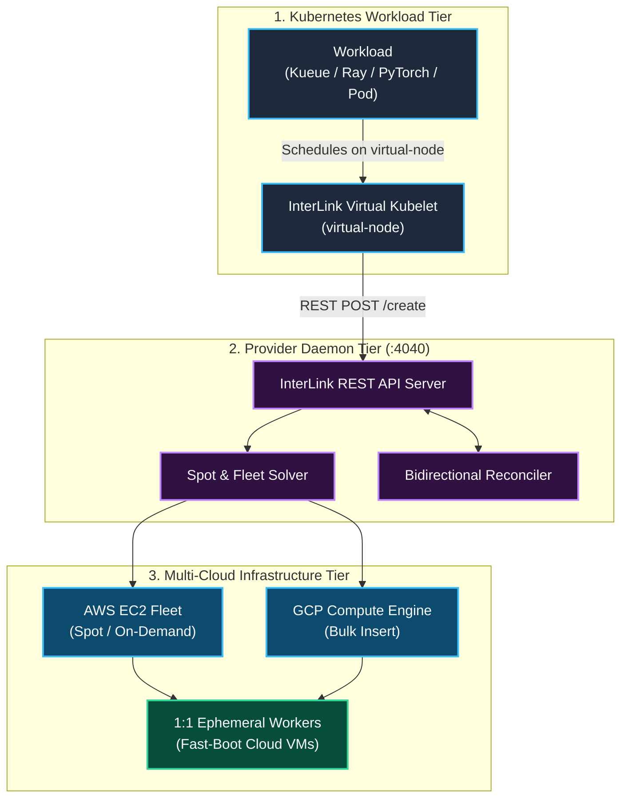
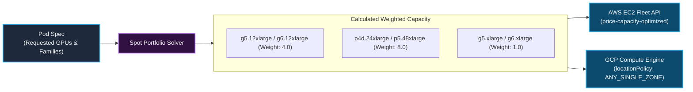
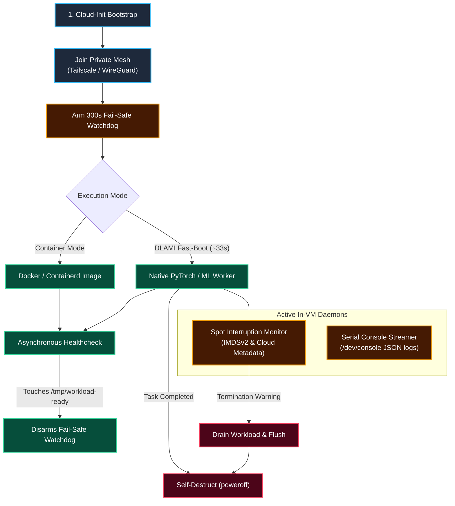
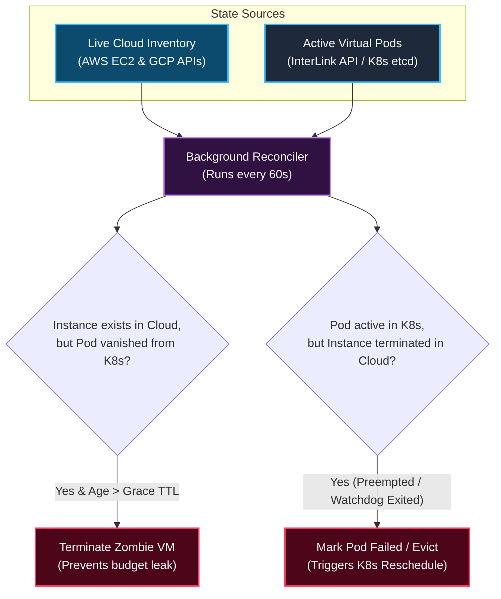

<h1 align="center">interlink-provider-cloudvm</h1>

<p align="center">
  <!-- Implementation -->
  <!-- Language - Go -->
  <a href="https://go.dev/">
    
  </a>
  <!-- Toolchain - mise -->
  <a href="https://mise.jdx.dev/">
    
  </a>
  <br>
  <!-- Verification -->
  <!-- CI - GitHub Actions -->
  <a href="https://github.com/simonepri/interlink-provider-cloudvm/actions/workflows/ci.yml">
    
  </a>
  <br>
  <!-- Distribution -->
  <!-- Release - Release Please -->
  <a href="https://github.com/googleapis/release-please">
    
  </a>
  <!-- Packaging - Helm -->
  <a href="https://helm.sh/">
    
  </a>
  <!-- Container - Docker -->
  <a href="https://www.docker.com/">
    
  </a>
  <!-- License - Apache 2.0 -->
  <a href="LICENSE">
    
  </a>
</p>

<p align="center">
  ⚡ Ultra-fast, multi-cloud Spot and On-Demand VM bursting for Kubernetes via CNCF InterLink.
</p>

---

## Overview

`interlink-provider-cloudvm` is an open-source provider plugin for **[CNCF InterLink](https://github.com/interlink-hq/interLink)**. It allows Kubernetes clusters to burst computational workloads (such as distributed Ray clusters, PyTorch training, or batch genomics pipelines) directly onto opportunistic cloud virtual machines (**AWS EC2 Fleet**, **GCP Compute Engine**) without running local node pools or waiting for traditional Cluster Autoscalers.



---

## Core Subsystems

### 1. Spot Portfolio Solver & Weighted Capacity

When bidding for spot capacity across heterogeneous GPU instance families (`g4dn`, `g5`, `g6`, `p4d`, `p5`), default cloud fleet APIs treat each instance as `1 unit`. Without weighting, requesting 8 units from a fleet containing `g5.12xlarge` (4 GPUs each) would launch 8 instances with 32 GPUs total, multiplying cloud costs fourfold.

The solver calculates exact **Weighted Capacity** based on physical accelerator count:

$$\\sum (\\text{count}_i \\times \\text{weight}_i) = \\text{TargetCapacity}$$



| Instance Family | Physical GPUs | Calculated Weight | Fulfillment for 8 Requested GPUs |
| :--- | :---: | :---: | :--- |
| `g5.xlarge` / `g6.xlarge` | 1 | **1.0** | Provisions 8 VMs (8 × 1 = 8 GPUs) |
| `g5.12xlarge` / `g6.12xlarge` | 4 | **4.0** | Provisions 2 VMs (2 × 4 = 8 GPUs) |
| `p4d.24xlarge` / `p5.48xlarge` | 8 | **8.0** | Provisions 1 VM (1 × 8 = 8 GPUs) |

#### Fleet Allocation Strategies

- **`price-capacity-optimized` (AWS)**: Analyzes historical spot interruption data to identify deep capacity pools, then selects the lowest-priced pool among them. This provides 70–90% cost savings with the lowest preemption frequency.
- **`locationPolicy: ANY_SINGLE_ZONE` (GCP)**: Dynamically selects whichever availability zone in a target region currently has sufficient spot inventory to fulfill the entire requested batch, avoiding inter-zone network egress latency and cross-zone traffic costs.

---

### 2. In-VM Ephemeral Lifecycle & Fast-Boot

Traditional Kubernetes nodes take 3–5 minutes to become ready: VM boot (~45s), Kubelet and CNI initialization (~45s), and pulling 10–15GB CUDA/PyTorch container images over the network (60–180s). During spot preemption, this delay halts distributed computation.

`interlink-provider-cloudvm` introduces **Native DLAMI Fast-Boot**:
- **DLAMI (Deep Learning Amazon Machine Image)**: Official cloud images with pre-installed NVIDIA drivers, CUDA toolkits, and PyTorch runtimes directly on disk.
- **~33-Second Cold Start**: By running natively within the pre-warmed DLAMI environment, the worker process launches directly without pulling heavy container layers, achieving cold-start-to-cluster readiness in ~33 seconds.
- **Container Mode**: Standard container execution (Docker / Containerd) remains available for custom images.



#### In-VM Watchdogs & Telemetry
- **2-Minute Preemption Monitor**: Continuously polls AWS IMDSv2 metadata (`/latest/meta-data/spot/instance-action`) and GCP metadata (`/computeMetadata/v1/instance/preempted`) to trigger graceful worker drains before eviction.
- **300s Fail-Safe Self-Destruct**: Shuts down the machine if workload initialization fails within 5 minutes, preventing budget leaks from orphaned instances.
- **Serial Console Telemetry**: Streams structured status heartbeats to `/dev/console`, allowing `kubectl logs` and status tracking without maintaining open SSH ports or credentials.

---

### 3. Bidirectional Reconciler (Garbage Collection)

An asynchronous reconciliation loop runs every 60 seconds to synchronize Kubernetes Pod state with live cloud provider inventory:



---

## Usage

Workloads target the `cloudvm` virtual node using standard InterLink annotations:

```yaml
apiVersion: v1
kind: Pod
metadata:
  name: gpu-inference-worker
  annotations:
    cloudvm-job.vk.io/provider: "aws"
    cloudvm-job.vk.io/capacity-type: "spot"
    cloudvm-job.vk.io/ami-mode: "dlami"
    cloudvm-job.vk.io/instance-type: "g5.xlarge"
spec:
  nodeSelector:
    kubernetes.io/role: cloudvm
  tolerations:
    - key: virtual-node.interlink/no-schedule
      operator: Exists
      effect: NoSchedule
  containers:
    - name: worker
      resources:
        limits:
          nvidia.com/gpu: "1"
```

---

## Installation via Helm

```bash
helm upgrade --install interlink-provider-cloudvm \
  oci://ghcr.io/simonepri/charts/interlink-provider-cloudvm \
  --namespace interlink \
  --create-namespace \
  --set provider.type=aws \
  --set provider.awsRegion=us-east-1
```

---

## Development

```bash
# Install toolchain
mise install

# Run static checks and unit tests
mise run verify

# Build binary
mise run build
```

---

## License

[Apache 2.0](LICENSE) © 2026 Simone Primarosa
