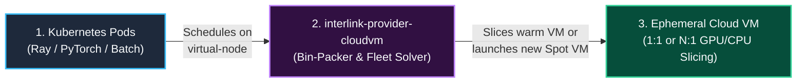
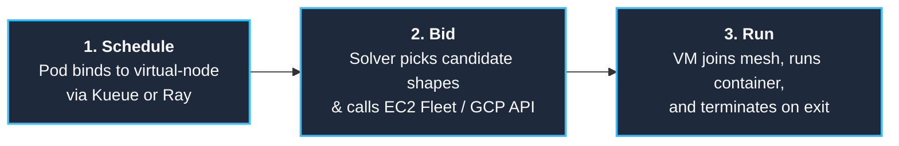
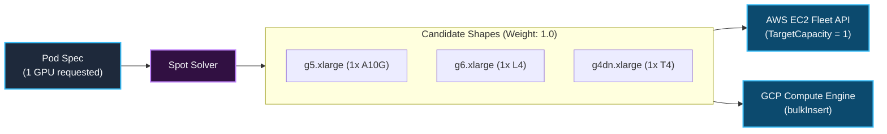
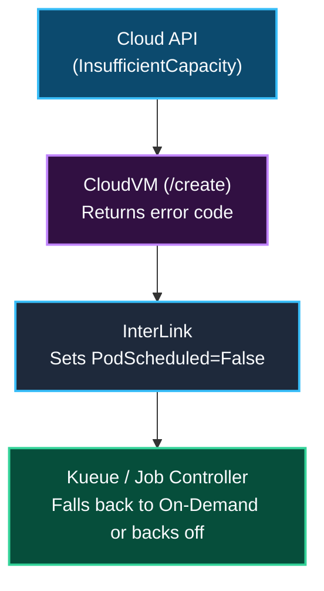
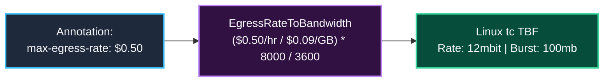
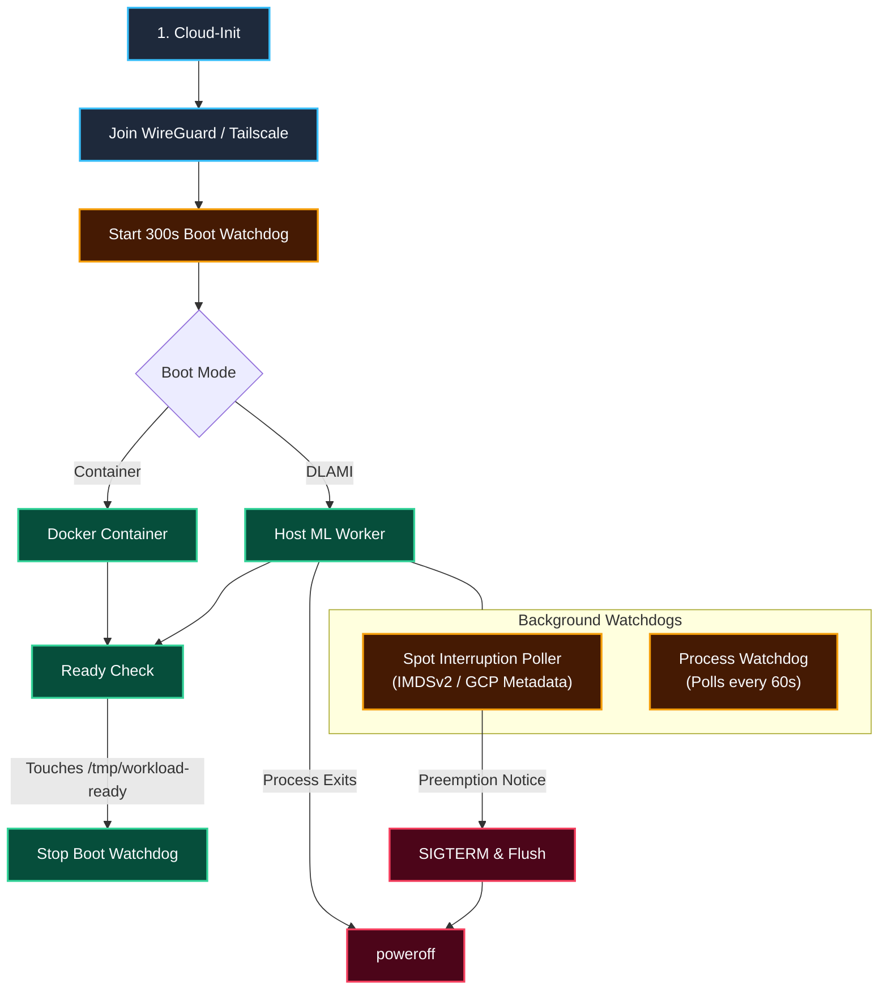
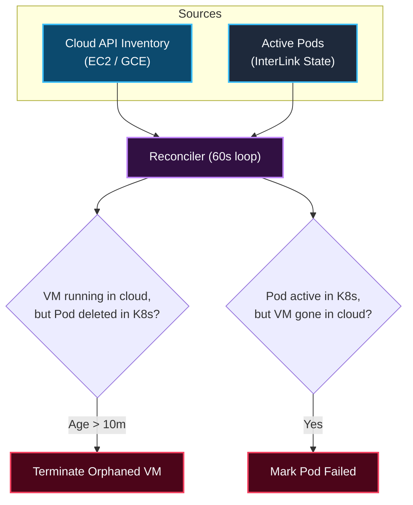
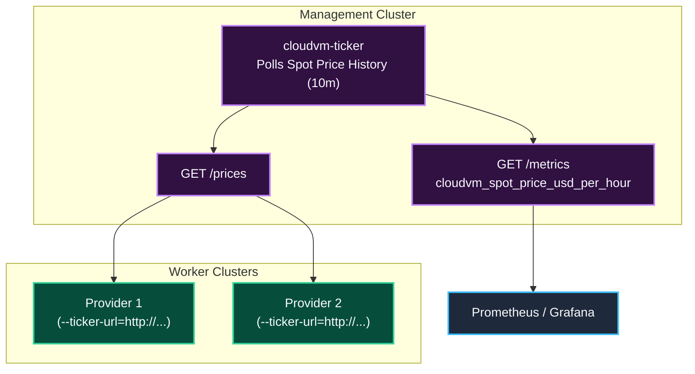

<h1 align="center">interlink-provider-cloudvm</h1>

<p align="center">
  <!-- Implementation -->
  <a href="https://go.dev/">
    
  </a>
  <!-- Toolchain - mise -->
  <a href="https://mise.jdx.dev/">
    
  </a>
  <br>
  <!-- Verification -->
  <a href="https://github.com/simonepri/interlink-provider-cloudvm/actions/workflows/ci.yml">
    
  </a>
  <br>
  <!-- Distribution -->
  <a href="https://github.com/googleapis/release-please">
    
  </a>
  <a href="https://helm.sh/">
    
  </a>
  <a href="https://www.docker.com/">
    
  </a>
  <a href="LICENSE">
    
  </a>
</p>

<p align="center">
  Multi-cloud Spot and On-Demand VM bursting for Kubernetes via CNCF InterLink.
</p>

---

## Overview

`interlink-provider-cloudvm` is a **[CNCF InterLink](https://github.com/interlink-hq/interLink)** provider plugin that lets a Kubernetes cluster burst pods directly onto ephemeral cloud VMs across regions and cloud providers.

When a single region runs out of spot GPUs (A10G, L4, L40S, H100), in-cluster autoscalers get stuck in `Pending` because they can only launch nodes inside the local cluster VPC. `interlink-provider-cloudvm` bypasses that limit by turning scheduled pods into standalone EC2 Fleet or GCP Compute Engine requests in any target region, connecting the VM back to the cluster over a private WireGuard mesh.



### In-Cluster Autoscaling vs. Virtual Bursting

Most setups run both side-by-side:
- **In-Cluster Nodes (Karpenter / Cluster Autoscaler)**: Run persistent services, Ray head nodes, Kueue controllers, databases, and low-latency workloads inside the cluster VPC.
- **Burst Virtual Nodes (`interlink-provider-cloudvm`)**: Run stateless GPU/CPU batch jobs across external regions and spot pools when local capacity is full or too expensive.

| Capability | In-Cluster Autoscaler (Karpenter) | `interlink-provider-cloudvm` |
| :--- | :---: | :---: |
| **Primary Role** | Local steady-state & stateful services | Multi-region & multi-cloud batch burst |
| **Geographic Scope** | ❌ Single VPC & region | ✅ Any region or cloud via WireGuard |
| **Spot Pool Access** | ❌ Local AZs only | ✅ Cross-region price & capacity arbitrage |
| **Node Bootstrap** | ⚠️ Kubelet join + CNI + DaemonSets | ✅ Boots straight into workload |
| **Cluster Overhead** | ⚠️ `Node` object in etcd + VPC IPs | ✅ Single static virtual node, 0 VPC IPs |
| **Packing & Isolation** | ⚠️ Shared host kernel across pods | ✅ 1:1 dedicated VM or N:1 GPU/CPU bin-packing |
| **Persistent Volumes (CSI)** | ✅ Native EBS / CSI mounts | ❌ S3 / GCS / FUSE mounts only |
| **Idle Cost** | Consolidation & scale-down cooldown | **`$0`** (VM powers off on process exit) |

---

## Architecture



The provider consists of five main components:

1. **Multi-Pod Bin-Packer (`NodePool`)**: Tracks free CPU, memory, and discrete GPU/TPU device slots across active VMs using `k8s.io/apimachinery/pkg/api/resource`. If a 4-GPU pod lands on an 8-GPU spot VM (`g5.48xlarge` or `p4d.24xlarge`), a second 4-GPU pod packs straight into the remaining 4 GPUs (`[4,5,6,7]`) without booting another VM.
2. **Fleet Solver**: On a bin-pack miss, maps pod resource requests (`nvidia.com/gpu`, `google.com/tpu`, CPU, memory) to equivalent cloud instance types (`CreateFleet` on AWS, `bulkInsert` on GCP) with optional hourly price caps (`cloudvm.vk.io/max-price`).
3. **Backpressure Loop**: Returns capacity status (`CapacityExhausted`, `PriceCapExceeded`) to Kubernetes so job queues like Kueue can fall back to on-demand or another region.
4. **Egress Spend Governor**: Converts an hourly dollar budget (`cloudvm.vk.io/max-egress-rate: "$0.50"`) into a Linux `tc` Token Bucket Filter on `eth0`, throttling public internet egress while leaving private mesh traffic untouched.
5. **Reconciler & Cost Tagging**: Polls cloud APIs every 60s to clean up orphaned VMs, update pod states on spot preemption, and tag instances/EBS volumes for OpenCost billing reports.

---

## Core Subsystems

### 1. Spot Fleet Bidding & Multi-Pod Bin-Packing (N Pods to 1 VM)

When a pod schedules onto the virtual node, the provider first checks its `NodePool` for an active VM in the target region with enough free CPU, memory, and discrete accelerator slots (`NodeResourcesMostAllocated` scoring):

- **Bin-Pack Hit (< 1s)**: If a previous 4-GPU pod triggered an 8-GPU spot instance (for example, when 4-GPU spot pools were empty and an 8-GPU `g5.48xlarge` was allocated), the provider assigns the free GPU slots (`NVIDIA_VISIBLE_DEVICES=4,5,6,7`) and starts the second pod on the same warm VM immediately.
- **Bin-Pack Miss**: If no warm VM can fit the pod, the solver builds a list of compatible shapes and calls the cloud API for a `price-capacity-optimized` allocation (`TotalTargetCapacity = 1`).
- **Co-Tenant Lifecycle**: Deleting one pod on a shared VM releases its GPU/CPU slots while keeping the VM alive for remaining co-tenants. The VM only terminates when the last pod on it exits (or after the 60s idle grace window).



| Pod Request | Fleet Target | Candidate Shapes | Result |
| :--- | :---: | :--- | :--- |
| **1 GPU** | 1 VM | `g5.xlarge`, `g6.xlarge`, `g4dn.xlarge` | 1 VM with 1 GPU |
| **4 GPUs** | 1 VM | `g5.12xlarge`, `g5.24xlarge`, `g6.12xlarge` | 1 VM with 4 GPUs |
| **8 GPUs** | 1 VM | `p5.48xlarge`, `p4de.24xlarge`, `g5.48xlarge` | 1 VM with 8 GPUs |

> [!NOTE]
> Multi-node jobs (distributed PyTorch, Ray clusters) run as multiple Kubernetes pods. Each worker pod binds to the virtual node and gets its own VM.

- **Idempotency**: Every AWS `CreateFleet` call sets a deterministic `ClientToken` (`cvm-<uid>-<namespace>-<pod>`) with the Pod UID first. Network retries will not launch duplicate VMs.
- **Hardware Pinning**: If a workload requires a specific GPU architecture, set `cloudvm.vk.io/instance-type: "p4d.24xlarge"` on the pod.

---

### 2. Capacity Backpressure & Kueue Integration

When spot pools are empty or above the price cap, the provider fails fast so upstream controllers can react instead of hanging:



- `CapacityExhausted`: Requested spot pools have no capacity in the target region.
- `PriceCapExceeded`: Current spot price is higher than `cloudvm.vk.io/max-price`.

---

### 3. Egress Rate Limiting (Linux `tc`)

Cloud internet egress ($0.09/GB on AWS, $0.085/GB on GCP) can easily surprise teams running data-heavy jobs. Setting `cloudvm.vk.io/max-egress-rate: "$0.50"` caps public egress spend at $0.50/hr by configuring a Linux `tc` Token Bucket Filter at boot:



`tc` sets up a two-band priority queue (`prio bands 2`) on `eth0`:
- **Band 1 (Unthrottled)**: WireGuard (`UDP 51820`) and Tailscale (`UDP 41641`) mesh traffic bypasses the rate limit so cluster heartbeats and Ray GCS traffic are never throttled.
- **Band 2 (Throttled)**: All other outbound traffic goes through the Token Bucket Filter.

---

### 4. VM Boot Lifecycle & Watchdogs

The provider supports two boot modes:
1. **DLAMI Mode (`cloudvm.vk.io/ami-mode: "dlami"`)**: Boots an AWS Deep Learning AMI with NVIDIA drivers, CUDA, and PyTorch pre-installed on disk.
2. **Container Mode (Default)**: Pulls and runs the pod's container image via Docker/Containerd.



- **Spot Interruption Poller**: Polls AWS IMDSv2 (`/latest/meta-data/spot/instance-action`, 120s warning) or GCP metadata (`/computeMetadata/v1/instance/preempted`, 30s warning) and sends `SIGTERM` to the container before shutting down.
- **300s Boot Watchdog**: Powers off the VM if the container fails to start within 5 minutes, preventing stuck VMs from accruing charges.
- **Process Exit Hook**: AWS VMs launch with `InstanceInitiatedShutdownBehavior=terminate`. As soon as the container exits and `cloud-init` runs `poweroff`, AWS terminates the instance and deletes its root EBS volume.

---

### 5. Reconciler & Zombie Cleanup

A background loop runs every 60 seconds in the provider to keep Kubernetes and cloud state in sync:



---

### 6. Spot Price Ticker (`cloudvm-ticker`)

To avoid hitting AWS/GCP API rate limits when running multiple provider instances, spot price polling can be separated into a standalone `cloudvm-ticker` deployment:



- **Embedded Mode (Default)**: The provider polls spot prices directly every `10m ± 2m`.
- **Central Ticker Mode**: Deploy the `cloudvm-ticker` Helm chart once and point providers at `--ticker-url=http://cloudvm-ticker.monitoring.svc:8080`.

---

### 7. Cost Allocation (OpenCost)

Because burst VMs do not run Kubelet or cAdvisor, cost attribution relies on cloud billing tags. Every instance and EBS volume is tagged on creation:
- `ManagedBy: interlink-provider-cloudvm`
- `ClusterTag: <cluster-name>`
- `PodName: <pod-name>`
- `Namespace: <pod-namespace>`
- `PodUID: <pod-uid>`
- `CostCenter: <cost-center>`
- `JobID: <job-id>`

OpenCost ingests these tags from the AWS Cost and Usage Report (CUR) or GCP billing export to map VM spend back to Kubernetes namespaces and jobs.

---

### 8. Replacing Node DaemonSets on Bare VMs

Standard Kubernetes DaemonSets do not run on InterLink virtual nodes. Instead, host-level tools are configured via `cloud-init` or pre-baked into the VM image:

| Kubernetes DaemonSet | CloudVM Equivalent | How It Runs | Purpose |
| :--- | :--- | :--- | :--- |
| **CSI FUSE Driver** (`csi-rclone`) | `rclone mount` / `s3fs` / `gcsfuse` | `cloud-init` service | Mounts S3/GCS buckets to `/mnt/data` before the container starts. |
| **Torch Compile Cache** | Pre-populated kernel cache in AMI | Local disk / S3 | Avoids 5-15 minute Triton/Inductor compilation on cold boot. |
| **Node Problem Detector** | NVML health check script | Host cron / systemd | Checks for GPU Xid/ECC errors and exits the VM if a card fails. |
| **DCGM Exporter** | Host OTEL / DCGM agent | Systemd service | Pushes GPU utilization and memory metrics over the WireGuard mesh. |

---

## Security & Isolation

1. **VM-Level Isolation**: Each job runs in a dedicated cloud VM (AWS Nitro / GCP KVM) with its own kernel and ephemeral root disk.
2. **IMDSv2 Hop Limit**: AWS instances enforce IMDSv2 with `HttpPutResponseHopLimit: 1`, blocking containers from stealing host IAM role credentials via `169.254.169.254`.
3. **No Inbound SSH**: VMs join the WireGuard/Tailscale mesh without `--ssh` enabled and with no inbound ports open on the cloud security group.
4. **Ephemeral Mesh Keys**: Mesh auth keys are scoped to short-lived tags.

---

## When NOT to Use This

| Workload Type | Why It Fits Poorly | Use This Instead |
| :--- | :--- | :--- |
| **Tightly Coupled Multi-Node Training** (e.g. 400-3200 Gbps EFA/RoCE NCCL all-reduce) | WireGuard overlays are built for control-plane traffic and Ray GCS coordination, not multi-hundred-gigabit RDMA tensor parallelism. | Same-AZ GPU placement groups with AWS EFA or GCP GPUDirect-TCPXO. |
| **Small Microservices** (e.g. 0.25 vCPU, 512MB RAM) | Launching a dedicated VM per pod wastes capacity and hits the 60-second cloud billing minimum. | Standard Kubernetes nodes managed by **Karpenter**. |
| **Multi-Container Pods with Shared Volumes** | Only the primary workload container runs on the VM; Kubernetes `ConfigMap` and `Secret` volume mounts are not projected into the VM filesystem. | In-cluster node pools, or pass config via environment variables and S3. |
| **Sub-Minute Tasks (< 60s)** | Cloud providers charge a 60-second minimum per VM launch, and VM boot takes ~30-60s. | Warm in-cluster pod pools or serverless functions. |

---

## Failure Modes

| Event | How It's Detected | What Happens | Recovery |
| :--- | :--- | :--- | :--- |
| **Spot Preemption** | In-VM poller checks IMDSv2 / GCP metadata | Sends `SIGTERM` to workload (120s on AWS, 30s on GCP), flushes logs, and powers off. | Reconciler marks pod `Failed (SpotInterruption)`; job controller re-queues. |
| **Spot Pool Empty** | Cloud API returns `InsufficientInstanceCapacity` | `/create` fails immediately and sets `PodScheduled=False (CapacityExhausted)`. | Kueue falls back to on-demand flavor or retries with backoff. |
| **Container Fails to Start** | 300s boot watchdog on the VM | Watchdog powers off the VM if `/tmp/workload-ready` is not created within 5m. | VM terminates; pod is marked `Failed`. |
| **Container Crashes** | 60s process liveness check | Script sees container exited and runs `poweroff`. | VM terminates; pod is marked `Failed`. |
| **Control Plane Disconnected** | Provider reconciler loop | If the pod no longer exists in Kubernetes after 10m, the provider terminates the VM via cloud API. | Prevents orphaned VMs from running if the cluster loses connectivity. |

---

## Usage Examples

### Example 1: Spot GPU Job (DLAMI Fast-Boot)

```yaml
apiVersion: v1
kind: Pod
metadata:
  name: gpu-inference-worker
  annotations:
    cloudvm.vk.io/provider: "aws"
    cloudvm.vk.io/capacity-type: "spot"
    cloudvm.vk.io/ami-mode: "dlami"
    cloudvm.vk.io/instance-type: "g5.xlarge"
    cloudvm.vk.io/max-price: "2.50"
    cloudvm.vk.io/max-egress-rate: "$0.50"
spec:
  nodeSelector:
    kubernetes.io/role: cloudvm
  tolerations:
    - key: virtual-node.interlink/no-schedule
      operator: Exists
      effect: NoSchedule
  containers:
    - name: worker
      resources:
        limits:
          nvidia.com/gpu: "1"
```

### Example 2: Spot CPU Worker (Container Mode)

```yaml
apiVersion: v1
kind: Pod
metadata:
  name: ray-data-worker
  annotations:
    cloudvm.vk.io/provider: "aws"
    cloudvm.vk.io/capacity-type: "spot"
    cloudvm.vk.io/instance-type: "c6i.2xlarge"
spec:
  nodeSelector:
    kubernetes.io/role: cloudvm
  tolerations:
    - key: virtual-node.interlink/no-schedule
      operator: Exists
      effect: NoSchedule
  containers:
    - name: worker
      image: rayproject/ray:2.44.0
      env:
        - name: RAY_HEAD_ADDRESS
          value: "ray-head.default.svc.cluster.local:6379"
      resources:
        limits:
          cpu: "8"
          memory: "16Gi"
```

---

## Installation

### Provider Chart

```bash
helm upgrade --install interlink-provider-cloudvm \
  oci://ghcr.io/simonepri/charts/interlink-provider-cloudvm \
  --namespace interlink \
  --create-namespace \
  --set provider.type=aws \
  --set provider.awsRegion=us-east-1
```

### Spot Price Ticker Chart (Optional)

```bash
helm upgrade --install cloudvm-ticker \
  oci://ghcr.io/simonepri/charts/cloudvm-ticker \
  --namespace monitoring \
  --create-namespace \
  --set serviceMonitor.enabled=true
```

---

## Development

Requires [mise](https://mise.jdx.dev/) for tool management.

```bash
# Install Go, linters, and Helm
mise install

# Run all linters, security checks, and tests
mise run verify

# Run unit tests with race detector
mise run test

# Build binary to ./bin/interlink-provider-cloudvm
mise run build
```
