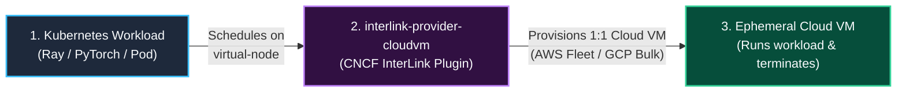
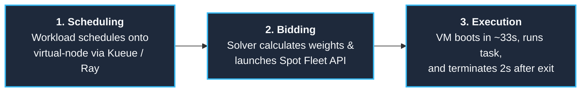
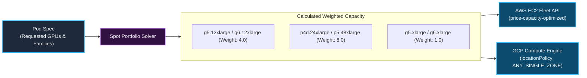
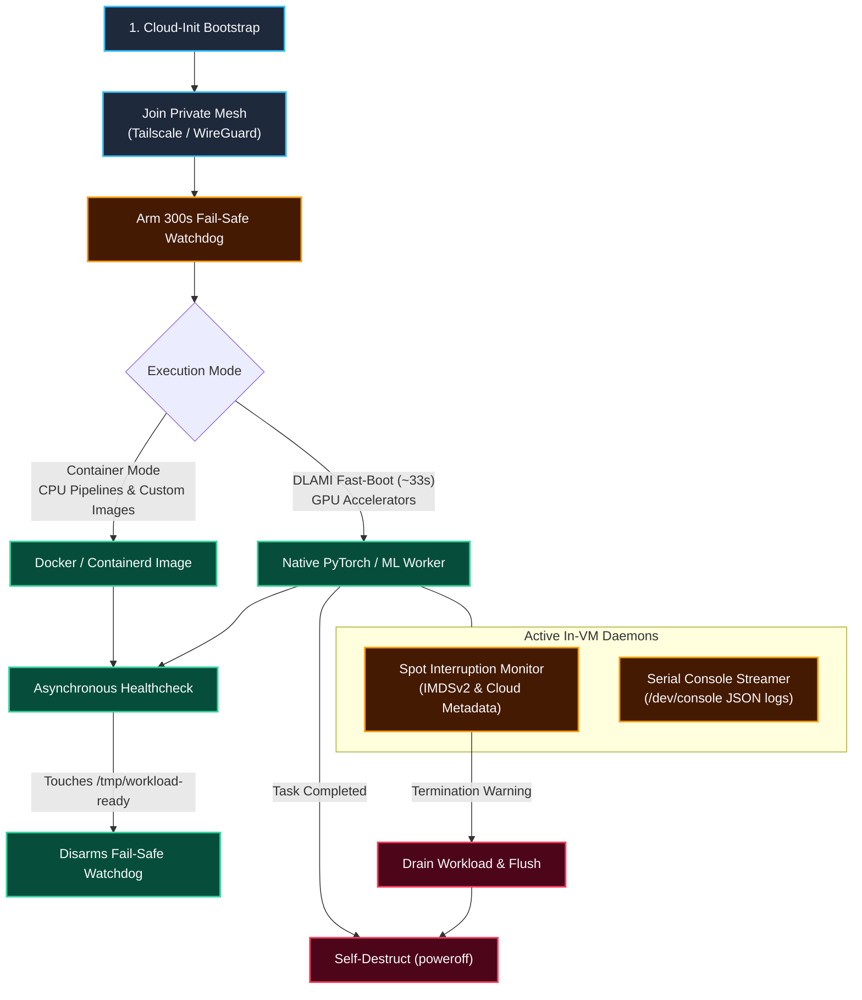
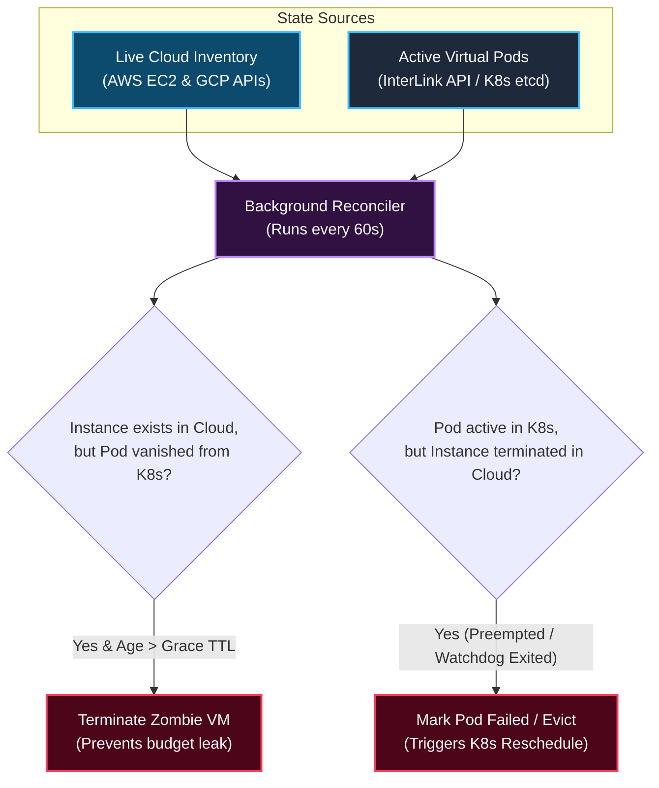
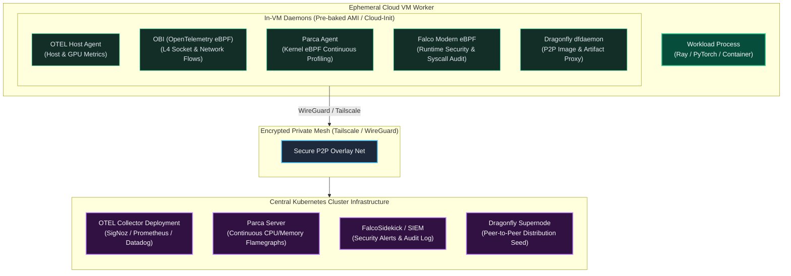

<h1 align="center">interlink-provider-cloudvm</h1>

<p align="center">
  <!-- Implementation -->
  <!-- Language - Go -->
  <a href="https://go.dev/">
    
  </a>
  <!-- Toolchain - mise -->
  <a href="https://mise.jdx.dev/">
    
  </a>
  <br>
  <!-- Verification -->
  <!-- CI - GitHub Actions -->
  <a href="https://github.com/simonepri/interlink-provider-cloudvm/actions/workflows/ci.yml">
    
  </a>
  <br>
  <!-- Distribution -->
  <!-- Release - Release Please -->
  <a href="https://github.com/googleapis/release-please">
    
  </a>
  <!-- Packaging - Helm -->
  <a href="https://helm.sh/">
    
  </a>
  <!-- Container - Docker -->
  <a href="https://www.docker.com/">
    
  </a>
  <!-- License - Apache 2.0 -->
  <a href="LICENSE">
    
  </a>
</p>

<p align="center">
  ⚡ Ultra-fast, multi-cloud Spot and On-Demand VM bursting for Kubernetes via CNCF InterLink.
</p>

---

## 1. High-Level Concept

`interlink-provider-cloudvm` is an open-source provider plugin for **[CNCF InterLink](https://github.com/interlink-hq/interLink)**. 

Its primary purpose is to solve the **Spot GPU bottleneck** in Kubernetes: allowing clusters to instantly tap into global, multi-region spot GPU fleets (e.g. NVIDIA A10G, L4, L40S, H100) with zero local node-pool overhead. It also seamlessly handles general-purpose CPU workloads (such as data preprocessing, ETL, and Ray data pipelines).



### The Problem It Solves

| | Traditional Kubernetes (Cluster Autoscaler / Karpenter) | `interlink-provider-cloudvm` |
| :--- | :--- | :--- |
| **Execution Model** | Provisions full nodes $\\to$ registers `kubelet` $\\to$ pulls images $\\to$ schedules pods | **1 Pod = 1 Dedicated Cloud VM** |
| **GPU Cold-Start** | 3–5 minutes (node bootstrap + pulling 15GB CUDA container images) | **~33 seconds** (native pre-baked DLAMI execution) |
| **Geographic Scope** | Single VPC / Single Region | **Cross-Region & Multi-Cloud Fleet Arbitrage** |
| **Idle Cost** | Keeps empty nodes warm; consolidation and scale-down delay | **$0** (VM terminates 2 seconds after the task process exits) |
| **Workload Scope** | Any Kubernetes workload | **Optimized for Spot GPUs**, fully supports CPU pipelines |

---

## 2. How It Works (Step-by-Step)

A workload progresses through three clean stages:



### Core Engines

To deliver this, `interlink-provider-cloudvm` is built on three core internal engines:

1. **Spot Portfolio Solver**: Translates pod resource requirements into multi-family weighted fleet requests (`CreateFleet` / `bulkInsert`) to bid at the lowest spot price without overprovisioning.
2. **In-VM Ephemeral Bootstrap & Watchdogs**: A hardened cloud-init engine providing fast native boot (~33s), P2P WireGuard mesh networking, a 2-minute preemption watcher, and a self-destruct watchdog.
3. **Bidirectional Reconciler**: A background garbage collector that terminates orphan/zombie cloud VMs if pods vanish, and evicts pods from Kubernetes if cloud instances are preempted.

---

## 3. Subsystem Deep Dives

### A. Spot Portfolio Solver & Weighted Capacity

When bidding for spot capacity across diversified GPU instance families (`g4dn`, `g5`, `g6`, `g6e`, `p4d`, `p5`), cloud fleet APIs count **instances**, not **GPUs**. Without weighting, requesting 8 units from a fleet containing `g5.12xlarge` (4 GPUs each) would launch 8 VMs with 32 GPUs total, quadrupling costs.

The solver computes **Weighted Capacity** based on physical accelerator counts:

$$\\sum (\\text{count}_i \\times \\text{weight}_i) = \\text{TargetCapacity}$$



| Instance Family | Physical GPUs | Calculated Weight | Fulfillment for 8 Requested GPUs |
| :--- | :---: | :---: | :--- |
| `g5.xlarge` / `g6.xlarge` | 1 | **1.0** | Provisions 8 VMs (8 × 1 = 8 GPUs) |
| `g5.12xlarge` / `g6.12xlarge` | 4 | **4.0** | Provisions 2 VMs (2 × 4 = 8 GPUs) |
| `p4d.24xlarge` / `p5.48xlarge` | 8 | **8.0** | Provisions 1 VM (1 × 8 = 8 GPUs) |

#### Multi-Cloud Placement Strategies
- **`price-capacity-optimized` (AWS EC2 Fleet)**: Filters for spot pools with the deepest available inventory (lowest preemption risk), then allocates the lowest-priced pool among them. Delivers 70–90% cost savings with industry-leading spot stability.
- **`locationPolicy: ANY_SINGLE_ZONE` (GCP Compute Engine)**: Automatically places distributed worker batches in whichever single availability zone has enough spot capacity to host the entire group, eliminating cross-zone egress latency and inter-zone networking fees.

---

### B. In-VM Ephemeral Lifecycle & Execution Modes

`interlink-provider-cloudvm` supports two runtime modes:

1. **Native DLAMI Fast-Boot (Optimized for GPU ML Workloads)**:
   - Utilizes the official **AWS Deep Learning AMI (DLAMI)**, which comes with NVIDIA drivers, CUDA, and PyTorch pre-installed on disk.
   - Bypasses pulling heavy 10–15GB container images over the network.
   - Reaches cluster-ready status in **~33 seconds**.
2. **Container Mode (Optimized for CPU & Custom Workloads)**:
   - Uses standard Docker/Containerd execution for CPU pipelines, data transformations, or custom application containers.
   - Ideal for Ray Data pipelines, ETL jobs, and batch CPU processing.



#### Watchdogs & Telemetry
- **2-Minute Preemption Monitor**: Continuously polls AWS IMDSv2 metadata (`/latest/meta-data/spot/instance-action`) and GCP metadata (`/computeMetadata/v1/instance/preempted`) to cleanly drain workers and checkpoint state prior to eviction.
- **300s Fail-Safe Self-Destruct**: Shuts down the machine if workload initialization fails within 5 minutes, preventing budget leaks from orphaned instances.
- **Serial Console Telemetry**: Emits structured heartbeats to `/dev/console` (read via cloud serial port APIs), enabling `kubectl logs` without open SSH ports or credentials.

---

### C. Bidirectional Reconciler (Garbage Collection)

An asynchronous background loop runs every 60 seconds to synchronize Kubernetes Pod state with live cloud inventory:



---

## 4. Running Node Daemons on Ephemeral VMs

In traditional Kubernetes, infrastructure tools run as cluster-wide **DaemonSets**. Because `interlink-provider-cloudvm` provisions pure 1:1 cloud instances without a local Kubelet, DaemonSets do not schedule on ephemeral VMs.

Instead, the provider uses a **Split Observability & Security Architecture**:



### How Standard Infrastructure Daemons Run:

| Tool / Daemon | Traditional K8s DaemonSet | In Ephemeral CloudVM | Telemetry & Data Path |
| :--- | :--- | :--- | :--- |
| **OpenTelemetry (OTEL)** | OTEL DaemonSet scraping pods | Injected via pod env vars or host agent (`OTEL_EXPORTER_OTLP_ENDPOINT`) | OTLP gRPC over private mesh $\\to$ central in-cluster OTEL Collector. |
| **OBI (OpenTelemetry eBPF)** | OBI DaemonSet (`preset: network`) | Runs as lightweight systemd service hooking kernel sockets | Exports `obi.network.flow.bytes` over mesh $\\to$ central OTEL Collector / SigNoz. |
| **Parca** | Parca DaemonSet with host eBPF | Runs as systemd service with eBPF enabled on VM kernel | Continuously pushes pprof profiles over mesh $\\to$ central Parca server. |
| **Falco** | Falco DaemonSet with kernel driver | Runs `falco --modern-bpf` with VM-level hypervisor isolation | Syscall violations forward via gRPC/HTTP $\\to$ central `falcosidekick`. |
| **Dragonfly** | Dragonfly Dfdaemon DaemonSet | Runs local `dfdaemon` proxy redirecting `/etc/docker/daemon.json` | P2P block distribution across global VMs $\\to$ avoids registry rate-limits. |

### Golden AMI vs. Dynamic Cloud-Init Injection

To maintain the **~33-second cold-start**, daemons can be packaged in two ways:
1. **Pre-baked Golden AMI (Recommended for Production)**: Tools (Parca, Falco, Dragonfly) are pre-installed into custom AMIs via Packer. The VM boots with all binaries and kernel eBPF probes already on disk—zero network downloads at runtime.
2. **Cloud-Init Systemd Hooks**: Lightweight binaries or systemd units are launched dynamically at boot through cloud-init user-data scripts.

### Why Ephemeral VMs Offer Stronger Security (Falco & eBPF)
On a multi-tenant Kubernetes worker node, a compromised container sharing the node kernel poses a risk to neighboring pods. With 1:1 ephemeral VMs:
- Each task runs inside its own **isolated hardware virtual machine** (AWS Nitro / GCP KVM).
- Falco and Parca monitor the dedicated kernel with zero interference from other tenants.
- When the task completes, the VM and its file systems are permanently deleted.

## 5. Usage Examples

### Example 1: Spot GPU ML Worker (Fast-Boot)

```yaml
apiVersion: v1
kind: Pod
metadata:
  name: esm2-gpu-inference
  annotations:
    cloudvm-job.vk.io/provider: "aws"
    cloudvm-job.vk.io/capacity-type: "spot"
    cloudvm-job.vk.io/ami-mode: "dlami"
    cloudvm-job.vk.io/instance-type: "g5.xlarge"
spec:
  nodeSelector:
    kubernetes.io/role: cloudvm
  tolerations:
    - key: virtual-node.interlink/no-schedule
      operator: Exists
      effect: NoSchedule
  containers:
    - name: worker
      resources:
        limits:
          nvidia.com/gpu: "1"
```

### Example 2: Spot CPU Data Pipeline Worker (Container Mode)

```yaml
apiVersion: v1
kind: Pod
metadata:
  name: ray-data-transform
  annotations:
    cloudvm-job.vk.io/provider: "aws"
    cloudvm-job.vk.io/capacity-type: "spot"
    cloudvm-job.vk.io/instance-type: "c6i.2xlarge"
spec:
  nodeSelector:
    kubernetes.io/role: cloudvm
  tolerations:
    - key: virtual-node.interlink/no-schedule
      operator: Exists
      effect: NoSchedule
  containers:
    - name: worker
      image: rayproject/ray:2.44.0
      env:
        - name: RAY_HEAD_ADDRESS
          value: "ray-head.default.svc.cluster.local:6379"
      resources:
        limits:
          cpu: "8"
          memory: "16Gi"
```

---

## 6. Installation via Helm

```bash
helm upgrade --install interlink-provider-cloudvm \
  oci://ghcr.io/simonepri/charts/interlink-provider-cloudvm \
  --namespace interlink \
  --create-namespace \
  --set provider.type=aws \
  --set provider.awsRegion=us-east-1
```

---

## 7. Development

```bash
# Install toolchain
mise install

# Run static verification gate and unit tests
mise run verify

# Build binary
mise run build
```

---

## License

[Apache 2.0](LICENSE) © 2026 Simone Primarosa
