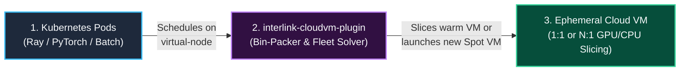
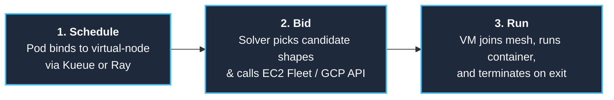
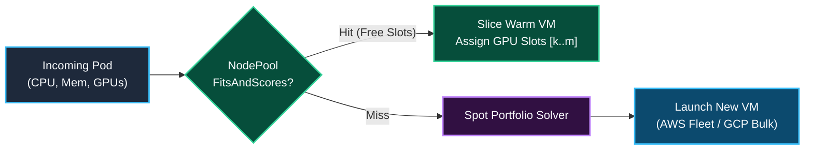
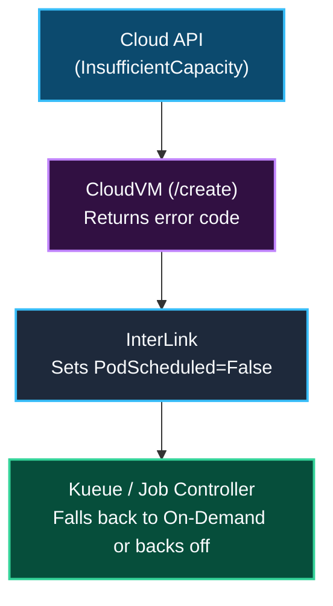
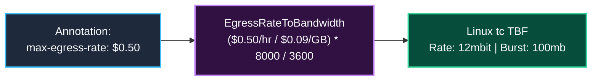
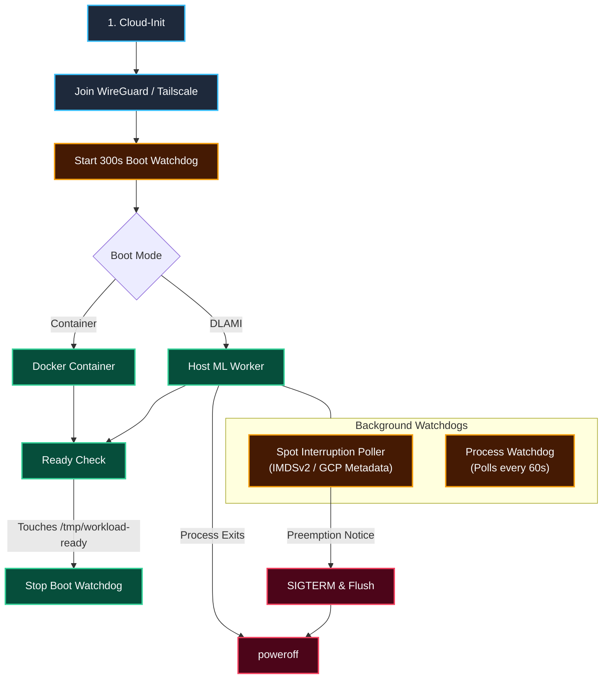
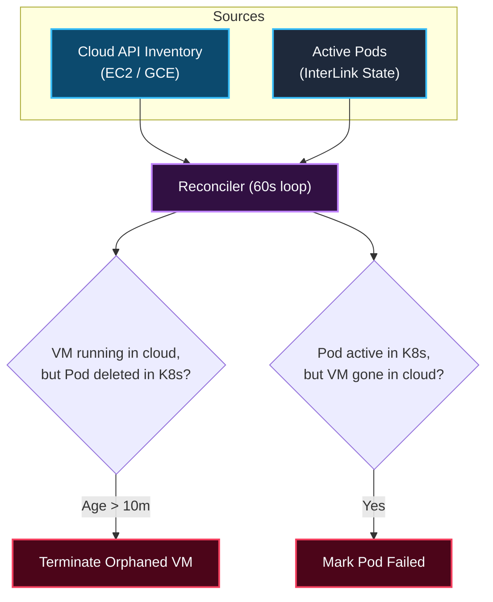
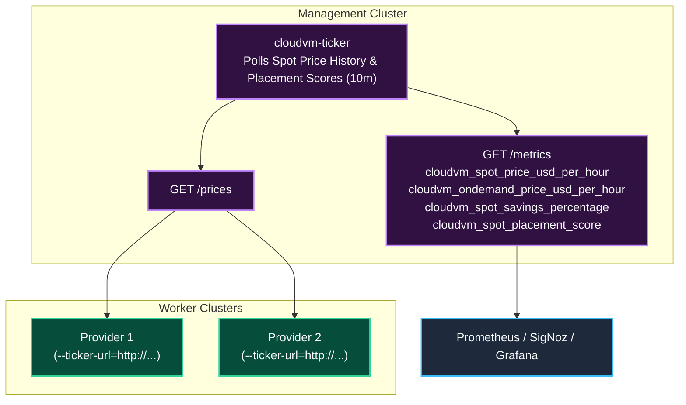

<h1 align="center">interlink-cloudvm-plugin</h1>

<p align="center">
  <!-- Implementation -->
  <a href="https://go.dev/">
    
  </a>
  <!-- Toolchain - mise -->
  <a href="https://mise.jdx.dev/">
    
  </a>
  <br>
  <!-- Verification -->
  <a href="https://github.com/simonepri/interlink-cloudvm-plugin/actions/workflows/ci.yml">
    
  </a>
  <br>
  <!-- Distribution -->
  <a href="https://github.com/googleapis/release-please">
    
  </a>
  <a href="https://helm.sh/">
    
  </a>
  <a href="https://www.docker.com/">
    
  </a>
  <a href="LICENSE">
    
  </a>
</p>

<p align="center">
  Multi-cloud Spot and On-Demand VM bursting for Kubernetes via CNCF InterLink.
</p>

---

## Overview

`interlink-cloudvm-plugin` is a **[CNCF InterLink](https://github.com/interlink-hq/interLink)** provider plugin that lets a Kubernetes cluster burst pods directly onto ephemeral cloud VMs across regions and cloud providers.

When a single region runs out of spot GPUs (A10G, L4, L40S, H100), in-cluster autoscalers get stuck in `Pending` because they can only launch nodes inside the local cluster VPC. `interlink-cloudvm-plugin` bypasses that limit by turning scheduled pods into standalone EC2 Fleet or GCP Compute Engine requests in any target region, connecting the VM back to the cluster over a private WireGuard mesh.



### In-Cluster Autoscaling vs. Virtual Bursting

Most setups run both side-by-side:
- **In-Cluster Nodes (Karpenter / Cluster Autoscaler)**: Run persistent services, Ray head nodes, Kueue controllers, databases, and low-latency workloads inside the cluster VPC.
- **Burst Virtual Nodes (`interlink-cloudvm-plugin`)**: Run stateless GPU/CPU batch jobs across external regions and spot pools when local capacity is full or too expensive.

| Capability | In-Cluster Autoscaler (Karpenter) | `interlink-cloudvm-plugin` |
| :--- | :--- | :--- |
| **Primary Role** | Local steady-state & stateful services | Multi-region & multi-cloud batch burst |
| **Geographic Scope** | Single VPC & region | Any region or cloud via WireGuard |
| **Spot Pool Access** | Local AZs only | Cross-region price & capacity arbitrage |
| **Node Bootstrap** | Kubelet join + CNI + DaemonSets | Boots straight into workload |
| **Cluster Overhead** | `Node` object in etcd + VPC IPs | Single static virtual node, 0 VPC IPs |
| **Packing & Isolation** | Shared host kernel across pods | 1:1 dedicated VM or same-namespace N:1 bin-packing |
| **Persistent Volumes (CSI)** | Native EBS / CSI mounts | S3 / GCS / FUSE mounts only |
| **Idle Cost** | Consolidation & scale-down cooldown | `$0` when last pod on VM exits |

---

## Architecture



The provider consists of five main components:

1. **Multi-Pod Bin-Packer (`NodePool`)**: Tracks free CPU, memory, and discrete GPU/TPU device slots across active VMs using `k8s.io/apimachinery/pkg/api/resource`. If a 4-GPU pod lands on an 8-GPU spot VM (`g5.48xlarge` or `p4d.24xlarge`), a second 4-GPU pod packs straight into the remaining 4 GPUs (`[4,5,6,7]`) without booting another VM.
2. **Fleet Solver**: On a bin-pack miss, maps pod resource requests (`nvidia.com/gpu`, `google.com/tpu`, CPU, memory) to equivalent cloud instance types (`CreateFleet` on AWS, `bulkInsert` on GCP) with optional hourly price caps (`cloudvm.vk.io/max-price`).
3. **Backpressure Loop**: Returns capacity status (`CapacityExhausted`, `PriceCapExceeded`) to Kubernetes so job queues like Kueue can fall back to on-demand or another region.
4. **Egress Spend Governor**: Converts an hourly dollar budget (`cloudvm.vk.io/max-egress-rate: "$0.50"`) into a Linux `tc` Token Bucket Filter on `eth0`, throttling public internet egress while leaving private mesh traffic untouched.
5. **Reconciler & Cost Tagging**: Polls cloud APIs every 60s to clean up orphaned VMs, update pod states on spot preemption, and tag instances/EBS volumes for OpenCost billing reports.

---

## Core Subsystems

### 1. Spot Fleet Bidding & Multi-Pod Bin-Packing (N Pods to 1 VM)

When a pod schedules onto the virtual node, the provider first checks `NodePool` for an active VM in the same namespace and region that has enough free CPU, memory, and discrete GPU/TPU slots (`NodeResourcesMostAllocated` scoring):

- **Bin-Pack Hit**: If an active VM has free capacity (for example, an 8-GPU `g5.48xlarge` currently running a single 4-GPU pod on GPUs `[0..3]`), the provider assigns the remaining GPU slots (`[4..7]`) and dispatches the second pod onto that warm VM without calling EC2/GCE.
- **Bin-Pack Miss**: If no active VM can fit the request, the solver builds a list of candidate instance types and requests a new VM (`price-capacity-optimized` on AWS EC2 Fleet, `bulkInsert` on GCP).
- **Co-Tenant Lifecycle**: Deleting one pod on a shared VM releases its GPU/CPU slots while keeping the VM running for remaining pods. The cloud VM is only terminated once its last active pod finishes.



| Scenario | Pod Request | Provisioned VM Shape | NodePool Allocation |
| :--- | :--- | :--- | :--- |
| **Exact 1:1 Fit** | 1 GPU (`16Gi` RAM) | `g5.xlarge` (`1` GPU, `16Gi`) | Pod 1 gets GPU `[0]` (VM 100% full) |
| **Oversized Spot VM (Pod 1)** | 4 GPUs (`64Gi` RAM) | `g5.48xlarge` (`8` GPUs, `768Gi`) | Launches 1 VM; Pod 1 gets GPUs `[0,1,2,3]` |
| **Oversized Spot VM (Pod 2)** | 4 GPUs (`64Gi` RAM) | *Reuses warm `g5.48xlarge`* | **0 VMs launched**; Pod 2 gets GPUs `[4,5,6,7]` |
| **CPU Batch Slicing** | 4 Pods x `8` vCPU | `c6i.8xlarge` (`32` vCPU, `64Gi`) | All 4 pods pack onto 1 shared VM |

- **Idempotency**: Every AWS `CreateFleet` call sets a deterministic `ClientToken` (`cvm-<uid>-<namespace>-<pod>`) with the Pod UID first so network retries never launch duplicate VMs.
- **Hardware Pinning**: To require a specific instance shape, set `cloudvm.vk.io/instance-type: "p4d.24xlarge"` on the pod.

---

### 2. Capacity Backpressure & Kueue Integration

When spot pools are empty or above the price cap, the provider fails fast so upstream controllers can react instead of hanging:



- `CapacityExhausted`: Requested spot pools have no capacity in the target region.
- `PriceCapExceeded`: Current spot price is higher than `cloudvm.vk.io/max-price`.

---

### 3. Egress Rate Limiting (Linux `tc`)

Cloud internet egress ($0.09/GB on AWS, $0.085/GB on GCP) can easily surprise teams running data-heavy jobs. Setting `cloudvm.vk.io/max-egress-rate: "$0.50"` caps public egress spend at $0.50/hr by configuring a Linux `tc` Token Bucket Filter at boot:



`tc` sets up a two-band priority queue (`prio bands 2`) on `eth0`:
- **Band 1 (Unthrottled)**: WireGuard (`UDP 51820`) and Tailscale (`UDP 41641`) mesh traffic bypasses the rate limit so cluster heartbeats and Ray GCS traffic are never throttled.
- **Band 2 (Throttled)**: All other outbound traffic goes through the Token Bucket Filter.

---

### 4. VM Boot Lifecycle & Watchdogs

The provider supports two boot modes:
1. **DLAMI Mode (`cloudvm.vk.io/ami-mode: "dlami"`)**: Boots an AWS Deep Learning AMI with NVIDIA drivers, CUDA, and PyTorch pre-installed on disk.
2. **Container Mode (Default)**: Pulls and runs the pod's container image via Docker/Containerd.



- **Spot Interruption Poller**: Polls AWS IMDSv2 (`/latest/meta-data/spot/instance-action`, 120s warning) or GCP metadata (`/computeMetadata/v1/instance/preempted`, 30s warning) and sends `SIGTERM` to the container before shutting down.
- **300s Boot Watchdog**: Powers off the VM if the container fails to start within 5 minutes, preventing stuck VMs from accruing charges.
- **Process Exit Hook**: AWS VMs launch with `InstanceInitiatedShutdownBehavior=terminate`. As soon as the container exits and `cloud-init` runs `poweroff`, AWS terminates the instance and deletes its root EBS volume.

---

### 5. Reconciler & Zombie Cleanup

A background loop runs every 60 seconds in the provider to keep Kubernetes and cloud state in sync:



---

### 6. Spot Price Ticker, Placement Scores, and Cost Metrics (`cloudvm-ticker`)

To avoid hitting AWS/GCP API rate limits when running multiple provider instances, spot price polling, placement score analysis, and cost benchmarking can be separated into a standalone `cloudvm-ticker` deployment:



- **Embedded Mode (Default)**: The provider polls spot prices and placement scores directly every `10m ± 2m`.
- **Central Ticker Mode**: Deploy the `cloudvm-ticker` Helm chart once and point providers at `--ticker-url=http://cloudvm-ticker.monitoring.svc:8080`.
- **Exposed Prometheus Metrics**:
  - `cloudvm_spot_price_usd_per_hour{region, instance_type}`: Current AWS EC2 Spot price per hour.
  - `cloudvm_ondemand_price_usd_per_hour{region, instance_type}`: Baseline AWS EC2 On-Demand list price per hour.
  - `cloudvm_spot_savings_percentage{region, instance_type}`: Percentage savings of Spot compared to On-Demand ((OnDemand - Spot) / OnDemand * 100).
  - `cloudvm_spot_placement_score{region, instance_type}`: Real-time AWS Spot Placement Score (1 to 10 scale) indicating likelihood of successful spot instance fulfillment with low preemption risk.

**Fill plans.** For every GPU count in `LADDER_SIZES` and memory floor in `LADDER_MEMORY_TIERS`, the ticker plans the cheapest way to get that many GPUs. It takes spot GPUs first, but in each region only up to the largest probed count at which every smaller probe also scores at least 3, then covers the rest with on-demand GPUs. Each step takes the offer with the lowest cost per GPU still needed, so a whole instance larger than the remainder is priced at what it costs. Both stay within the region's EC2 quotas, which every instance type of a family (G or P) shares; an offer whose quota could not be read is not planned. To score spot capacity, the ticker asks [`GetSpotPlacementScores`](https://docs.aws.amazon.com/AWSEC2/latest/APIReference/API_GetSpotPlacementScores.html), for each memory floor and GPUs-per-instance size, about the tracked shapes of that size at 8, 64, and 256 GPUs; a region with no score gets no spot GPUs of that size. GCP offers have neither scores nor quotas yet, so plans use AWS only. Expected GPUs count each spot GPU at its score divided by 10 and each on-demand GPU in full; AWS does not calibrate the scores as probabilities, so treat the result as a ranking signal.

  - `cloudvm_spot_capacity_score{provider, region, min_gpu_memory_gb, gpus_per_instance, gpus}`: Spot placement score for getting that many GPUs in shapes of that size at that memory floor.
  - `cloudvm_fill_price_usd_per_gpu_hour{min_gpu_memory_gb, gpus}`, `cloudvm_fill_planned_gpus{...}`, `cloudvm_fill_expected_gpus{...}`: Blended price, planned GPUs (whole instances can exceed the target), and expected GPUs of each plan.
  - `cloudvm_fill_gpus{min_gpu_memory_gb, gpus, provider, region, gpu_model, capacity_type}`: GPUs a plan takes from one region, GPU model, and capacity type.
  - `cloudvm_fill_limited{min_gpu_memory_gb, gpus, reason}`: 1 when a plan falls short, with `reason` `quota`, `no_quota_data`, or `capacity`.

---

### 7. Cost Allocation (OpenCost)

Because burst VMs do not run Kubelet or cAdvisor, cost attribution relies on cloud billing tags. Every instance and EBS volume is tagged on creation:
- `ManagedBy: interlink-cloudvm-plugin`
- `ClusterTag: <cluster-name>`
- `PodName: <pod-name>`
- `Namespace: <pod-namespace>`
- `PodUID: <pod-uid>`
- `CostCenter: <cost-center>`
- `JobID: <job-id>`

OpenCost ingests these tags from the AWS Cost and Usage Report (CUR) or GCP billing export to map VM spend back to Kubernetes namespaces and jobs.

---

### 8. Replacing Node DaemonSets on Bare VMs

Standard Kubernetes DaemonSets do not run on InterLink virtual nodes. Instead, host-level tools are configured via `cloud-init` or pre-baked into the VM image:

| Kubernetes DaemonSet | CloudVM Equivalent | How It Runs | Purpose |
| :--- | :--- | :--- | :--- |
| **CSI FUSE Driver** (`csi-rclone`) | `rclone mount` / `s3fs` / `gcsfuse` | `cloud-init` service | Mounts S3/GCS buckets to `/mnt/data` before the container starts. |
| **Torch Compile Cache** | Pre-populated kernel cache in AMI | Local disk / S3 | Avoids 5-15 minute Triton/Inductor compilation on cold boot. |
| **Node Problem Detector** (`ENABLE_NPD=true`) | Embedded standalone NPD agent | Host systemd service | Checks GPU Xid/ECC errors, kernel deadlocks, and driver faults; terminates unhealthy VMs cleanly. |
| **DCGM Exporter / OTEL** (`OTEL_ENDPOINT`) | Host OTEL Collector / Vector | Systemd service | Ships GPU telemetry, container logs, and system metrics directly to central SigNoz/Honeycomb. |
| **Log collector** (`CLOUDVM_OTLP_LOGS_ENDPOINT`) | Tunnel agent log stream | Reverse tunnel session | The tunnel agent streams the bootstrap log, runner log, and `docker logs` of each pod container over its tunnel; the plugin forwards them as OTLP/HTTP logs tagged `cloudvm.instance_id`, `cloudvm.region`, `k8s.pod.name`, and `k8s.namespace.name`, and keeps the last 128 KiB of each pod's container output for `kubectl logs`. |
| **Pull-Through Cache** (`REGISTRY_MIRRORS`) | Docker / containerd registry mirrors | Host daemon config | Pulls container images via local cluster caches (Harbor, Spegel) avoiding Docker Hub limits. |
| **Custom Bootstrap** (`CUSTOM_BOOTSTRAP_SCRIPT`) | Shell script execution hook | `cloud-init` execution | Allows mounting NFS/EFS/FSx shares, enrolling security agents, or injecting custom CA certs. |

---

## Provider Support Matrix

| Provider | Backend Mechanism | Maturity | Capabilities |
| :--- | :--- | :--- | :--- |
| **AWS** | EC2 Instant Fleet (`CreateFleet`) | Production-ready | Multi-shape portfolio bidding, dynamic hardware catalog discovery, `price-capacity-optimized` spot allocation, IMDSv2 interruption poller, rate limiting via `tc` |
| **GCP** | Compute Engine (`bulkInsert`) | Experimental / Preview | Single-zone spot provisioning, preemption metadata polling, basic egress rate limiting |

---

## Security & Isolation

1. **VM-Level Isolation**: Each job runs in a dedicated cloud VM (AWS Nitro / GCP KVM) with its own kernel and ephemeral root disk.
2. **IMDSv2 Hop Limit**: AWS instances enforce IMDSv2 with `HttpPutResponseHopLimit: 1`, blocking containers from stealing host IAM role credentials via `169.254.169.254`.
3. **No Inbound SSH**: VMs join the WireGuard/Tailscale mesh without `--ssh` enabled and with no inbound ports open on the cloud security group.
4. **Ephemeral Mesh Keys**: Mesh auth keys are scoped to short-lived tags.
5. **Non-Root Container Execution & IMDS Lockdown**: Workload containers run as non-root (defaulting to UID `65532:65532` unless configured via pod or container `securityContext.runAsUser`), dropping `SETUID` and `SETGID` with `no-new-privileges`. Pods or containers specifying `runAsUser: 0` or `runAsGroup: 0` are rejected to prevent accessing cloud instance metadata under host networking. Host iptables rules drop all non-root outbound traffic to `169.254.169.254`, preventing containers from reading cloud instance metadata (IMDS) or user-data while allowing host system daemons (dockerd, SSM, AWS CLI, spot-monitor) full access.
6. **Same-Namespace Host Network Sharing**: Bin-packed multi-tenant containers on a shared VM run with `--net=host` to provide native throughput for Ray workers and distributed training. Co-tenants on the same VM share localhost networking within the same Kubernetes namespace (bin-packing across different namespaces is disallowed).
7. **AWS KMS Runner Token Encryption**: When `KMS_KEY_ID` is configured, runner authentication tokens are encrypted using AWS KMS before rendering instance user-data. The VM decrypts the token at boot using its instance profile (`kms:Decrypt`), ensuring zero plaintext tokens are present in user-data or cloud instance metadata.
8. **Private Registry Auth & Ephemeral Credentials**: Kubernetes `imagePullSecrets` arrive in the virtual kubelet's create request (or, when the request lacks one, are read through the Kubernetes API if the plugin has access) and are transferred exclusively over the authenticated runner channel. The in-VM runner creates an ephemeral, permission-restricted (`0700`) temporary directory for `docker --config` during image pull and deletes it immediately in a `finally:` block, preventing co-tenant credential leakage.
9. **Reverse Tunnel Runner Channel**: Workers accept no inbound traffic. At boot each worker joins the tailnet with the plugin's ephemeral, pre-tagged `TAILSCALE_AUTHKEY` (advertising `tag:clvm-worker`, read from a `0600` file and deleted after join, KMS-enveloped when `KMS_KEY_ID` is set), then a small agent dials `clvm-tunnel.<cell>.c.corp.boltz.com:443` over TLS verified against the public CA. The plugin's gateway (plain TCP on `TUNNEL_GATEWAY_LISTEN`, TLS terminated in front of it) accepts a session only from a tracked instance presenting the runner token issued at its launch, and every container call travels over that Yamux session to the runner, which listens on loopback only. A worker that has not connected within `TUNNEL_CONNECT_TIMEOUT` is failed and terminated. `RUNNER_DIRECT_FALLBACK=true` restores direct private-IP calls for same-VPC workers.
10. **Boot Console Diagnostics**: The bootstrap log is mirrored to the serial console. When a worker fails to boot or open its tunnel, the daemon fetches the last 4 KiB of EC2 console output and appends it to the pod's terminal container message. The daemon role needs `ec2:GetConsoleOutput`; without it the fetch is skipped.

---

## When NOT to Use This

| Workload Type | Why It Fits Poorly | Use This Instead |
| :--- | :--- | :--- |
| **Tightly Coupled Multi-Node Training** (e.g. 400-3200 Gbps EFA/RoCE NCCL all-reduce) | WireGuard overlays are built for control-plane traffic and Ray GCS coordination, not multi-hundred-gigabit RDMA tensor parallelism. | Same-AZ GPU placement groups with AWS EFA or GCP GPUDirect-TCPXO. |
| **Small Microservices** (e.g. 0.25 vCPU, 512MB RAM) | Launching a dedicated VM per pod wastes capacity and hits the 60-second cloud billing minimum. | Standard Kubernetes nodes managed by **Karpenter**. |
| **Multi-Container Pods with Shared Volumes** | Only the primary workload container runs on the VM; Kubernetes `ConfigMap` and `Secret` volume mounts are not projected into the VM filesystem. | In-cluster node pools, or pass config via environment variables and S3. |
| **Pods Requiring Arbitrary In-VM Secret Projections** | Only the primary workload container runs on the VM; Kubernetes `ConfigMap` and volume mounts are not projected into the VM filesystem. Private container registry authentication via `imagePullSecrets` is natively supported. | In-cluster node pools, or pass configuration via environment variables and S3/GCS object stores. |
| **Sub-Minute Tasks (< 60s)** | Cloud providers charge a 60-second minimum per VM launch, and VM boot takes ~30-60s. | Warm in-cluster pod pools or serverless functions. |

---

## Failure Modes

| Event | How It's Detected | What Happens | Recovery |
| :--- | :--- | :--- | :--- |
| **Spot Preemption** | In-VM poller checks IMDSv2 / GCP metadata | Sends `SIGTERM` to workload (120s on AWS, 30s on GCP), flushes logs, and powers off. | Reconciler marks pod `Failed (SpotInterruption)`; job controller re-queues. |
| **Spot Pool Empty** | Cloud API returns `InsufficientInstanceCapacity` | `/create` fails immediately and sets `PodScheduled=False (CapacityExhausted)`. | Kueue falls back to on-demand flavor or retries with backoff. |
| **Container Fails to Start** | 300s boot watchdog on the VM | Watchdog powers off the VM if `/tmp/workload-ready` is not created within 5m. | VM terminates; pod is marked `Failed`. |
| **Container Crashes** | 60s process liveness check | Script sees container exited and runs `poweroff`. | VM terminates; pod is marked `Failed`. |
| **Control Plane Disconnected** | Provider reconciler loop | If the pod no longer exists in Kubernetes after 10m, the provider terminates the VM via cloud API. | Prevents orphaned VMs from running if the cluster loses connectivity. |

---

## Usage Examples

### Example 1: Spot GPU Job (DLAMI Fast-Boot)

```yaml
apiVersion: v1
kind: Pod
metadata:
  name: gpu-inference-worker
  annotations:
    cloudvm.vk.io/provider: "aws"
    cloudvm.vk.io/capacity-type: "spot"
    cloudvm.vk.io/ami-mode: "dlami"
    cloudvm.vk.io/instance-type: "g5.xlarge"
    cloudvm.vk.io/max-price: "2.50"
    cloudvm.vk.io/max-egress-rate: "$0.50"
spec:
  nodeSelector:
    kubernetes.io/role: cloudvm
  tolerations:
    - key: virtual-node.interlink/no-schedule
      operator: Exists
      effect: NoSchedule
  containers:
    - name: worker
      resources:
        limits:
          nvidia.com/gpu: "1"
```

### Example 2: Spot CPU Worker (Container Mode)

```yaml
apiVersion: v1
kind: Pod
metadata:
  name: ray-data-worker
  annotations:
    cloudvm.vk.io/provider: "aws"
    cloudvm.vk.io/capacity-type: "spot"
    cloudvm.vk.io/instance-type: "c6i.2xlarge"
spec:
  nodeSelector:
    kubernetes.io/role: cloudvm
  tolerations:
    - key: virtual-node.interlink/no-schedule
      operator: Exists
      effect: NoSchedule
  containers:
    - name: worker
      image: rayproject/ray:2.44.0
      env:
        - name: RAY_HEAD_ADDRESS
          value: "ray-head.default.svc.cluster.local:6379"
      resources:
        limits:
          cpu: "8"
          memory: "16Gi"
```

---

## Installation

### Provider Chart

```bash
helm upgrade --install interlink-cloudvm-plugin \
  oci://ghcr.io/simonepri/charts/interlink-cloudvm-plugin \
  --namespace interlink \
  --create-namespace \
  --set provider.type=aws \
  --set provider.awsRegion=us-east-1
```

### Spot Price Ticker Chart (Optional)

```bash
helm upgrade --install cloudvm-ticker \
  oci://ghcr.io/simonepri/charts/cloudvm-ticker \
  --namespace monitoring \
  --create-namespace \
  --set serviceMonitor.enabled=true
```

---

## Development

Requires [mise](https://mise.jdx.dev/) for tool management.

```bash
# Install Go, linters, and Helm
mise install

# Run all linters, security checks, and tests
mise run verify

# Run unit tests with race detector
mise run test

# Build binary to ./bin/interlink-cloudvm-plugin
mise run build
```


---

## Known Production Architecture Notes

### High Availability and Storage Options

1. Active-Active High Availability (PostgreSQL Store):
When `DATABASE_URL` is configured, `interlink-cloudvm-plugin` persists runner tokens, completed pod termination records, tombstones, and multi-region instance mappings directly in PostgreSQL.
- Supports multi-replica deployments (`replicas: 2+`) with Kubernetes `RollingUpdate` strategy.
- Eliminates single points of failure and allows zero-downtime control-plane upgrades.
- Shared state prevents duplicate instance creation and guarantees idempotent cleanup across replicas.

2. Single Replica Standalone (Local Disk Store):
When `DATABASE_URL` is omitted, the provider maintains state caches backed by an atomic fsync store on persistent volume storage (`ReadWriteOnce` PVC via `DATA_DIR`). To ensure lock integrity and state consistency across pod restarts, deploy with `replicas: 1` (`Recreate` strategy).

3. In-VM Runner Token Delivery:
Runner authorization tokens are generated securely per instance and passed through cloud instance launch user-data templates. Runner credentials are never exposed via cloud provider metadata tags or external APIs.

4. Co-tenant Discovery Timeout:
When the provider restarts while an in-VM runner is unreachable, the node is flagged with unverified co-tenants and protected from idle collection and zombie cleanup. Background reconciliation retries container discovery on each reconcile pass for up to 30 minutes before releasing the node for garbage collection.


### Regional Virtual Nodes

Run one Virtual Kubelet per region and map each node name to its region with `NODE_REGIONS` (`provider.nodeRegions` in Helm), a JSON object such as `{"virtual-node-clvm-aws-euw1":"eu-west-1"}`. A pod bound to a mapped node launches in that node's region. The region is chosen in this order: the `cloudvm.vk.io/region` annotation, the bound node's region, the pod's `topology.kubernetes.io/region` node selector, then `AWS_REGION`.

### Availability Zone Filtering and Region Fallback

Before each `CreateFleet`, the provider resolves each subnet's Availability Zone with `DescribeSubnets` and drops every (instance type, subnet) override whose AZ does not offer that instance type according to `DescribeInstanceTypeOfferings` (location type `availability-zone`). Offerings stay cached for one hour per region and subnet AZs for the process lifetime. When no override remains, the launch fails in that region with `no requested instance type is offered in the availability zones of the configured subnets`. A failed lookup sends the unfiltered overrides instead of blocking the launch.

A pod launches only in its pinned region (see [Regional Virtual Nodes](#regional-virtual-nodes)) unless it sets `cloudvm.vk.io/candidate-regions`, a comma-separated region list. With that annotation, a capacity failure in the pinned region (`InsufficientInstanceCapacity`, `UnfulfillableCapacity`, `InvalidFleetConfiguration`, quota errors, an empty instant fleet, or no offered override) moves the launch to the next candidate region. Candidates are ordered by the embedded ticker's best spot placement score for the requested instance types when `ENABLE_TICKER=true`, and by annotation order otherwise. One launch tries at most 3 regions, counting the pinned one. A fallback region uses only its `CLUSTER_FACTS` launch template and subnets, and the provider skips candidates that have no template there before counting the 3-region limit. Fallback is disabled when `KMS_KEY_ID` is a bare key ID or alias rather than an ARN, because workers in other regions could not decrypt the runner token.

Every launch posts a `CloudVMRegionSelected` event on the pod naming the region used and, after a fallback, the error that each earlier region returned. The chart's RBAC grants `create` on `events` for this.

### AWS IAM Permissions

The provider's AWS role needs these actions:

| Action | Used for |
| :--- | :--- |
| `ec2:CreateFleet`, `ec2:RunInstances`, `ec2:CreateTags` | Launching tagged instant fleets |
| `iam:PassRole` | Passing the worker instance profile named in the launch template |
| `ec2:DescribeInstances`, `ec2:TerminateInstances` | Instance status, inventory, and cleanup |
| `ec2:DescribeInstanceTypes` | Hardware catalog discovery |
| `ec2:DescribeInstanceTypeOfferings`, `ec2:DescribeSubnets` | Dropping overrides an AZ does not offer |
| `ec2:DescribeRegions`, `ec2:DescribeSpotPriceHistory`, `ec2:GetSpotPlacementScores` | Spot price ticker and placement scores |
| `pricing:GetProducts`, `servicequotas:GetServiceQuota` | On-demand baselines and quota signals |
| `kms:Encrypt` | Runner token encryption when `KMS_KEY_ID` is set |

### Reverse Tunnel Configuration

With `PROVIDER_TYPE=aws` or `gcp`, the plugin refuses to start unless workers can reach it through the tunnel:

| Variable | Default | Purpose |
| :--- | :--- | :--- |
| `TUNNEL_CELL` | (required unless `TUNNEL_ENDPOINT` is set) | Cell name; workers dial `clvm-tunnel.<cell>.c.corp.boltz.com:443` |
| `TUNNEL_ENDPOINT` | | Overrides the `host:port` workers dial |
| `TUNNEL_GATEWAY_LISTEN` | `:7443` | Plain TCP listener for worker sessions behind the TLS-terminating gateway |
| `TAILSCALE_AUTHKEY` | (required while any region uses `tailnet`) | Reusable, ephemeral, pre-tagged tailnet auth key workers join with |
| `TUNNEL_GATEWAY_IP` | (required while any region uses `router`) | Gateway ClusterIP router workers pin the tunnel host to in `/etc/hosts` |
| `TUNNEL_PUBLIC_ENDPOINT` | (required while any region uses `public`) | `host:port` of the public listener public workers dial |
| `TUNNEL_ALLOWED_ACCOUNTS` | (required while any region uses `public`) | Comma-separated AWS account IDs whose identity documents the gateway accepts |
| `TUNNEL_IDENTITY_VERIFICATION` | `enabled` | `disabled` admits public workers on their launch token alone |
| `TAILSCALE_TAGS` | `tag:clvm-worker` | Tags workers advertise |
| `TUNNEL_CONNECT_TIMEOUT` | `10m` | Deadline for a new worker's first tunnel session |
| `RUNNER_DIRECT_FALLBACK` | `false` | Also call the runner on the worker's private IP |

`CLUSTER_FACTS` picks each region's path to the gateway with `regions.<region>.tunnelTransport`:

- `tailnet` (default): the worker joins the tailnet and dials the tunnel endpoint.
- `router`: the worker skips the tailnet, maps the tunnel host to `TUNNEL_GATEWAY_IP` (which the footprint VPC routes through its router pair), and dials the tunnel endpoint with normal TLS and SNI.
- `public`: the worker dials `TUNNEL_PUBLIC_ENDPOINT` and adds its RSA-2048 signed AWS instance identity document to the handshake; the gateway rejects a public-region worker whose document is missing, names another instance, or fails `AWSIdentityVerifier` (signature, `TUNNEL_ALLOWED_ACCOUNTS`, launch record).

The plugin refuses to start when a transport in use lacks its variable or `CLUSTER_FACTS` names an unknown transport.

`/metrics` exports `cloudvm_tunnel_sessions{region}` and `cloudvm_tunnel_handshake_rejections_total{reason}`. Sessions live in one plugin process, so run a single replica while the tunnel is enabled.

### AWS KMS Runner Token Encryption

For high-compliance environments, set `KMS_KEY_ID` (or `provider.kmsKeyId` in Helm). When configured:
- The provider daemon encrypts the generated runner authorization token using `kms:Encrypt` before launching EC2 instances.
- Only the base64 ciphertext is placed into EC2 user-data. Zero plaintext authentication secrets appear in launch templates, user-data, or cloud-init logs.
- During instance boot, cloud-init runs `aws kms decrypt` to populate `/etc/cloudvm/runner-token` (`chmod 0600`), and the in-VM micro-runner enforces Bearer authentication on port `:9090`.
- The EC2 instance role attached to worker VMs requires `kms:Decrypt` permissions on the specified KMS key ARN.

### Private Container Registries and imagePullSecrets

- The provider reads the Secrets named in a pod's `imagePullSecrets` from the create request's `secrets`, which a virtual kubelet with [patch 0003](https://github.com/simonepri/elastic-kueue-kuberay-patches/blob/main/patches/interlink/0003-image-pull-secrets.patch) fills the way a kubelet supplies them. It asks the Kubernetes API only for a Secret the request lacks, and only when it has a service-account token; like the kubelet, it logs a warning and launches without a Secret it cannot find, read, or parse.
- The merged credentials are delivered securely over the private WireGuard mesh via `/containers/start`.
- The in-VM micro-runner creates an ephemeral, pod-isolated credentials directory (`mode 0600`) during `docker --config <dir> pull <image>`, and deletes the directory immediately after the pull completes.
- Credentials never touch EC2/GCE user-data and are never shared across co-tenant containers on the same VM.
- In addition to standard Kubernetes secrets, AWS ECR private image repositories remain supported natively via the instance profile EC2 credential helper (`docker-credential-ecr-login`).
